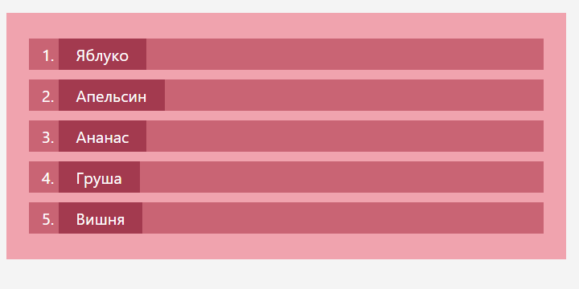
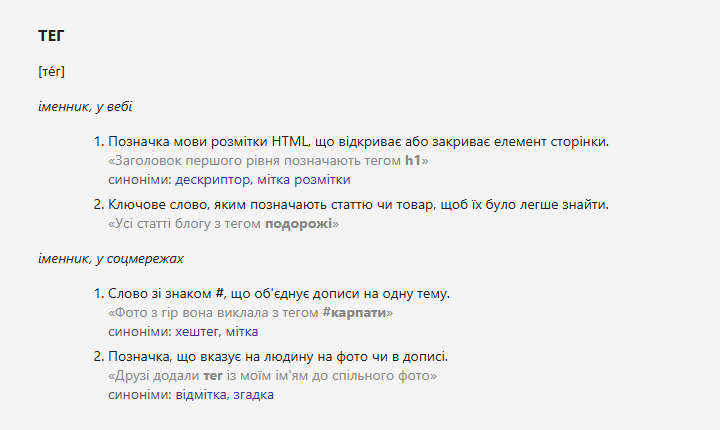

`Домашня робота №3`

## Оформлення списків за допомогою CSS

Створити дві HTML-сторінки зі списками й оформити їх за допомогою CSS так, як показано на зображеннях.

### Завдання 1. Список фруктів

Створити сторінку з **нумерованим списком** із п'яти фруктів і оформити його:

- світлий фон у всього списку
- темніший фон у кожного пункту списку
- найтемніший фон — лише під текстом пункту
- відступи між пунктами й від країв списку



### Завдання 2. Словникова стаття

Створити сторінку зі словниковою статтею про слово **«тег»**. Використати **список визначень**
(`dl`, `dt`, `dd`) для слова, вимови й груп значень і **нумеровані списки** (`ol`, `li`) для значень
у кожній групі. Приклади вживання — сірим кольором, синоніми — синім.



<details>
<summary><b>📄 Текст для завдання 2</b></summary>

```text
ТЕГ
[те́г]

іменник, у вебі
1. Позначка мови розмітки HTML, що відкриває або закриває елемент сторінки.
   «Заголовок першого рівня позначають тегом h1»
   синоніми: дескриптор, мітка розмітки
2. Ключове слово, яким позначають статтю чи товар, щоб їх було легше знайти.
   «Усі статті блогу з тегом подорожі»

іменник, у соцмережах
1. Слово зі знаком #, що об'єднує дописи на одну тему.
   «Фото з гір вона виклала з тегом #карпати»
   синоніми: хештег, мітка
2. Позначка, що вказує на людину на фото чи в дописі.
   «Друзі додали тег із моїм ім'ям до спільного фото»
   синоніми: відмітка, згадка
```

</details>

**Підказки:**

- щоб номер у завданні 1 опинився всередині кольорової смуги пункту, а не ліворуч від неї, — `list-style-position: inside`
- текст, що має окремий фон чи колір усередині пункту, можна обгорнути тегом `<span>` з класом
- відступи всередині елемента — `padding`, між елементами — `margin`

---

### 📖 Пов'язані уроки

- [7. Списки](/Lessons/7_Lists.md) — `ol`, `dl` / `dt` / `dd`, вкладення списків
- [5. Основи CSS: підключення стилів, селектори тегів, класи](/Lessons/5_CSS_Basics.md) — фон, колір, шрифт, класи
- [4. Форматування тексту; блокові та рядкові елементи](/Lessons/4_Text_Formatting.md) — `b`, `em`, блокові й рядкові елементи

---

<p align="center">
    У MyStat потрібно завантажити код сторінок та скриншоти їх вигляду у браузері або посилання на проєкт у <a href="https://codepen.io/">CodePen</a>.
</p>

---
