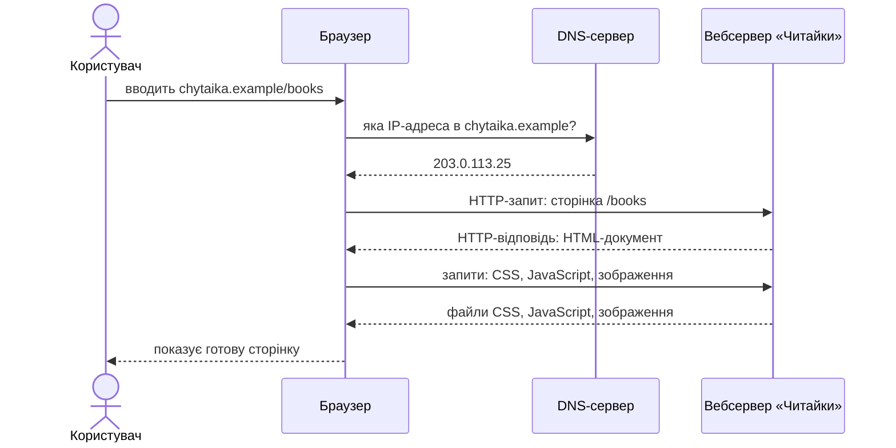
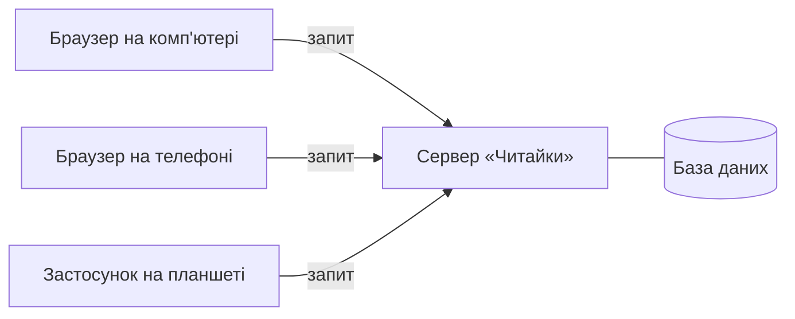
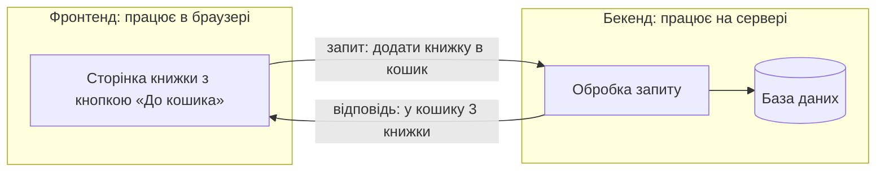
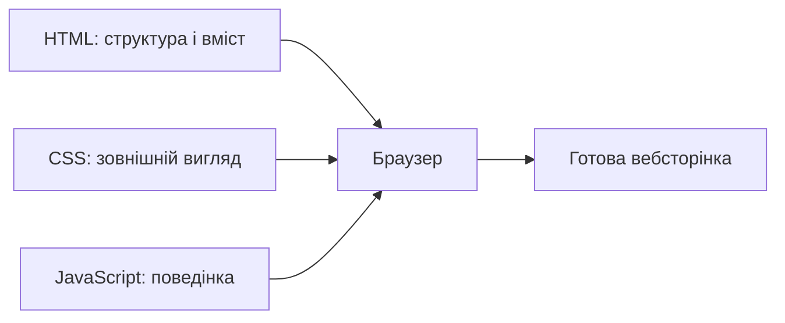

# 1. Вступ до веб-технологій

![block-badge]

## Зміст

1. [Що таке інтернет і веб](#що-таке-інтернет-і-веб)
2. [Як працює інтернет](#як-працює-інтернет)
3. [Що відбувається, коли ви відкриваєте сайт](#що-відбувається-коли-ви-відкриваєте-сайт)
4. [Клієнт-серверна архітектура](#клієнт-серверна-архітектура)
5. [Фронтенд і бекенд](#фронтенд-і-бекенд)
6. [Хто такий фулстек-розробник](#хто-такий-фулстек-розробник)
7. [HTML, CSS та JavaScript: три мови фронтенду](#html-css-та-javascript-три-мови-фронтенду)
8. [Що ви вже використовували, не знаючи цього](#що-ви-вже-використовували-не-знаючи-цього)
9. [Підсумок](#підсумок)
10. [Запитання для самоперевірки](#запитання-для-самоперевірки)
11. [Довідкові матеріали](#довідкові-матеріали)

---

## Що таке інтернет і веб

Щодня ви дивитеся відео, листуєтеся в месенджерах, шукаєте інформацію й купуєте речі онлайн. За всім цим
стоять дві різні речі, які в побуті часто називають одним словом «інтернет».

> **Інтернет** (Internet) — всесвітня мережа, що об'єднує мільйони комп'ютерних мереж і дає змогу
> пристроям у будь-якій точці світу обмінюватися даними. _Інтернет — це «дороги», якими їздять дані_.

> **Веб**, або **Всесвітнє павутиння** (World Wide Web, WWW), — система вебсторінок, пов'язаних між собою
> посиланнями, яку ми переглядаємо в браузері. _Веб — це один із сервісів, що працюють поверх інтернету_.

Веб придумав британський науковець Тім Бернерс-Лі (Tim Berners-Lee) у 1989 році, працюючи в CERN.
Головна ідея — **гіпертекст**: документи, у яких можна клацнути посилання й перейти до іншого документа,
навіть якщо він зберігається на комп'ютері на іншому кінці світу.

**Що працює через інтернет, але не є вебом:**

- електронна пошта в поштовій програмі на телефоні
- месенджери (Telegram, Viber) у мобільних застосунках
- онлайн-ігри
- відеодзвінки

> [!WARNING]
> **Часта плутанина:** «інтернет» і «веб» — не синоніми. Інтернет — це мережа, а веб — лише одна з
> послуг, яка нею користується. Коли ви відкриваєте сайт у браузері — ви користуєтеся вебом; коли
> граєте в онлайн-гру — інтернетом, але не вебом.

Наш курс — саме про **веб**: як створюються вебсторінки, які ви бачите в браузері.

> **Вебсторінка** (web page) — документ, який браузер завантажує з інтернету й показує на екрані.
>
> **Вебсайт** (website) — набір пов'язаних вебсторінок під однією адресою (наприклад, головна сторінка,
> каталог, контакти). _Сайт складається зі сторінок, як книжка — з аркушів_.

> **Браузер** (web browser) — програма для перегляду вебсторінок: Google Chrome, Mozilla Firefox,
> Microsoft Edge, Safari, Opera.

---

## Як працює інтернет

Щоб дані могли знайти шлях від одного пристрою до іншого, кожен пристрій у мережі має власну адресу —
так само, як кожен будинок має поштову адресу.

> **IP-адреса** (IP address) — числовий номер пристрою в мережі, наприклад `203.0.113.25`.
> _За IP-адресою дані знаходять потрібний комп'ютер_.

Але запам'ятовувати числа незручно: ніхто не вводить у браузер `203.0.113.25`, щоб подивитися відео.
Тому сайти мають зрозумілі людині імена — **доменні імена** (`youtube.com`, `wikipedia.org`).

> **DNS** (Domain Name System, система доменних імен) — «телефонна книга» інтернету, яка перетворює
> доменне ім'я на IP-адресу. _Ви знаєте ім'я — DNS підказує номер_.

Перш ніж звернутися до сайту, браузер запитує DNS-сервер, яка IP-адреса стоїть за ім'ям сайту.

Дані в інтернеті передаються не одним шматком, а **пакетами** — невеликими частинами. Кожен пакет
мандрує мережею окремо: через ваш Wi-Fi-роутер, мережу інтернет-провайдера, магістральні кабелі (зокрема
підводні — між континентами) — і на місці збирається назад у цілий файл.

**Хто бере участь у передачі даних:**

| Учасник | Роль | Аналогія з поштою |
| :---- | :---- | :---- |
| **Ваш пристрій** | надсилає й отримує дані | відправник і отримувач листа |
| **Роутер** | з'єднує домашню мережу з мережею провайдера | поштова скринька біля дому |
| **Інтернет-провайдер** | компанія, що підключає вас до інтернету | місцеве поштове відділення |
| **Магістральні мережі** | передають дані між містами, країнами й континентами | літаки й потяги, що перевозять пошту |
| **DNS-сервер** | перетворює доменне ім'я на IP-адресу | довідник адрес |

Щоб усі пристрої світу розуміли один одного, вони дотримуються однакових правил — **протоколів**.

> **Протокол** (protocol) — набір правил, за якими пристрої обмінюються даними. _Протокол — це спільна
> «мова спілкування» комп'ютерів_.

Для вебу головний протокол — **HTTP** (HyperText Transfer Protocol, протокол передачі гіпертексту).
Його захищена версія — **HTTPS**: дані шифруються, тому сторонні не можуть їх прочитати чи підмінити.
Про захищене з'єднання браузер повідомляє значком біля адреси сайту
(замок або значок налаштувань).

> [!TIP]
> **Порада:** на сайтах, де ви вводите пароль або дані картки, завжди перевіряйте, що адреса
> починається з `https://`. Сучасні браузери попереджають, якщо з'єднання незахищене.
> Але пам'ятайте: HTTPS захищає лише з'єднання і не гарантує, що сам сайт чесний, — шахрайські сайти
> теж використовують HTTPS.

---

## Що відбувається, коли ви відкриваєте сайт

Розгляньмо, що відбувається за ці пів секунди між натисканням Enter і появою сторінки. Як наскрізний
приклад уроку візьмемо вигаданий інтернет-магазин книжок «Читайка» з адресою
`https://chytaika.example/books`.

> [!NOTE]
> **Зверніть увагу:** домен `.example` спеціально зарезервований для прикладів у документації — такого
> сайту насправді не існує, тож перевірити його в браузері не вийде.

Спершу розберімо саму адресу.

> **URL** (Uniform Resource Locator) — повна адреса ресурсу в інтернеті: сторінки, зображення, файлу.
> _За URL браузер знає, куди і як звернутися_.

| Частина URL | Значення | Що означає |
| :---- | :---- | :---- |
| **Протокол** | `https://` | за якими правилами спілкуватися (захищений HTTP) |
| **Доменне ім'я** | `chytaika.example` | на якому сервері шукати сайт |
| **Шлях** | `/books` | яку саме сторінку сайту відкрити (каталог книжок) |

Тепер — сам процес:

1. **Користувач** вводить адресу в браузер → натискає Enter.
2. **Браузер** питає **DNS-сервер**: «Яка IP-адреса в `chytaika.example`?» → DNS відповідає: `203.0.113.25`.
3. **Браузер** надсилає за цією IP-адресою **HTTP-запит** → «Дай мені сторінку `/books`».
4. **Вебсервер** «Читайки» знаходить готову сторінку або формує її на льоту з даних (напр., з
   актуального списку книжок) → надсилає **HTTP-відповідь** з HTML-документом.
5. **Браузер** читає HTML і бачить, що сторінці потрібні ще файли стилів, скриптів і зображення →
   надсилає за ними окремі запити.
6. **Браузер** складає все отримане докупи → показує **користувачу** готову сторінку.

На діаграмі показано, як браузер крок за кроком отримує сторінку: спершу IP-адресу від DNS, потім
документ і додаткові файли від вебсервера.

Кожна HTTP-відповідь містить **код стану** — число, що повідомляє, чи вдалося виконати запит.

| Код | Назва | Що означає |
| :---- | :---- | :---- |
| **200** | OK | усе гаразд, ось сторінка |
| **404** | Not Found | такої сторінки на сервері немає |
| **500** | Internal Server Error | на сервері сталася помилка |

> [!NOTE]
> **Зверніть увагу:** сторінку «404» ви точно бачили, коли переходили за застарілим посиланням. Тепер
> ви знаєте, що це сервер чесно відповів: «Такої сторінки в мене немає».

---

## Клієнт-серверна архітектура

Ви, мабуть, помітили, що в прикладі вище завжди є дві сторони: одна **просить**, інша — **відповідає**.
На цьому принципі побудований увесь веб.

> **Клієнт-серверна архітектура** (client-server architecture) — спосіб організації програм, за якого
> **клієнт** надсилає запити, а **сервер** їх обробляє й повертає відповіді. _Клієнт питає — сервер
> відповідає_.

> **Клієнт** (client) — програма або пристрій, що надсилає запит: зазвичай це браузер на вашому
> комп'ютері чи телефоні.
>
> **Сервер** (server) — комп'ютер (і програма на ньому), що постійно працює, чекає на запити й
> надсилає відповіді. Сервер зберігає файли сайту та дані: товари, користувачів, замовлення.
> _Клієнт — той, хто замовляє; сервер — той, хто обслуговує_.

Зручна аналогія — **ресторан**:

| Ресторан | Веб | Роль |
| :---- | :---- | :---- |
| **Відвідувач** | клієнт (браузер) | робить замовлення й отримує страву |
| **Замовлення** | HTTP-запит | що саме потрібно |
| **Кухня** | сервер | готує те, що замовили |
| **Комора з продуктами** | база даних | де зберігається все потрібне для «страв» |
| **Готова страва** | HTTP-відповідь | результат, який повертається відвідувачу |

Один сервер обслуговує одночасно багато клієнтів — так само, як одна кухня годує весь зал.

На діаграмі показано, що різні клієнти звертаються до одного сервера, а сервер бере дані з бази даних.

> **База даних** (database) — організоване сховище даних на сервері. Для «Читайки» це список книжок із
> цінами, облікові записи покупців, замовлення. Як працюють бази даних — окрема велика тема, у цьому
> курсі ми їх не розглядатимемо.

**Ознаки клієнт-серверної взаємодії:**

- ініціатор — клієнт: у класичному вебі сервер нічого не надсилає, поки його не попросять
- клієнт і сервер — різні комп'ютери, з'єднані мережею
- сервер працює постійно, а клієнт підключається лише тоді, коли потрібно
- дані зберігаються на сервері, тому їх видно з будь-якого пристрою

> [!TIP]
> **Порада:** клієнт-серверну взаємодію можна побачити наживо. Відкрийте будь-який сайт, натисніть
> **F12** (Інструменти розробника, DevTools) і перейдіть на вкладку **Network** (Мережа). Оновіть
> сторінку (**F5**) — кожен рядок у списку є окремим запитом браузера до сервера, з кодом стану й
> розміром відповіді.

> [!CAUTION]
> 📸 **TODO-IMG** `images/l1_i1.png`
> **Що зобразити:** скриншот вкладки Network в Інструментах розробника браузера після оновлення сторінки будь-якого сайту — видно список запитів (HTML, CSS, JS, зображення) і колонку зі статусом 200.

---

## Фронтенд і бекенд

Будь-який сайт складається з двох частин: тієї, яку бачить користувач, і тієї, що працює «за лаштунками».

> **Фронтенд** (front-end, «передня частина») — частина сайту, яка працює в браузері користувача: те, що
> ми бачимо на екрані, і те, як сторінка реагує на наші дії. _Фронтенд — це «вітрина» сайту_.

> **Бекенд** (back-end, «задня частина») — частина сайту, яка працює на сервері: зберігання даних,
> обробка запитів, перевірка паролів, оформлення замовлень. _Бекенд — це «склад і бухгалтерія» за
> вітриною_.

Без цього поділу важко зрозуміти, хто що робить у команді: вигляд і поведінка кнопки «До кошика» й підрахунок
суми замовлення — це зовсім різні завдання, і вирішують їх різні люди різними інструментами.

Розгляньмо, як фронтенд і бекенд «Читайки» працюють разом, коли покупець додає книжку в кошик:

1. **Фронтенд** показує картку книжки з кнопкою «До кошика» → покупець натискає кнопку.
2. **Фронтенд** надсилає **бекенду** запит: «Додай книжку №125 у кошик цього покупця».
3. **Бекенд** перевіряє в **базі даних**, чи є книжка в наявності → записує її в кошик → відповідає:
   «Готово, у кошику 3 книжки».
4. **Фронтенд** отримує відповідь → змінює число біля значка кошика з 2 на 3.

На діаграмі показано, що фронтенд і бекенд працюють на різних комп'ютерах і обмінюються запитами та
відповідями.

| Критерій | Фронтенд | Бекенд |
| :---- | :---- | :---- |
| **Де працює** | у браузері користувача | на сервері |
| **Чи бачить користувач** | так — це все, що на екрані | ні — працює «за лаштунками» |
| **За що відповідає** | вигляд сторінки, зручність, реакція на дії | дані, логіка, безпека, обчислення |
| **Приклад у «Читайці»** | картки книжок, кнопки, меню, кошик на екрані | ціни й наявність, облікові записи, оплата |
| **Основні мови** | HTML, CSS, JavaScript | PHP, Python, Java, C#, JavaScript (Node.js — JavaScript на сервері) та інші |

**Головна різниця** — місце роботи: фронтенд виконується на комп'ютері користувача й відповідає за
те, що людина бачить і з чим взаємодіє, а бекенд виконується на сервері й відповідає за дані та
правила, за якими працює сайт.

> [!WARNING]
> **Часта помилка:** вважати, що ціну чи пароль достатньо перевірити у фронтенді. Код фронтенду
> завантажується на комп'ютер користувача, і досвідчений користувач може його змінити. Тому все, що
> стосується безпеки й грошей, обов'язково перевіряє бекенд.

---

## Хто такий фулстек-розробник

Відповідно до двох частин сайту існують і різні спеціальності розробників.

> **Фронтенд-розробник** (front-end developer) — фахівець, який створює частину сайту, що працює в
> браузері: верстає сторінки за макетом дизайнера (тобто перетворює малюнок
> на справжню вебсторінку) й «оживляє» їх.

> **Бекенд-розробник** (back-end developer) — фахівець, який створює серверну частину: логіку сайту,
> роботу з базами даних, обробку запитів.

> **Фулстек-розробник** (full-stack developer) — фахівець, який працює і з фронтендом, і з бекендом,
> тобто може самостійно створити сайт «від кнопки до бази даних». _Stack (стек) — це набір технологій,
> full stack — увесь набір_.

Над сайтом часто працює і **вебдизайнер** (UI/UX designer): він не пише код, а продумує, як сайт
виглядатиме і наскільки зручно ним користуватися, і малює макети — зазвичай у програмі
[Figma](https://www.figma.com/). Фронтенд-розробник перетворює ці макети на справжні вебсторінки.

| Спеціальність | Що робить | Основні інструменти | Що НЕ робить |
| :---- | :---- | :---- | :---- |
| **Вебдизайнер** | малює макети сторінок, продумує зручність | Figma | не пише код сайту |
| **Фронтенд-розробник** | перетворює макет на робочі сторінки в браузері | HTML, CSS, JavaScript | не налаштовує сервер і бази даних |
| **Бекенд-розробник** | пише серверну логіку, працює з даними | PHP, Python, Java, C#, Node.js, бази даних | не займається зовнішнім виглядом сторінок |
| **Фулстек-розробник** | робить і фронтенд, і бекенд | усе з двох рядків вище | — |

> [!NOTE]
> **Зверніть увагу:** фулстек-розробник знає обидві частини, але зазвичай менш глибоко, ніж вузький
> спеціаліст. У невеликих проєктах і стартапах фулстек-розробники дуже цінні, а у великих компаніях частіше
> працюють окремі команди фронтенду й бекенду.

У цьому курсі ми вивчатимемо **фронтенд** — з нього найчастіше починають шлях у веброзробку, бо
результат своєї роботи видно одразу в браузері.

---

## HTML, CSS та JavaScript: три мови фронтенду

Будь-яка вебсторінка, яку ви бачите в браузері, побудована за допомогою трьох технологій. Кожна має
свою чітку роль, і вони не замінюють одна одну.

> **HTML** (HyperText Markup Language, мова гіпертекстової розмітки) — мова, якою описують **структуру
> та вміст** сторінки: де заголовок, де абзац тексту, де зображення, посилання, кнопка, таблиця.
> _HTML відповідає на питання «що є на сторінці?»_.

> **CSS** (Cascading Style Sheets, каскадні таблиці стилів) — мова, якою описують **зовнішній вигляд**
> сторінки: кольори, шрифти, розміри, відступи, розташування елементів, вигляд на телефоні й комп'ютері.
> _CSS відповідає на питання «як це виглядає?»_.

> **JavaScript** (скорочено JS) — мова програмування, якою описують **поведінку** сторінки: реакцію на
> натискання, перевірку заповнення форм, зміну вмісту без перезавантаження. _JavaScript відповідає на
> питання «що відбувається, коли користувач щось робить?»_.

Найпоширеніша аналогія — **будинок**:

| Технологія | Роль | Аналогія з будинком | Що НЕ робить |
| :---- | :---- | :---- | :---- |
| **HTML** | структура і вміст | стіни, кімнати, двері, вікна | не задає кольорів і не має власної логіки |
| **CSS** | зовнішній вигляд | фарба, шпалери, меблі, освітлення | не додає нового вмісту й не має власної логіки |
| **JavaScript** | поведінка, інтерактивність | електрика, дверний дзвінок, ліфт | не замінює HTML і CSS, а працює разом з ними |

Повернімося до «Читайки» й подивімося, за що відповідає кожна мова в картці однієї книжки:

| Частина картки | HTML | CSS | JavaScript |
| :---- | :---- | :---- | :---- |
| **Назва книжки** | сам текст назви, позначений як заголовок | жирний шрифт, темно-синій колір | — |
| **Обкладинка** | зображення з описом | однаковий розмір у всіх картках, заокруглені кути | збільшення після натискання |
| **Ціна** | текст «320 грн» | великий помаранчевий шрифт | — |
| **Кнопка «До кошика»** | сама кнопка з написом | зелений фон, змінює колір, коли на неї наводять курсор миші | надсилає запит бекенду й оновлює лічильник кошика |
| **Розташування карток** | список карток | по чотири в ряд на комп'ютері, по одній на телефоні | — |

Браузер отримує всі три види файлів і складає з них одну сторінку:

На діаграмі показано, що HTML, CSS і JavaScript — окремі складові, з яких браузер збирає сторінку.

Сторінка може існувати без CSS і JavaScript — тоді це буде простий текст зі стандартним оформленням
браузера (сині підкреслені посилання, великі заголовки), як сайти 1990-х. А от без HTML сторінки немає взагалі: саме HTML — її основа.

> [!WARNING]
> **Часта плутанина:** HTML і CSS — це **не мови програмування**. HTML — мова розмітки (описує, що є на
> сторінці), CSS — мова стилів (описує, як воно виглядає). Повноцінну логіку — обчислення, умови, обробку дій
> користувача — на сторінці описує JavaScript.

> [!WARNING]
> **Часта плутанина:** JavaScript і Java — **різні мови**, схожі лише назвою. Назву JavaScript
> отримав у 1995 році з маркетингових міркувань, коли мова Java була дуже популярною.

Ви можете самі подивитися, як сторінка виглядає без стилів. У браузері **Firefox** відкрийте будь-який
сайт і в меню виберіть **Вигляд → Стиль сторінки → Без стилю** (View → Page Style → No Style;
якщо меню не видно — натисніть **Alt**). Залишиться лише HTML.

> [!CAUTION]
> 📸 **TODO-IMG** `images/l1_i2.png`
> **Що зобразити:** одна й та сама сторінка сайту у Firefox поруч — звичайна і з вимкненими стилями (Вигляд → Стиль сторінки → Без стилю).

Подивитися HTML-код будь-якої сторінки можна комбінацією **Ctrl+U** (перегляд коду сторінки). Поки
що цей код здаватиметься незрозумілим — як він влаштований і як писати власні сторінки, ми розберемо
в наступних уроках.

> [!IMPORTANT]
> **Ключова ідея:** HTML — це **зміст і структура**, CSS — **зовнішній вигляд**, JavaScript —
> **поведінка**. Фронтенд-розробник поєднує всі три мови, щоб створити сторінку, яка має гарний вигляд
> і зручно працює.

---

## Що ви вже використовували, не знаючи цього

Кожен сайт, яким ви користуєтеся щодня, має фронтенд і бекенд.

| Сервіс | Що робить фронтенд | Що робить бекенд |
| :---- | :---- | :---- |
| [YouTube](https://www.youtube.com/) | відеоплеєр, кнопки «Подобається», стрічка рекомендацій на екрані | зберігає мільйони відео, підбирає рекомендації, рахує перегляди |
| [Вікіпедія](https://uk.wikipedia.org/) | сторінки статей, пошуковий рядок, меню | зберігає статті та історію всіх їхніх змін, шукає за запитом |
| [Google Документи](https://docs.google.com/) | редактор тексту в браузері, панель форматування | зберігає документи, показує зміни співавторів у реальному часі |
| Інтернет-магазин | каталог, фільтри, кошик, форма замовлення | ціни й наявність товарів, оплата, доставка |
| Електронний щоденник | розклад і оцінки на екрані | зберігає оцінки, перевіряє, хто ввійшов: учень, батьки чи вчитель |

> [!IMPORTANT]
> **Ключова ідея:** коли ви натискаєте «Подобається» під відео, фронтенд одразу зафарбовує кнопку, а
> бекенд записує вашу оцінку в базу даних — тому вона збережеться, навіть якщо ви відкриєте YouTube на
> іншому пристрої (за умови, що ви увійшли у свій обліковий запис).

---

## Підсумок

- інтернет — це всесвітня мережа для передачі даних, а веб — система вебсторінок, що працює поверх неї
- коли ви відкриваєте сайт, браузер через DNS дізнається IP-адресу сервера й обмінюється з ним
  HTTP-запитами та відповідями
- веб побудований за клієнт-серверною архітектурою: клієнт (браузер) просить — сервер відповідає
- фронтенд працює в браузері й відповідає за те, що бачить користувач; бекенд працює на сервері й
  відповідає за дані та логіку; фулстек-розробник уміє і те, й інше
- фронтенд будується на трьох мовах: HTML — структура, CSS — вигляд, JavaScript — поведінка

---

## Запитання для самоперевірки

1. Чим інтернет відрізняється від вебу? Наведіть приклад сервісу, який працює через інтернет, але не є
   частиною вебу.
2. Навіщо потрібна система DNS, якщо в кожного сервера вже є IP-адреса?
3. Чим протокол HTTPS відрізняється від HTTP і де це особливо важливо?
4. Опишіть по кроках, що відбувається від моменту введення адреси сайту до появи сторінки на екрані.
5. Що таке клієнт і сервер? Хто з них першим починає обмін даними?
6. Що означає код стану 404 і хто його надсилає?
7. Чим фронтенд відрізняється від бекенду? До якої частини належить перевірка пароля під час входу і
   чому?
8. Хто такий фулстек-розробник і чим він відрізняється від фронтенд-розробника?
9. Яку роль на сторінці виконують HTML, CSS і JavaScript? Чому HTML не вважають мовою програмування?

---

## Довідкові матеріали

- [Інтернет](https://uk.wikipedia.org/wiki/%D0%86%D0%BD%D1%82%D0%B5%D1%80%D0%BD%D0%B5%D1%82) — `uk.wikipedia.org`
- [Всесвітнє павутиння](https://uk.wikipedia.org/wiki/%D0%92%D1%81%D0%B5%D1%81%D0%B2%D1%96%D1%82%D0%BD%D1%94_%D0%BF%D0%B0%D0%B2%D1%83%D1%82%D0%B8%D0%BD%D0%BD%D1%8F) — `uk.wikipedia.org`
- [Система доменних імен](https://uk.wikipedia.org/wiki/DNS) — `uk.wikipedia.org`
- [HTTP](https://uk.wikipedia.org/wiki/HTTP) — `uk.wikipedia.org`
- [Клієнт-серверна архітектура](https://uk.wikipedia.org/wiki/%D0%9A%D0%BB%D1%96%D1%94%D0%BD%D1%82-%D1%81%D0%B5%D1%80%D0%B2%D0%B5%D1%80%D0%BD%D0%B0_%D0%B0%D1%80%D1%85%D1%96%D1%82%D0%B5%D0%BA%D1%82%D1%83%D1%80%D0%B0) — `uk.wikipedia.org`
- [Front end та back end](https://uk.wikipedia.org/wiki/%D0%A4%D1%80%D0%BE%D0%BD%D1%82%D0%B5%D0%BD%D0%B4) — `uk.wikipedia.org`
- [How does the Internet work?](https://developer.mozilla.org/en-US/docs/Learn_web_development/Howto/Web_mechanics/How_does_the_Internet_work) — `developer.mozilla.org`
- [How the web works](https://developer.mozilla.org/en-US/docs/Learn_web_development/Getting_started/Web_standards/How_the_web_works) — `developer.mozilla.org`
- [Client-server overview](https://developer.mozilla.org/en-US/docs/Learn_web_development/Extensions/Server-side/First_steps/Client-Server_overview) — `developer.mozilla.org`
- [What are browser developer tools?](https://developer.mozilla.org/en-US/docs/Learn_web_development/Howto/Tools_and_setup/What_are_browser_developer_tools) — `developer.mozilla.org`

---

[block-badge]:https://img.shields.io/badge/%D0%92%D1%81%D1%82%D1%83%D0%BF%20%D0%B4%D0%BE%20%D0%B2%D0%B5%D0%B1%D1%83-purple?style=flat
