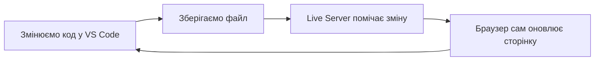

# 2. Середовище розробки: Visual Studio Code і CodePen

![block-badge] ![html-badge]

## Зміст

1. [Редактор коду і текстовий редактор](#редактор-коду-і-текстовий-редактор)
2. [Встановлення Visual Studio Code](#встановлення-visual-studio-code)
3. [Робоча папка проєкту і перший файл](#робоча-папка-проєкту-і-перший-файл)
4. [Корисні можливості VS Code](#корисні-можливості-vs-code)
5. [Відкриття сторінки в браузері](#відкриття-сторінки-в-браузері)
6. [Розширення Live Server](#розширення-live-server)
7. [CodePen: редактор у браузері](#codepen-редактор-у-браузері)
8. [VS Code чи CodePen](#vs-code-чи-codepen)
9. [Інструменти розробника](#інструменти-розробника)
10. [Підсумок](#підсумок)
11. [Запитання для самоперевірки](#запитання-для-самоперевірки)
12. [Довідкові матеріали](#довідкові-матеріали)

---

## Редактор коду і текстовий редактор

У минулому уроці ви дізналися, що вебсторінка — це HTML-документ, який браузер завантажує й показує на
екрані. Сам HTML-документ — це звичайний текстовий файл. Тож написати його можна навіть у Блокноті
(Notepad), який є в будь-якій версії Windows. Але робити це там так само незручно, як писати твір на калькуляторі.

> **Текстовий редактор** (text editor) — програма для створення й редагування текстових файлів:
> Блокнот у Windows, TextEdit у macOS. _Текстовий редактор просто зберігає набрані символи — і нічим не
> допомагає_.

> **Редактор коду** (code editor) — текстовий редактор, створений спеціально для програмістів: він
> розфарбовує код, підказує, знаходить помилки й економить сотні натискань клавіш. _Редактор коду — це
> Блокнот, який «розуміє» мову, якою ви пишете_.

Окремо варто згадати **текстовий процесор** — Microsoft Word чи Google Документи. Для коду він не
годиться взагалі: зберігає файл у власному форматі (`.docx`) з шрифтами й відступами, які браузер не
зрозуміє, а ще «розумно» замінює звичайні лапки `"` на типографські `«»` чи `“”` — і код ламається.

| Програма | Приклад | Що вміє | Чи годиться для вебу |
| :---- | :---- | :---- | :---- |
| **Текстовий процесор** | Microsoft Word | оформлення документів: шрифти, таблиці, картинки | ні — зберігає не простий текст і псує лапки |
| **Текстовий редактор** | Блокнот | простий текст без оформлення | так, але дуже незручно |
| **Редактор коду** | Visual Studio Code | підсвітка, підказки, автодоповнення, розширення | так — саме для цього створений |

У нашому курсі ми працюватимемо у двох інструментах:

- **Visual Studio Code** (скорочено **VS Code**) — безкоштовний редактор коду від Microsoft, який
  встановлюється на комп'ютер; ним користується більшість веброзробників світу
- **CodePen** — онлайн-редактор, що працює просто в браузері, без встановлення

---

## Встановлення Visual Studio Code

VS Code безкоштовний і працює на Windows, macOS та Linux. Завантажувати його варто **лише з офіційного
сайту** — копії з інших сайтів можуть містити віруси.

1. **Ви** відкриваєте [code.visualstudio.com](https://code.visualstudio.com/) → натискаєте кнопку
   завантаження для Windows.
2. **Браузер** завантажує файл інсталятора → ви його запускаєте й погоджуєтеся з ліцензією.
3. **Інсталятор** на кроці «Select Additional Tasks» пропонує додаткові параметри → увімкніть обидва
   пункти **Add "Open with Code" action to Windows Explorer ...** (для файлів і для папок).
4. **Інсталятор** завершує встановлення → VS Code запускається й показує вкладку привітання (Welcome).

> [!TIP]
> **Порада:** пункт «Open with Code» додає в контекстне меню Провідника (клацання правою кнопкою миші)
> команду, що відкриває папку чи файл у VS Code. Це найшвидший спосіб почати роботу з проєктом.

**Українська мова інтерфейсу (за бажанням).** Серед офіційних мовних пакетів Microsoft української
поки немає, але є пакети від спільноти: відкрийте розширення (**Ctrl+Shift+X**), введіть у пошук
`Ukrainian Language Pack` і встановіть один із них. Мову потім можна змінити командою
**Configure Display Language** (палітра команд — **Ctrl+Shift+P**). Переклад таких пакетів буває
неповним, тож у цьому уроці назви меню наведено англійською — так, як їх показує VS Code «з коробки»,
і так, як вони звучать у більшості підручників та відео.

---

## Робоча папка проєкту і перший файл

Сайт складається з багатьох файлів: сторінок, стилів, зображень. Щоб вони не губилися серед
завантажень і фотографій, кожен проєкт тримають в **окремій папці**.

> **Робоча папка проєкту** (project folder) — папка, у якій лежать усі файли одного сайту. _Один
> проєкт — одна папка_.

Створимо папку для сторінки книгарні «Читайка», з якою працюватимемо в наступних уроках:

1. **Ви** створюєте в Провіднику папку, наприклад `Документи\Web\chytaika`.
2. **Ви** клацаєте на ній правою кнопкою миші → **Open with Code** (або в самому VS Code: **File → Open
   Folder...**).
3. **VS Code** запитує, чи довіряєте ви авторам файлів у цій папці → для власної папки відповідайте
   **Yes, I trust the authors**.
4. **Ви** на панелі **Explorer** наводите курсор на назву папки → натискаєте значок **New File...** →
   вводите ім'я `index.html` і натискаєте Enter.

> [!NOTE]
> **Зверніть увагу:** у назвах файлів і папок вебпроєкту використовуйте лише **малі латинські літери,
> цифри, дефіс і підкреслення** — без пробілів і кирилиці: `index.html`, `about-us.html`. Більшість серверів в
> інтернеті розрізняють великі й малі літери, а пробіли й кирилиця в адресах перетворюються на коди на
> кшталт `%20`.

Чому саме `index.html`? Так за домовленістю називають **головну сторінку** сайту: коли браузер
звертається до папки сайту без імені файлу, сервер віддає саме `index.html`.

<!--
> [!CAUTION]
> 📸 **TODO-IMG** `images/l2_i1.png`
> **Що зобразити:** вікно VS Code з відкритою папкою `chytaika` і файлом `index.html` (з кодом сторінки з розділу «Корисні можливості VS Code»), з підписаними областями: панель дій (Activity Bar) зліва, бокова панель Explorer зі списком файлів, область редактора з вкладкою файлу, рядок стану (Status Bar) внизу.
-->

**З чого складається вікно VS Code:**

| Область | Де розташована | Для чого |
| :---- | :---- | :---- |
| **Панель дій** (Activity Bar) | вузька смуга значків ліворуч | перемикання між провідником, пошуком, розширеннями |
| **Бокова панель** (Side Bar) | поруч із панеллю дій | список файлів проєкту (Explorer), результати пошуку |
| **Редактор** (Editor) | центральна частина | тут ви пишете код; кожен відкритий файл — окрема вкладка |
| **Рядок стану** (Status Bar) | смуга внизу вікна | мова файлу, кодування, кнопки розширень (напр. Go Live) |

### Розширення файлів

> **Розширення файлу** (file extension) — частина імені після останньої крапки: `.html`, `.css`, `.js`,
> `.png`. _За розширенням комп'ютер (і VS Code) визначає, що це за файл і як його відкривати_.

| Розширення | Що в файлі |
| :---- | :---- |
| **`.html`** | вебсторінка (HTML-код) |
| **`.css`** | стилі сторінки (CSS-код) |
| **`.js`** | скрипт (JavaScript-код) |
| **`.png`**, **`.jpg`**, **`.svg`** | зображення |
| **`.txt`** | звичайний текст — браузер покаже його як текст, а не як сторінку |

За замовчуванням Провідник Windows **приховує** розширення відомих типів файлів. Увімкніть їх показ:
у Windows 10 — вкладка **Вигляд** (View) → прапорець **Розширення імен файлів** (File name extensions);
у Windows 11 — **Вигляд** (View) → **Показати** (Show) → **Розширення імен файлів** (File name extensions).

> [!WARNING]
> **Часта помилка:** створити файл у Блокноті, назвати його `index.html` — і отримати `index.html.txt`.
> Через приховані розширення ви бачите лише `index.html`, але насправді це текстовий файл, і браузер
> покаже код замість сторінки. Тому файли проєкту створюйте у VS Code й тримайте показ розширень
> увімкненим.

---

## Корисні можливості VS Code

Відкриймо щойно створений `index.html` і подивімося, чим редактор коду допомагає порівняно з
Блокнотом.

**Що VS Code робить за вас:**

- **підсвітка синтаксису** (syntax highlighting) — теги, атрибути й текст мають різні кольори, тож код
  легко читати, а пропущену лапку видно одразу
- **автодоповнення** (autocomplete, IntelliSense) — щойно ви почнете вводити `<h`, з'явиться список
  тегів, що починаються на «h»; вибір — стрілками й Enter
- **автозакриття тегів** — коли ви вводите `<h1>`, редактор сам дописує закривальний `</h1>`
- **Emmet** — розгортання коротких скорочень у готовий код (про нього — нижче)
- **автозбереження** — файл зберігається сам, без натискання Ctrl+S (вмикається окремо)

### Emmet: шаблон сторінки за одну секунду

Кожна HTML-сторінка починається з однакового «каркаса» з кількох службових рядків. Набирати їх щоразу
вручну довго, а помилитися — легко.

> **Emmet** — вбудований у VS Code інструмент, що перетворює коротке скорочення (abbreviation) на
> повний фрагмент коду. _Ви пишете кілька символів — Emmet дописує решту_.

У порожньому файлі `index.html` введіть знак оклику `!`. З'явиться підказка з позначкою
**Emmet Abbreviation** — натисніть **Tab** (або Enter).

<!--
> [!CAUTION]
> 📸 **TODO-IMG** `images/l2_i2.png`
> **Що зобразити:** редактор VS Code з порожнім файлом `index.html`, у якому введено `!`: видно випадний список підказок із пунктом `!` — **Emmet Abbreviation** і праворуч від нього попередній перегляд шаблону HTML-документа.
-->

Emmet вставить такий шаблон (саме в такому вигляді його створює VS Code):

```html
<!DOCTYPE html>
<html lang="en">
<head>
    <meta charset="UTF-8">
    <meta name="viewport" content="width=device-width, initial-scale=1.0">
    <title>Document</title>
</head>
<body>
    
</body>
</html>
```

Детально, з чого складається HTML-документ, ми розберемо в наступному уроці. Поки що достатньо знати,
що робить кожен рядок тут:

| Рядок | Що робить |
| :---- | :---- |
| **`<!DOCTYPE html>`** | повідомляє браузеру, що це сучасний HTML-документ |
| **`<html lang="en">`** | обгортає всю сторінку; `lang` вказує мову вмісту — `en` означає англійську |
| **`<head>` ... `</head>`** | службова частина: її вміст не показується на самій сторінці |
| **`<meta charset="UTF-8">`** | кодування — завдяки йому кирилиця відображається правильно, а не набором незрозумілих символів |
| **`<meta name="viewport" ...>`** | щоб сторінка коректно виглядала на телефоні |
| **`<title>Document</title>`** | назва сторінки, яку видно на вкладці браузера |
| **`<body>` ... `</body>`** | видима частина сторінки — тут пишемо все, що бачить користувач |

Шаблон потрібно трохи підлаштувати під наш сайт:

1. змініть `lang="en"` на `lang="uk"` — вміст сторінки українською
2. замініть `Document` у `title` на назву сторінки — `Читайка`
3. всередині `body` додайте заголовок і абзац з назвою книжки

Emmet допоможе й тут: введіть `h1` і натисніть Tab — отримаєте `<h1></h1>` з курсором посередині;
так само працює `p` + Tab.

#### `index.html` — перша сторінка «Читайки»

```html
<!DOCTYPE html>
<html lang="uk">
<head>
    <meta charset="UTF-8">
    <meta name="viewport" content="width=device-width, initial-scale=1.0">
    <title>Читайка</title>
</head>
<body>
    <h1>Тіні забутих предків</h1>
    <p>Повість Михайла Коцюбинського. Ціна: 280 грн.</p>
</body>
</html>
```

Тег `h1` позначає головний заголовок сторінки, а `p` — абзац тексту. Більше про них — у наступному
уроці.

> [!WARNING]
> **Часта помилка:** залишити `lang="en"` на українській сторінці. Сторінка відобразиться, але браузер
> і пошукові системи вважатимуть її англійською, а програма екранного читання для незрячих читатиме
> український текст з англійською вимовою.

### Збереження і автозбереження

Поки зміни не збережено, на вкладці файлу замість хрестика видно **білу крапку ●**. Браузер бачить лише
**збережений** файл, тому найчастіша причина «я змінив код, а сторінка не змінилася» — файл просто не
збережено.

Щоб не думати про це, увімкніть автозбереження: меню **File → Auto Save**. Тепер VS Code зберігатиме
файл сам приблизно через секунду після того, як ви перестали друкувати.

### Корисні гарячі клавіші

| Комбінація | Дія | Коли знадобиться |
| :---- | :---- | :---- |
| **Ctrl+S** | зберегти файл | після кожної зміни (якщо автозбереження вимкнене) |
| **Ctrl+Z** | скасувати останню дію | щось випадково видалили |
| **Ctrl+Y** | повернути скасовану дію | скасували забагато |
| **Ctrl+/** | закоментувати / розкоментувати рядок | тимчасово «вимкнути» шматок коду |
| **Shift+Alt+F** | відформатувати документ (вирівняти відступи) | код «поїхав» і його важко читати |
| **Alt+↑** / **Alt+↓** | перемістити рядок вгору / вниз | поміняти місцями два рядки |
| **Ctrl+F** | пошук у файлі | знайти потрібне слово в довгому коді |
| **Ctrl+Shift+X** | відкрити панель розширень | встановити Live Server чи мовний пакет |

> [!TIP]
> **Порада:** не обов'язково запам'ятовувати все одразу. Почніть з **Ctrl+S**, **Ctrl+Z** і
> **Shift+Alt+F** — вони знадобляться вже на першому занятті, а решта «прилипне» з практикою.

---

## Відкриття сторінки в браузері

Найпростіший спосіб побачити сторінку — відкрити файл `index.html` у браузері так само, як ви
відкриваєте фото: двічі клацнути на ньому в Провіднику (або перетягнути файл у вікно браузера).

Результат у браузері:


Зверніть увагу на адресний рядок: замість `https://...` там буде щось на кшталт
`file:///C:/Users/.../chytaika/index.html`. Протокол `file://` означає, що браузер узяв файл просто з
вашого диска, без жодного сервера й без інтернету.

У такого способу є незручність: після кожної зміни в коді доводиться **зберігати файл і вручну
оновлювати сторінку** (**F5**). Коли ви постійно перемикаєтеся між редактором і браузером, це швидко
набридає — і саме цю проблему розв'язує Live Server.

---

## Розширення Live Server

Можливості VS Code можна доповнювати, встановлюючи **розширення** — невеликі програми-додатки, як
застосунки на телефоні.

> **Live Server** — розширення для VS Code (автор — Ritwick Dey), яке запускає на вашому комп'ютері
> невеликий локальний вебсервер і **автоматично оновлює сторінку в браузері** щоразу, коли ви зберігаєте
> файл. _Зберегли код — і за мить бачите результат, нічого не натискаючи в браузері_.

**Встановлення:**

1. **Ви** відкриваєте панель розширень (**Ctrl+Shift+X**) → вводите в пошук `Live Server`.
2. **VS Code** показує список → виберіть розширення **Live Server** автора **Ritwick Dey**
   (ідентифікатор `ritwickdey.LiveServer`) → натисніть **Install**.
3. **VS Code** встановлює розширення → у рядку стану праворуч з'являється кнопка **Go Live**.

**Запуск:**

1. **Ви** відкриваєте папку проєкту у VS Code → натискаєте **Go Live** у рядку стану (або клацаєте
   правою кнопкою на `index.html` → **Open with Live Server**).
2. **Live Server** запускає локальний сервер → браузер відкриває адресу
   `http://127.0.0.1:5500/index.html`, а на кнопці в рядку стану з'являється **Port : 5500**.
3. **Ви** змінюєте код і зберігаєте файл → **Live Server** помічає зміну й сам оновлює сторінку в браузері.

Щоб зупинити сервер, ще раз натисніть кнопку з номером порту в рядку стану.



На діаграмі показано цикл роботи з Live Server: після кожного збереження сторінка в браузері
оновлюється автоматично.

<!--
> [!CAUTION]
> 📸 **TODO-IMG** `images/l2_i4.png`
> **Що зобразити:** екран, поділений навпіл: ліворуч VS Code з файлом `index.html` «Читайки» і кнопкою **Port : 5500** у рядку стану (обвести), праворуч — браузер з цією сторінкою і адресою `http://127.0.0.1:5500/index.html` в адресному рядку.
-->

> [!NOTE]
> **Зверніть увагу:** адреса `127.0.0.1` завжди означає «цей самий комп'ютер», а `5500` — номер порту,
> на якому працює Live Server. Пригадайте клієнт-серверну архітектуру з минулого уроку: тепер ваш
> комп'ютер одночасно і сервер (Live Server), і клієнт (браузер). Адреса `127.0.0.1` працює лише на
> вашому комп'ютері — в інтернет сторінка не потрапляє.

Live Server оновлює сторінку після **збереження**, тому в парі з автозбереженням результат з'являється
майже одразу, щойно ви перестали друкувати.

---

## CodePen: редактор у браузері

Іноді встановити VS Code немає змоги: чужий комп'ютер, планшет, потрібно швидко показати комусь
приклад. Для таких випадків є онлайн-редактори.

> **CodePen** — онлайн-редактор для HTML, CSS і JavaScript, який працює просто в браузері: код пишеться
> в панелях, а результат одразу видно поруч. _CodePen — це «пісочниця» для фронтенду, якою можна
> поділитися посиланням_.

> **Pen** («ручка») — окремий проєкт у CodePen: невеликий фрагмент HTML, CSS і JavaScript з власною
> адресою. _Один приклад — один Pen_.

### Класичний редактор: три панелі і результат

Відкрийте [codepen.io/pen](https://codepen.io/pen/) — це класичний редактор CodePen (Classic Editor).
Він складається з таких частин:

| Частина | Що в ній |
| :---- | :---- |
| **Панель HTML** | HTML-код сторінки |
| **Панель CSS** | стилі (знадобляться з уроку про CSS) |
| **Панель JS** | JavaScript (у цьому курсі — пізніше) |
| **Результат** (Result) | готова сторінка, що оновлюється автоматично під час введення коду |
| **Кнопка Save** | збереження Pen (працює лише після входу в обліковий запис) |
| **Кнопка Change View** | розташування панелей: зверху, ліворуч, праворуч від результату |

Перенесімо в CodePen ту саму сторінку «Читайки». Різниця одна, але важлива: у панель HTML пишемо
**лише вміст `body`** — службову частину документа (`<!DOCTYPE html>`, `head`, `meta charset`)
CodePen додає сам.

#### Панель HTML у CodePen

```html
<h1>Тіні забутих предків</h1>
<p>Повість Михайла Коцюбинського. Ціна: 280 грн.</p>
```

Результат на панелі Result буде таким самим, як і у VS Code.

<!--
> [!CAUTION]
> 📸 **TODO-IMG** `images/l2_i5.png`
> **Що зобразити:** класичний редактор CodePen з прикладом «Читайки»: панелі HTML (з кодом вище), CSS і JS зверху, під ними — панель результату із заголовком і абзацом; обвести кнопку **Save** і назву Pen (поле з олівцем угорі ліворуч).
-->

### Збереження Pen і посилання для здачі роботи

Без облікового запису в CodePen можна писати код і дивитися результат, але **зберегти Pen не вийде**:
кнопка **Save** запропонує увійти або зареєструватися. Реєстрація безкоштовна.

1. **Ви** реєструєтеся на [codepen.io](https://codepen.io/) (кнопка **Sign Up**) → входите в обліковий запис.
2. **Ви** створюєте Pen, натискаєте на олівець біля назви **Untitled** → вводите назву, напр.
   `Читайка: перша сторінка`.
3. **Ви** натискаєте **Save** (або **Ctrl+S**) → **CodePen** зберігає Pen і змінює адресу в адресному
   рядку на постійну, на кшталт `https://codepen.io/ваш-нікнейм/pen/AbCdEf1`.
4. **Ви** копіюєте цю адресу з адресного рядка → надсилаєте її як посилання на роботу (наприклад, у
   MyStat).

> [!WARNING]
> **Часта помилка:** скопіювати посилання до збереження або забути зберегти останні зміни. За
> посиланням викладач побачить лише **збережену** версію Pen. Перед тим як надсилати посилання,
> відкрийте його у вікні в режимі інкогніто й переконайтеся, що там саме ваш код.

> [!NOTE]
> **Зверніть увагу:** у безкоштовному обліковому записі всі Pen **публічні** — їх може переглянути
> будь-хто, хто знає посилання. Не пишіть у них особисті дані: номер телефону, адресу, паролі.

У липні 2026 року CodePen запустив оновлений редактор **CodePen 2.0** — з провідником файлів і
бічною панеллю. Тому кнопка створення нового Pen на сайті може відкрити саме його. Основи там ті самі:
код, результат поруч, збереження й посилання. Якщо вам зручніший класичний вигляд з трьома панелями,
відкривайте редактор за адресою [codepen.io/pen](https://codepen.io/pen/).

---

## VS Code чи CodePen

Обидва інструменти знадобляться впродовж курсу, але кожен — для свого.

| Критерій | VS Code | CodePen |
| :---- | :---- | :---- |
| **Де працює** | програма на вашому комп'ютері | у браузері, без встановлення |
| **Чи потрібен інтернет** | ні (лише для встановлення розширень) | так |
| **Де зберігаються файли** | у папці на вашому диску | на сервері CodePen, у вашому обліковому записі |
| **Структура проєкту** | будь-яка кількість файлів і папок | у класичному редакторі — по одній панелі на HTML, CSS і JS |
| **Перегляд результату** | у браузері, з Live Server — з автооновленням | одразу в панелі Result |
| **Як поділитися** | надіслати файли або архів | надіслати посилання на Pen |
| **Коли обирати** | повноцінний сайт з кількох сторінок, зображень і стилів | швидкий експеримент, невеликий приклад, робота з чужого комп'ютера |

**Головна різниця** — місце, де живе проєкт: у VS Code це папка з файлами на вашому комп'ютері, якою
ви повністю керуєте, а в CodePen — онлайн-проєкт, який зручно показати будь-кому одним посиланням.

> [!IMPORTANT]
> **Ключова ідея:** редактор коду — лише інструмент, а HTML скрізь однаковий. Сторінку з VS Code можна
> перенести в CodePen і навпаки — треба лише пам'ятати, що в панель HTML у CodePen пишеться тільки вміст
> `body`.

---

## Інструменти розробника

Ви вже бачили інструменти розробника в минулому уроці, коли розглядали запити на вкладці Network. Тепер
познайомимося з вкладкою, яка знадобиться найчастіше, — з тією, що показує код сторінки.

> **Інструменти розробника** (Developer Tools, DevTools) — вбудований у браузер набір інструментів для
> перевірки сторінки: її HTML-коду, стилів, запитів, помилок. _DevTools дають змогу «зазирнути під
> капот» будь-якої сторінки_.

**Як відкрити DevTools:**

- клавіша **F12** (або **Ctrl+Shift+I**)
- клацнути правою кнопкою миші на будь-якому елементі сторінки → **Inspect** (в українському
  інтерфейсі браузера цей пункт перекладено) — DevTools відкриються одразу на цьому елементі

Відкрийте сторінку «Читайки» (через Live Server або подвійним клацанням) і натисніть F12. У Chrome і
Edge потрібна вкладка **Elements**, у Firefox — **Inspector**. На ній ви побачите код своєї сторінки,
згорнутий у «дерево»: трикутники ▸ розгортають вкладені частини.

<!--
> [!CAUTION]
> 📸 **TODO-IMG** `images/l2_i6.png`
> **Що зобразити:** браузер зі сторінкою «Читайки» і відкритими DevTools на вкладці Elements: курсор наведено на рядок `<h1>Тіні забутих предків</h1>` у дереві, а сам заголовок на сторінці підсвічено синім прямокутником.
-->

**Що можна зробити на вкладці Elements:**

- навести курсор на рядок коду — відповідний елемент підсвітиться на сторінці
- натиснути значок зі стрілкою в лівому верхньому куті DevTools (**Ctrl+Shift+C**) і клацнути на
  сторінці — DevTools покажуть код саме цього елемента
- двічі клацнути на тексті заголовка в дереві й змінити його — зміна одразу з'явиться на сторінці

> [!WARNING]
> **Часта плутанина:** зміни, зроблені в DevTools, **не зберігаються у ваш файл**. Вони живуть лише до
> оновлення сторінки (F5). DevTools — це «чернетка» для експериментів, а справжні зміни робляться у
> VS Code.

DevTools працюють на будь-якому сайті, не лише на вашому: так можна подивитися, як зверстані сторінки,
які вам подобаються. Детальніше вкладку зі стилями розглянемо, коли почнемо вивчати CSS.

---

## Підсумок

- для вебсторінок потрібен редактор коду, а не текстовий процесор: VS Code підсвічує код, підказує й
  розгортає скорочення Emmet (`!` + Tab — готовий шаблон сторінки, у якому треба змінити `lang` на `uk`)
- кожен проєкт — в окремій папці, головна сторінка — `index.html`; показ розширень файлів у Windows
  варто увімкнути
- браузер бачить лише збережений файл; Live Server сам оновлює сторінку після кожного збереження
- CodePen — онлайн-редактор з панелями HTML, CSS і JS; зберегти Pen і отримати посилання можна лише з
  обліковим записом
- інструменти розробника (F12) показують код будь-якої сторінки, але зміни в них тимчасові

---

## Запитання для самоперевірки

1. Чим редактор коду відрізняється від Блокнота? Чому для HTML не варто використовувати Microsoft Word?
2. Що таке розширення файлу? Чому файл `index.html.txt` браузер не покаже як вебсторінку?
3. Як за допомогою Emmet швидко створити шаблон HTML-документа? Що в ньому треба змінити для
   україномовної сторінки?
4. Ви змінили код, але сторінка в браузері залишилася старою. Які дві найімовірніші причини?
5. Що робить розширення Live Server? Що означає адреса `http://127.0.0.1:5500/index.html`?
6. Чим відрізняється код у панелі HTML у CodePen від повного файлу `index.html` у VS Code?
7. Що потрібно зробити, щоб отримати посилання на свою роботу в CodePen?
8. У яких ситуаціях зручніше працювати у VS Code, а в яких — у CodePen?
9. Як відкрити інструменти розробника і що показує вкладка Elements? Чи збережуться зміни, зроблені
   в ній?

---

## Довідкові матеріали

- [Visual Studio Code](https://uk.wikipedia.org/wiki/Visual_Studio_Code) — `uk.wikipedia.org`
- [Редактор початкового коду](https://uk.wikipedia.org/wiki/%D0%A0%D0%B5%D0%B4%D0%B0%D0%BA%D1%82%D0%BE%D1%80_%D0%BF%D0%BE%D1%87%D0%B0%D1%82%D0%BA%D0%BE%D0%B2%D0%BE%D0%B3%D0%BE_%D0%BA%D0%BE%D0%B4%D1%83) — `uk.wikipedia.org`
- [Розширення назви файлу](https://uk.wikipedia.org/wiki/%D0%A0%D0%BE%D0%B7%D1%88%D0%B8%D1%80%D0%B5%D0%BD%D0%BD%D1%8F_%D0%BD%D0%B0%D0%B7%D0%B2%D0%B8_%D1%84%D0%B0%D0%B9%D0%BB%D1%83) — `uk.wikipedia.org`
- [Еммет](https://uk.wikipedia.org/wiki/%D0%95%D0%BC%D0%BC%D0%B5%D1%82) — `uk.wikipedia.org`
- [Getting started with Visual Studio Code](https://code.visualstudio.com/docs/introvideos/basics) — `code.visualstudio.com`
- [User interface](https://code.visualstudio.com/docs/getstarted/userinterface) — `code.visualstudio.com`
- [Emmet in Visual Studio Code](https://code.visualstudio.com/docs/languages/emmet) — `code.visualstudio.com`
- [Keyboard shortcuts for Visual Studio Code](https://code.visualstudio.com/docs/getstarted/keybindings) — `code.visualstudio.com`
- [Display Language](https://code.visualstudio.com/docs/getstarted/locales) — `code.visualstudio.com`
- [Live Server](https://marketplace.visualstudio.com/items?itemName=ritwickdey.LiveServer) — `marketplace.visualstudio.com`
- [Documentation](https://blog.codepen.io/documentation/) — `blog.codepen.io`
- [Code editors](https://developer.mozilla.org/en-US/docs/Learn_web_development/Getting_started/Environment_setup/Code_editors) — `developer.mozilla.org`
- [What are browser developer tools?](https://developer.mozilla.org/en-US/docs/Learn_web_development/Howto/Tools_and_setup/What_are_browser_developer_tools) — `developer.mozilla.org`

---

[block-badge]:https://img.shields.io/badge/%D0%9E%D1%81%D0%BD%D0%BE%D0%B2%D0%B8%20HTML%20%D1%96%20CSS-purple?style=flat
[html-badge]:https://img.shields.io/badge/HTML-E34F26?style=flat&logo=html5&logoColor=white
