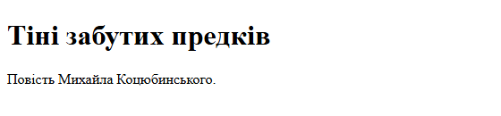
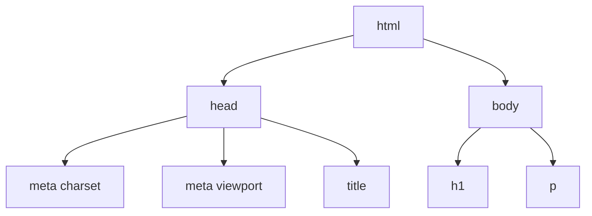
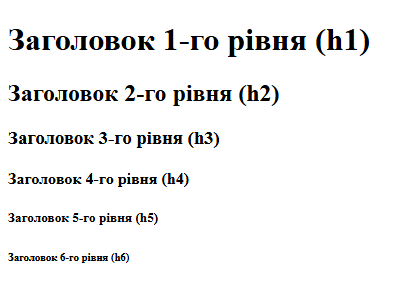
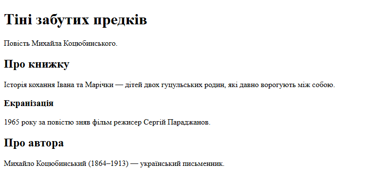
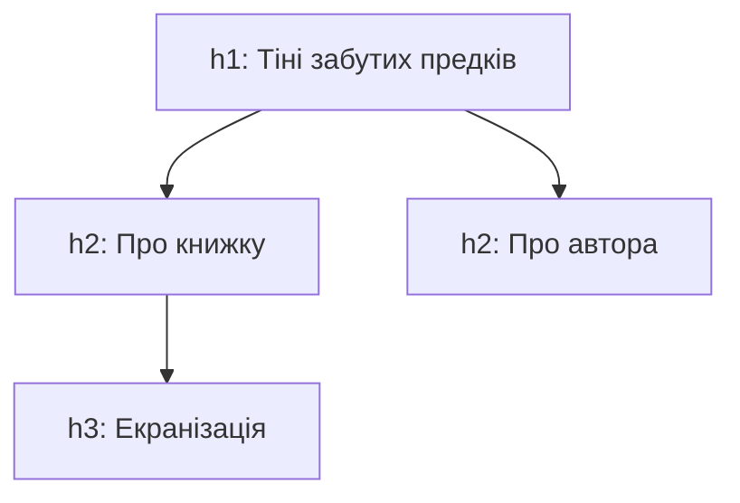
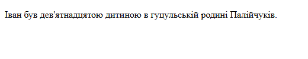
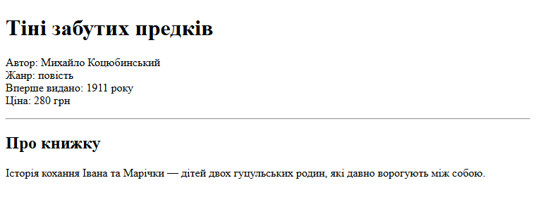
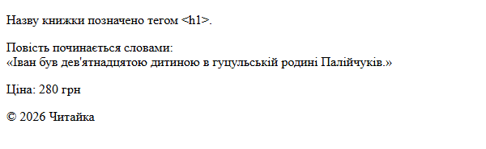
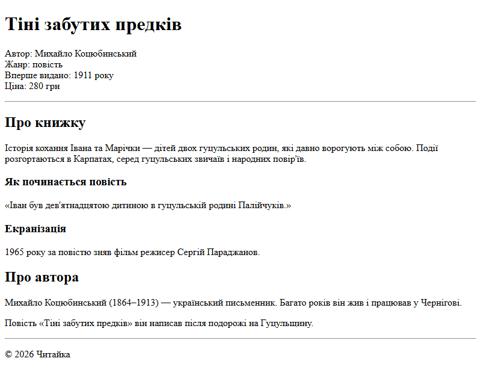

# 3. Основи HTML: структура документа, заголовки, абзаци

![block-badge] ![html-badge]

## Зміст

1. [Теги та елементи](#теги-та-елементи)
2. [Атрибути](#атрибути)
3. [Вкладеність елементів](#вкладеність-елементів)
4. [Структура HTML-документа](#структура-html-документа)
5. [Заголовки від h1 до h6](#заголовки-від-h1-до-h6)
6. [Абзаци](#абзаци)
7. [Як браузер обробляє пробіли й переноси рядків](#як-браузер-обробляє-пробіли-й-переноси-рядків)
8. [Перенесення рядка й горизонтальна лінія](#перенесення-рядка-й-горизонтальна-лінія)
9. [Коментарі](#коментарі)
10. [Спеціальні символи (HTML-сутності)](#спеціальні-символи-html-сутності)
11. [Сторінка книжки повністю](#сторінка-книжки-повністю)
12. [Де це застосовується на практиці](#де-це-застосовується-на-практиці)
13. [Підсумок](#підсумок)
14. [Запитання для самоперевірки](#запитання-для-самоперевірки)
15. [Довідкові матеріали](#довідкові-матеріали)

---

## Теги та елементи

У першому уроці ми з'ясували, що HTML описує **структуру й вміст** сторінки, а в попередньому — створили
файл `index.html` і відкрили його в браузері. Тепер навчимося писати сам HTML-код.

Браузер не розуміє звичайного тексту «тут заголовок, а тут абзац». Йому потрібні спеціальні позначки,
які показують, де починається і де закінчується кожна частина сторінки.

> **Тег** (tag) — позначка в кутових дужках, яка повідомляє браузеру, що це за частина сторінки:
> `<h1>`, `<p>`, `<body>`. _Тег — це «наклейка» з назвою, яку ми чіпляємо на шматок тексту_.

Більшість тегів ходять **парами**: відкривальний тег `<p>` ставиться на початку, закривальний `</p>` —
у кінці. Закривальний тег відрізняється скісною рискою `/` перед назвою.

> **Елемент** (element) — відкривальний тег, вміст і закривальний тег разом: `<p>Повість Михайла
> Коцюбинського.</p>`. _Тег — це лише позначка, а елемент — уся «коробка» разом із тим, що в ній_.

Розберімо будову елемента на прикладі абзацу з назвою книжки:

```html
<p title="Повість 1911 року">Тіні забутих предків</p>
```

| Частина | У прикладі | Що це |
| :---- | :---- | :---- |
| **Відкривальний тег** | `<p title="Повість 1911 року">` | початок елемента; тут же записуються атрибути |
| **Ім'я тегу** | `p` | який це елемент (`p` — paragraph, абзац) |
| **Атрибут** | `title="Повість 1911 року"` | додаткове налаштування елемента (див. наступний розділ) |
| **Вміст** | `Тіні забутих предків` | те, що побачить користувач |
| **Закривальний тег** | `</p>` | кінець елемента: та сама назва, але зі скісною рискою |
| **Елемент** | увесь рядок від `<p` до `</p>` | відкривальний тег + вміст + закривальний тег |

Деякі елементи не мають вмісту — їм нема чого «обгортати». Такі елементи записуються одним тегом.

| Вид | Як записується | Приклади | Особливість |
| :---- | :---- | :---- | :---- |
| **Парний тег** (paired tag) | `<p>вміст</p>` | `html`, `head`, `body`, `title`, `h1`, `p` | закривальний тег обов'язковий — у курсі завжди його пишемо |
| **Одиночний тег** (void element) | `<br>` | `br`, `hr`, `meta` | не має ні вмісту, ні закривального тегу |

> [!NOTE]
> **Зверніть увагу:** у чужому коді ви можете зустріти одиночні теги зі скісною рискою в кінці: `<br />`.
> Це старіший запис, браузер розуміє обидва варіанти. У нашому курсі пишемо коротко: `<br>`.

Імена тегів записуємо **малими літерами**: `<p>`, а не `<P>`. Браузер зрозуміє обидва варіанти, але
малі літери — загальноприйнятий стиль.

---

## Атрибути

Іноді самого тегу недостатньо: потрібно уточнити, якою мовою написана сторінка, куди веде посилання
або яке зображення показати. Для цього в тегах є атрибути.

> **Атрибут** (attribute) — додаткове налаштування елемента, яке записується у відкривальному тезі у
> вигляді `ім'я="значення"`. _Тег каже, **що** це за елемент, а атрибут — **яким** він є_.

**Правила запису атрибутів:**

- атрибути пишуться лише у **відкривальному** тезі, після імені тегу, через пробіл
- значення береться в **подвійні лапки**: `lang="uk"`
- в одному тезі може бути кілька атрибутів, розділених пробілами

У цьому уроці нам знадобляться такі атрибути:

| Атрибут | Де пишеться | Що означає |
| :---- | :---- | :---- |
| **`lang`** | `<html lang="uk">` | мова вмісту сторінки (`uk` — українська) |
| **`charset`** | `<meta charset="UTF-8">` | кодування символів документа |
| **`name`, `content`** | `<meta name="viewport" content="...">` | назва і значення службової інформації |
| **`title`** | `<p title="Повість 1911 року">` | підказка, яка з'являється, коли навести курсор миші на елемент |

Інші атрибути (наприклад, адреса зображення чи посилання) розглянемо разом з тегами, яким вони потрібні.

---

## Вкладеність елементів

Усередині одного елемента можуть бути інші елементи — так само, як у великій коробці можуть лежати
менші коробки.

> **Вкладеність** (nesting) — розміщення одних елементів усередині інших. Зовнішній елемент називають
> **батьківським** (parent), а внутрішній — **дочірнім** (child). _Уся HTML-сторінка — це коробки в
> коробках_.

Головне правило: **елемент, відкритий останнім, закривається першим**. Теги не можуть «перехрещуватися».

```html
<!-- Правильно: title повністю всередині head -->
<head>
    <title>Тіні забутих предків</title>
</head>

<!-- Неправильно: head закрито раніше, ніж title -->
<head>
    <title>Тіні забутих предків</head>
</title>
```

Щоб вкладеність було видно з першого погляду, дочірні елементи записують з **відступом** — 4 пробіли
(або натискання Tab) відносно батьківського. Браузеру відступи байдужі, але людині без них легко
заплутатися в коді.

> [!TIP]
> **Порада:** VS Code сам закриває тег, щойно ви напишете відкривальний, і підсвічує пару до тегу, на
> якому стоїть курсор. Якщо пара підсвічується не там, де ви очікуєте, — шукайте пропущений
> закривальний тег.

---

## Структура HTML-документа

У попередньому уроці Emmet (`!` + Tab) вставив у файл готову заготовку сторінки. Тепер розберемо, що
означає кожен її рядок.

> **HTML-документ** (HTML document) — текстовий файл з розширенням `.html`, у якому за певними правилами
> записано вміст сторінки. _Кожен HTML-документ має однаковий «скелет», а відрізняються сторінки лише
> тим, що в нього вкладено_.

Почнімо наскрізний приклад цього та наступних уроків: сторінку однієї книжки в книгарні «Читайка».
Створімо в робочій папці файл `book.html` і запишемо в нього:

```html
<!DOCTYPE html>
<html lang="uk">
<head>
    <meta charset="UTF-8">
    <meta name="viewport" content="width=device-width, initial-scale=1.0">
    <title>Тіні забутих предків — Читайка</title>
</head>
<body>
    <h1>Тіні забутих предків</h1>
    <p>Повість Михайла Коцюбинського.</p>
</body>
</html>
```

Результат у браузері:



Розберемо код рядок за рядком:

| Рядок | Що означає |
| :---- | :---- |
| **`<!DOCTYPE html>`** | оголошення типу документа: «це сучасний HTML». Це не тег, а вказівка для браузера, тому завжди стоїть першим рядком |
| **`<html lang="uk">`** | кореневий елемент — у ньому вміщено все інше. Атрибут `lang` повідомляє мову сторінки |
| **`<head>`** | «голова» документа: службова інформація для браузера, пошукових систем, соцмереж. На сторінці її не видно |
| **`<meta charset="UTF-8">`** | кодування UTF-8 — щоб кирилиця та інші символи відображалися правильно |
| **`<meta name="viewport" ...>`** | налаштування для телефонів: сторінка має займати ширину екрана пристрою. Детальніше — згодом, коли вивчатимемо адаптивну верстку |
| **`<title>`** | назва сторінки — її видно на вкладці браузера, у закладках і в результатах пошуку |
| **`<body>`** | «тіло» документа: усе, що користувач бачить на сторінці |
| **`</body>`, `</html>`** | закривальні теги: спершу закриваємо `body`, потім — `html` |

Структуру документа зручно уявити як дерево:



На діаграмі показано, що `head` і `body` — дочірні елементи `html`, а службові теги лежать у `head`, видимий вміст — у `body`.

| Критерій | `head` | `body` |
| :---- | :---- | :---- |
| **Для кого** | для браузера, пошукових систем, соцмереж | для користувача |
| **Чи видно на сторінці** | ні (лише `title` — на вкладці) | так |
| **Що містить** | `meta`, `title`, підключення стилів | заголовки, абзаци, зображення, посилання |
| **Скільки разів у документі** | один | один |

**Головна різниця** — `head` описує сторінку (її мову, кодування, назву), а `body` містить саму
сторінку, яку бачить користувач.

`title` видно не всередині сторінки, а на вкладці браузера:

<!--
> [!CAUTION]
> 📸 **TODO-IMG** `images/l3_i2.png`
> **Що зобразити:** вікно браузера з відкритою сторінкою `book.html` — на вкладці видно назву «Тіні забутих предків — Читайка», нижче видно заголовок і абзац сторінки.
-->

> [!WARNING]
> **Часта помилка:** залишити `lang="en"`, який Emmet ставить за замовчуванням. Сторінка
> відкриється, але браузер вважатиме її англомовною: запропонує «перекласти» українську сторінку, а
> програми екранного читання вимовлятимуть текст з англійською вимовою. Для українських сторінок
> пишіть `lang="uk"`.

Без `<meta charset="UTF-8">` сучасний браузер часто вгадує кодування сам, але гарантії немає: в
інших браузерах чи на сервері замість кирилиці можуть з'явитися незрозумілі символи. Тому цей рядок
пишемо в кожному документі.

> [!IMPORTANT]
> **Ключова ідея:** кожен HTML-документ починається з `<!DOCTYPE html>`, має один кореневий елемент
> `html`, усередині якого — `head` (службова інформація) і `body` (видимий вміст).

---

## Заголовки від h1 до h6

Коли ви відкриваєте статтю чи підручник, то спершу проглядаєте заголовки, щоб зрозуміти, про що текст і
де шукати потрібне. Вебсторінка працює так само.

> **Заголовки** (headings) — елементи `h1`…`h6`, що позначають назви розділів сторінки. Цифра — це
> **рівень** заголовка: `h1` — найважливіший, `h6` — найменш важливий. _Заголовки — це зміст сторінки,
> як у книжці: розділи, підрозділи, пункти_.

Ось усі шість рівнів:

```html
<h1>Заголовок 1-го рівня (h1)</h1>
<h2>Заголовок 2-го рівня (h2)</h2>
<h3>Заголовок 3-го рівня (h3)</h3>
<h4>Заголовок 4-го рівня (h4)</h4>
<h5>Заголовок 5-го рівня (h5)</h5>
<h6>Заголовок 6-го рівня (h6)</h6>
```

Тут і далі показуємо лише вміст `body`, решта документа — така сама, як у попередньому розділі.

Результат у браузері:



Браузер за замовчуванням робить заголовки жирними й зменшує їхній розмір від `h1` до `h6`. Але розмір —
це лише оформлення, і його можна змінити засобами CSS. Головне в заголовку — **рівень**, тобто його
місце в ієрархії сторінки.

**Правила ієрархії заголовків:**

- на сторінці — **один** `h1`: головна тема сторінки (у нас — назва книжки)
- розділи сторінки — `h2`, їхні підрозділи — `h3` і так далі
- рівні не перестрибують: після `h2` іде `h3`, а не одразу `h4`
- заголовок позначає назву розділу, а не будь-який текст, який хочеться виділити

Додамо до сторінки книжки розділи:

```html
<h1>Тіні забутих предків</h1>
<p>Повість Михайла Коцюбинського.</p>

<h2>Про книжку</h2>
<p>Історія кохання Івана та Марічки — дітей двох гуцульських родин, які давно ворогують між собою.</p>

<h3>Екранізація</h3>
<p>1965 року за повістю зняв фільм режисер Сергій Параджанов.</p>

<h2>Про автора</h2>
<p>Михайло Коцюбинський (1864–1913) — український письменник.</p>
```

Результат у браузері:



Ієрархія заголовків цієї сторінки:



На діаграмі показано, що «Екранізація» — підрозділ розділу «Про книжку», а обидва розділи `h2`
належать до теми сторінки `h1`.

> [!WARNING]
> **Часта помилка:** обирати заголовок за розміром шрифту: «`h2` завеликий — візьму `h4`». Рівень
> заголовка означає місце в структурі, а не розмір. Якщо розмір не подобається, заголовок
> залишаємо правильного рівня, а розмір змінюємо стилями CSS — це ми скоро вивчимо.

```html
<!-- Неправильно: h4 обрано через «гарний» розмір, рівні h2 і h3 пропущено -->
<h1>Тіні забутих предків</h1>
<h4>Про книжку</h4>

<!-- Правильно: розділ сторінки — це h2 -->
<h1>Тіні забутих предків</h1>
<h2>Про книжку</h2>
```

**Навіщо дотримуватися ієрархії, якщо сторінка все одно «нормально виглядає»:**

- пошукові системи за заголовками визначають, про що сторінка і які в неї розділи
- незрячі користувачі за допомогою програм екранного читання (screen readers) перескакують між
  заголовками, як ми пробігаємо очима зміст
- коли ви згодом оформлюватимете сторінку стилями, правильна структура заощадить багато часу

---

## Абзаци

Основна частина тексту на будь-якій сторінці — це абзаци.

> **Абзац** (paragraph) — елемент `p`, що позначає окремий фрагмент тексту, об'єднаний однією думкою.
> _Один абзац — одна думка_.

Браузер показує кожен абзац з нового рядка й додає порожній простір над ним і під ним, щоб абзаци
не зливалися. Ви вже бачили це на скриншотах вище.

```html
<p>Михайло Коцюбинський (1864–1913) — український письменник.</p>
<p>Повість «Тіні забутих предків» він написав після подорожі на Гуцульщину.</p>
```

Довгий абзац можна для зручності розбити в коді на кілька рядків — на сторінці він однаково буде
одним суцільним абзацом. Чому так — у наступному розділі.

> [!WARNING]
> **Часта помилка:** писати текст прямо в `body` без тегу `p`, а «абзаци» робити порожніми рядками в
> коді. Браузер покаже такий текст одним суцільним шматком, бо порожні рядки в HTML нічого не
> означають.

---

## Як браузер обробляє пробіли й переноси рядків

Що буде, якщо в коді поставити кілька пробілів поспіль або натиснути Enter посеред речення? Перевірмо
на першому реченні повісті:

```html
<p>Іван      був       дев'ятнадцятою
    дитиною


        в гуцульській      родині Палійчуків.</p>
```

Результат у браузері:



Браузер показав речення одним рядком зі звичайними пробілами.

> **Схлопування пробілів** (whitespace collapsing) — правило, за яким браузер замінює будь-яку
> послідовність пробілів, табуляцій і переносів рядків у тексті на **один** пробіл. _Хоч скільки пробілів
> і порожніх рядків ви поставите в коді, на сторінці буде один пробіл_.

Саме завдяки цьому правилу ми можемо робити відступи й розбивати довгі рядки в коді, як нам зручно, — на
сторінці це не позначиться. Але є і зворотний бік: Enter у коді **не переносить** текст на новий рядок
на сторінці. Для цього є окремі теги.

> [!NOTE]
> **Зверніть увагу:** браузер сам переносить текст на новий рядок, коли той не вміщається в ширину
> вікна. Змініть ширину вікна — і рядки абзацу перебудуються.

---

## Перенесення рядка й горизонтальна лінія

Іноді потрібно почати новий рядок, не починаючи нового абзацу: в адресі, у вірші, у переліку
характеристик товару.

> **Перенесення рядка** (line break) — одиночний тег `<br>`, який переносить текст на новий рядок
> усередині того самого абзацу. _`<br>` — це «Enter» для браузера_.

> **Горизонтальна лінія** (thematic break) — одиночний тег `<hr>`, що позначає зміну теми між частинами
> сторінки. Браузер показує її як горизонтальну лінію на всю ширину.

Додамо на сторінку книжки блок з основною інформацією і відокремимо його лінією від розділу «Про книжку»:

```html
<h1>Тіні забутих предків</h1>
<p>
    Автор: Михайло Коцюбинський<br>
    Жанр: повість<br>
    Вперше видано: 1911 року<br>
    Ціна: 280 грн
</p>

<hr>

<h2>Про книжку</h2>
<p>Історія кохання Івана та Марічки — дітей двох гуцульських родин, які давно ворогують між собою.</p>
```

Результат у браузері:



| Критерій | `<p>` | `<br>` | `<hr>` |
| :---- | :---- | :---- | :---- |
| **Вид тегу** | парний | одиночний | одиночний |
| **Що робить** | позначає окремий абзац | переносить рядок усередині абзацу | відокремлює частини сторінки лінією |
| **Простір навколо** | порожній простір над і під абзацом | без додаткового простору | лінія з простором над і під нею |
| **Коли використовувати** | новий фрагмент тексту, нова думка | адреса, вірш, рядки характеристик | перехід до іншої теми |

**Головна різниця** — `p` ділить текст на окремі думки, а `br` лише починає новий рядок усередині
однієї думки.

> [!WARNING]
> **Часта помилка:** робити відступи між абзацами кількома `<br><br><br>` або порожніми абзацами
> `<p></p>`. Відстань між елементами — це оформлення, і її задають стилями CSS (детальніше — згодом).
> `<br>` потрібен лише там, де перенесення рядка є частиною змісту.

---

## Коментарі

Код читають не лише браузери, а й люди: ви самі через місяць, ваші колеги, викладач. Іноді в коді
корисно залишити пояснення.

> **Коментар** (comment) — текст між `<!--` і `-->`, який браузер повністю ігнорує й не показує на
> сторінці. _Коментар — це записка для людей, які читатимуть код_.

```html
<!-- Розділ про автора -->
<h2>Про автора</h2>

<!--
    Коментар може займати кілька рядків.
    Тут можна тимчасово «вимкнути» частину коду:
    <p>Цей абзац браузер не покаже.</p>
-->
```

**Навіщо потрібні коментарі:**

- позначати початок великих частин сторінки, щоб швидше в них орієнтуватися
- пояснювати неочевидні рішення
- тимчасово «вимикати» частину коду, не видаляючи її

> [!TIP]
> **Порада:** у VS Code виділіть рядки й натисніть **Ctrl+/** — редактор сам обгорне їх у коментар.
> Повторне натискання прибирає коментар.

> [!NOTE]
> **Зверніть увагу:** коментарі не видно на сторінці, але їх видно в коді сторінки (**Ctrl+U**) —
> будь-хто може їх прочитати. Не пишіть у коментарях паролів та іншої особистої інформації.

---

## Спеціальні символи (HTML-сутності)

Деякі символи в HTML мають особливе значення. Наприклад, `<` браузер сприймає як початок тегу. Як тоді
написати на сторінці текст «тег `<h1>`»?

> **HTML-сутність** (HTML entity, character reference) — спеціальний запис символу, що починається з `&`
> і закінчується `;`. Браузер замінює його на відповідний символ. _Сутність — це «код» символу, який
> не можна або незручно набрати напряму_.

| Сутність | Символ | Коли потрібна |
| :---- | :---- | :---- |
| **`&lt;`** | `<` | знак «менше»; щоб браузер не прийняв текст за тег (less than) |
| **`&gt;`** | `>` | знак «більше» (greater than) |
| **`&amp;`** | `&` | сам амперсанд, щоб браузер не прийняв його за початок сутності |
| **`&nbsp;`** | нерозривний пробіл | пробіл, на якому браузер не перенесе рядок (non-breaking space) |
| **`&copy;`** | `©` | знак авторського права (copyright) |
| **`&laquo;`, `&raquo;`** | `«`, `»` | українські лапки «ялинки», яких немає на клавіатурі |

Використаємо кілька сутностей:

```html
<p>Назву книжки позначено тегом &lt;h1&gt;.</p>
<p>Повість починається словами:<br>
    &laquo;Іван був дев'ятнадцятою дитиною в гуцульській родині Палійчуків.&raquo;</p>
<p>Ціна: 280&nbsp;грн</p>
<p>&copy; 2026 Читайка</p>
```

Результат у браузері:



`&nbsp;` на скриншоті не відрізнити від звичайного пробілу — різниця помітна, лише коли рядок не
вміщається у вікно. Звичайний пробіл браузер може використати для перенесення, і тоді «280» залишиться
в кінці одного рядка, а «грн» перескочить на наступний. Нерозривний пробіл «склеює» число й одиницю
виміру, і вони переносяться разом.

> [!NOTE]
> **Зверніть увагу:** лапки «» можна вставити в код і напряму, скопіювавши їх, — результат буде той
> самий, бо документ у кодуванні UTF-8. Сутності `&laquo;` і `&raquo;` просто зручніше набирати з
> клавіатури.

---

## Сторінка книжки повністю

Зберемо все вивчене разом. Ось повний код сторінки `book.html`:

```html
<!DOCTYPE html>
<html lang="uk">
<head>
    <meta charset="UTF-8">
    <meta name="viewport" content="width=device-width, initial-scale=1.0">
    <title>Тіні забутих предків — Читайка</title>
</head>
<body>
    <!-- Назва книжки та коротка інформація -->
    <h1>Тіні забутих предків</h1>
    <p>
        Автор: Михайло Коцюбинський<br>
        Жанр: повість<br>
        Вперше видано: 1911 року<br>
        Ціна: 280&nbsp;грн
    </p>

    <hr>

    <!-- Розділ про книжку -->
    <h2>Про книжку</h2>
    <p>
        Історія кохання Івана та Марічки — дітей двох гуцульських родин, які давно
        ворогують між собою. Події розгортаються в Карпатах, серед гуцульських звичаїв
        і народних повір'їв.
    </p>

    <h3>Як починається повість</h3>
    <p>&laquo;Іван був дев'ятнадцятою дитиною в гуцульській родині Палійчуків.&raquo;</p>

    <h3>Екранізація</h3>
    <p>1965 року за повістю зняв фільм режисер Сергій Параджанов.</p>

    <!-- Розділ про автора -->
    <h2>Про автора</h2>
    <p>
        Михайло Коцюбинський (1864–1913) — український письменник.
        Багато років він жив і працював у Чернігові.
    </p>
    <p>
        Повість «Тіні забутих предків» він написав після подорожі на Гуцульщину.
    </p>

    <hr>

    <p>&copy; 2026 Читайка</p>
</body>
</html>
```

Результат у браузері:



**Що є на сторінці:**

- один заголовок `h1` — назва книжки; два розділи `h2`; у розділі «Про книжку» — два підрозділи `h3`
- рядки з характеристиками книжки розділені `<br>` усередині одного абзацу
- дві лінії `<hr>` відокремлюють інформацію про книжку від розділів і розділи — від підпису
- абзаци, розбиті в коді на кілька рядків, на сторінці показано суцільним текстом
- сутності: `&nbsp;` у ціні, `&laquo;`/`&raquo;` навколо цитати, `&copy;` у підписі
- коментарі позначають частини сторінки, але на самій сторінці їх не видно

Поки що сторінка має стандартне оформлення браузера: чорний шрифт із зарубками на білому тлі. Це
нормально — ми описали **структуру**, а зовнішній вигляд задаватимемо пізніше за допомогою CSS.

> [!IMPORTANT]
> **Ключова ідея:** HTML-документ — це дерево вкладених елементів. У `head` — службова інформація, у
> `body` — вміст, розмічений заголовками за ієрархією та абзацами. Пробіли й переноси в коді браузер
> схлопує, тому розмітку тексту задають лише теги.

---

## Де це застосовується на практиці

Усе, що ми вивчили в цьому уроці, є на кожній сторінці, яку ви відкриваєте.

| Що ви бачили | Де | Що за цим стоїть у HTML |
| :---- | :---- | :---- |
| **Назва вкладки** | вкладки й закладки браузера | елемент `title` |
| **Назва сторінки в пошуку** | результати [Google](https://www.google.com/) | пошукові системи зазвичай беруть її з `title` |
| **Пропозиція перекласти сторінку** | панель браузера над сторінкою | атрибут `lang` повідомляє браузеру мову сторінки |
| **Зміст статті** | бокова панель статей [Вікіпедії](https://uk.wikipedia.org/) | заголовки `h2` і `h3` статті |
| **Знак © у нижній частині сайтів** | майже кожен сайт | сутність `&copy;` або сам символ © |
| **Навігація для незрячих** | програми екранного читання | перехід між заголовками `h1`–`h6` |

> [!TIP]
> **Порада:** відкрийте будь-яку статтю у Вікіпедії, натисніть **Ctrl+U** і пошуком (**Ctrl+F**)
> знайдіть `<h1` та `<h2`. Ви побачите, що назва статті розмічена як `h1`, а розділи — як `h2`, тобто так
> само, як на нашій сторінці книжки.

---

## Підсумок

- HTML-сторінка складається з елементів: відкривальний тег, вміст, закривальний тег; одиночні теги
  (`br`, `hr`, `meta`) вмісту не мають, а атрибути уточнюють елемент і пишуться у відкривальному тезі
- кожен документ починається з `<!DOCTYPE html>`, далі `html` з атрибутом `lang`, у ньому `head`
  (службова інформація: `meta charset`, `title`) і `body` (видимий вміст)
- заголовки `h1`–`h6` обирають за ієрархією, а не за розміром; на сторінці один `h1`
- текст ділиться на абзаци `p`; браузер схлопує пробіли й переноси, тому новий рядок — це `<br>`, а
  зміну теми позначає `<hr>`
- коментарі `<!-- -->` браузер не показує, а символи з особливим значенням записують сутностями:
  `&lt;`, `&amp;`, `&nbsp;`, `&copy;`

---

## Запитання для самоперевірки

1. Чим тег відрізняється від елемента? Назвіть частини елемента `<p title="Повість">Текст</p>`.
2. Чим парні теги відрізняються від одиночних? Наведіть по два приклади.
3. Де записуються атрибути і як? Навіщо тегу `html` атрибут `lang="uk"`?
4. Чим `head` відрізняється від `body`? Що з вмісту `head` все-таки бачить користувач і де?
5. Що не так у коді `<head><title>Книжка</head></title>`? Як його виправити?
6. Чому не можна обирати рівень заголовка за розміром шрифту? Скільки заголовків `h1` має бути на сторінці?
7. Що побачить користувач, якщо в коді абзацу поставити десять пробілів і три порожні рядки? Як
   правильно перенести рядок усередині абзацу?
8. Коли варто використати `<br>`, а коли — новий абзац `<p>`? Для чого потрібен `<hr>`?
9. Як вивести на сторінці текст `<h1>` так, щоб браузер не прийняв його за тег? Навіщо в записі
   `280&nbsp;грн` потрібна сутність `&nbsp;`?

---

## Довідкові матеріали

- [HTML](https://uk.wikipedia.org/wiki/HTML) — `uk.wikipedia.org`
- [Тег (мова розмітки)](https://uk.wikipedia.org/wiki/%D0%A2%D0%B5%D0%B3_%28%D0%BC%D0%BE%D0%B2%D0%B0_%D1%80%D0%BE%D0%B7%D0%BC%D1%96%D1%82%D0%BA%D0%B8%29) — `uk.wikipedia.org`
- [Елементи HTML](https://uk.wikipedia.org/wiki/%D0%95%D0%BB%D0%B5%D0%BC%D0%B5%D0%BD%D1%82%D0%B8_HTML) — `uk.wikipedia.org`
- [Список позначень символів у XML та HTML](https://uk.wikipedia.org/wiki/%D0%A1%D0%BF%D0%B8%D1%81%D0%BE%D0%BA_%D0%BF%D0%BE%D0%B7%D0%BD%D0%B0%D1%87%D0%B5%D0%BD%D1%8C_%D1%81%D0%B8%D0%BC%D0%B2%D0%BE%D0%BB%D1%96%D0%B2_%D1%83_XML_%D1%82%D0%B0_HTML) — `uk.wikipedia.org`
- [Basic HTML syntax](https://developer.mozilla.org/en-US/docs/Learn_web_development/Core/Structuring_content/Basic_HTML_syntax) — `developer.mozilla.org`
- [What's in the head? Web page metadata](https://developer.mozilla.org/en-US/docs/Learn_web_development/Core/Structuring_content/Webpage_metadata) — `developer.mozilla.org`
- [Headings and paragraphs](https://developer.mozilla.org/en-US/docs/Learn_web_development/Core/Structuring_content/Headings_and_paragraphs) — `developer.mozilla.org`
- [&lt;h1&gt;–&lt;h6&gt; HTML section heading elements](https://developer.mozilla.org/en-US/docs/Web/HTML/Reference/Elements/Heading_Elements) — `developer.mozilla.org`
- [&lt;br&gt; HTML line break element](https://developer.mozilla.org/en-US/docs/Web/HTML/Reference/Elements/br) — `developer.mozilla.org`
- [&lt;hr&gt; HTML thematic break (horizontal rule) element](https://developer.mozilla.org/en-US/docs/Web/HTML/Reference/Elements/hr) — `developer.mozilla.org`
- [Handling whitespace](https://developer.mozilla.org/en-US/docs/Web/CSS/Guides/Text/Whitespace) — `developer.mozilla.org`
- [Character reference](https://developer.mozilla.org/en-US/docs/Glossary/Character_reference) — `developer.mozilla.org`

---

[block-badge]:https://img.shields.io/badge/%D0%9E%D1%81%D0%BD%D0%BE%D0%B2%D0%B8%20HTML%20%D1%96%20CSS-purple?style=flat
[html-badge]:https://img.shields.io/badge/HTML-E34F26?style=flat&logo=html5&logoColor=white
