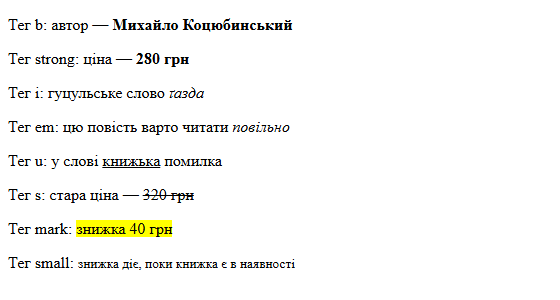
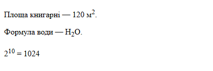
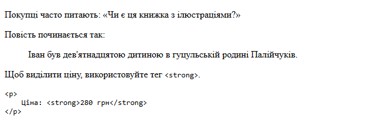
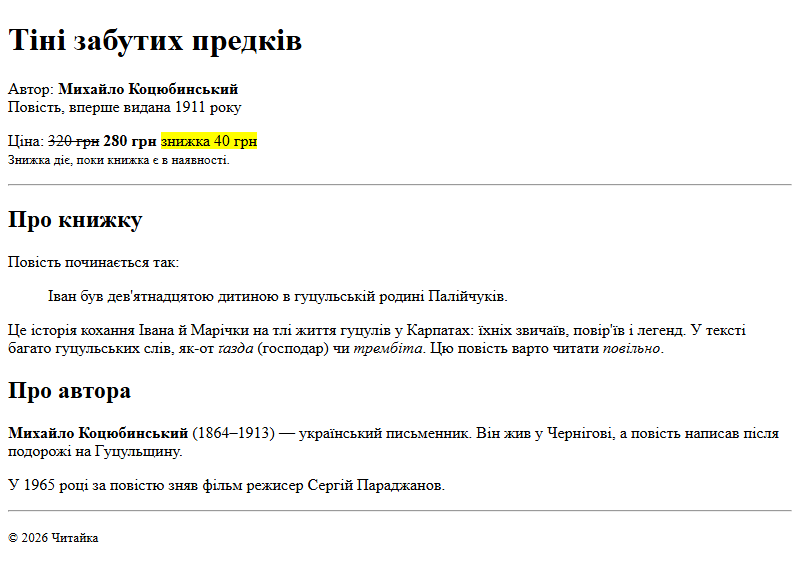
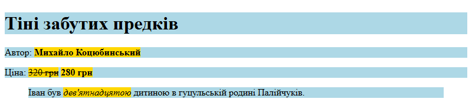
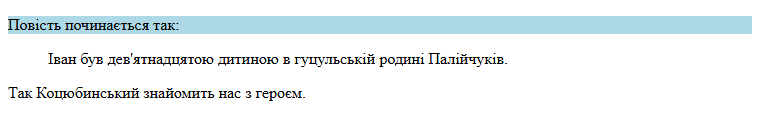

# 4. Форматування тексту; блокові та рядкові елементи

![block-badge] ![html-badge] ![css-badge]

## Зміст

1. [Навіщо форматувати текст](#навіщо-форматувати-текст)
2. [Теги форматування тексту](#теги-форматування-тексту)
3. [Смислові та візуальні теги](#смислові-та-візуальні-теги)
4. [Верхній і нижній індекси](#верхній-і-нижній-індекси)
5. [Цитати й код](#цитати-й-код)
6. [Сторінка книжки з форматуванням](#сторінка-книжки-з-форматуванням)
7. [Блокові та рядкові елементи](#блокові-та-рядкові-елементи)
8. [Що в що можна вкладати](#що-в-що-можна-вкладати)
9. [Де це трапляється на практиці](#де-це-трапляється-на-практиці)
10. [Підсумок](#підсумок)
11. [Запитання для самоперевірки](#запитання-для-самоперевірки)
12. [Довідкові матеріали](#довідкові-матеріали)

---

## Навіщо форматувати текст

У попередньому уроці ми створили сторінку книжки «Тіні забутих предків» із заголовками й абзацами. Але
весь текст у ній однаковий: ціна нічим не відрізняється від опису, а цитата з повісті — від звичайного
речення. Читач, який за кілька секунд пробігає сторінку очима, не помітить головного.

У друкованій книжці для цього є жирний шрифт, курсив, виноски, цитати з відступом. У HTML для цього є
окремі теги.

> **Теги форматування тексту** (text formatting tags) — HTML-теги, якими позначають окремі слова чи
> фрагменти **всередині** тексту: важливе, наголошене, виділене, застаріле, примітку. _Заголовки й
> абзаци ділять сторінку на частини, а теги форматування працюють усередині цих частин_.

Майже всі такі теги — парні: тег відкривається перед потрібним фрагментом і закривається після нього.

```html
<p>Ціна: <strong>280 грн</strong></p>
```

Тут `strong` позначає лише ціну, а решта абзацу залишається звичайним текстом.

---

## Теги форматування тексту

Розгляньмо вісім тегів, які трапляються найчастіше. Ось вони всі на одній сторінці — на прикладах з
нашої книгарні (повний документ із `DOCTYPE`, `head` і `body` — як в уроці 3; тут показано лише вміст `body`):

```html
<p>Тег b: автор — <b>Михайло Коцюбинський</b></p>
<p>Тег strong: ціна — <strong>280 грн</strong></p>
<p>Тег i: гуцульське слово <i>ґазда</i></p>
<p>Тег em: цю повість варто читати <em>повільно</em></p>
<p>Тег u: у слові <u>книжька</u> помилка</p>
<p>Тег s: стара ціна — <s>320 грн</s></p>
<p>Тег mark: <mark>знижка 40 грн</mark></p>
<p>Тег small: <small>знижка діє, поки книжка є в наявності</small></p>
```

Результат у браузері:



Кожен тег має **значення** — що саме він повідомляє про текст — і **вигляд за замовчуванням**, який
йому дає браузер:

| Тег | Що означає | Як виглядає за замовчуванням | Коли використовувати |
| :---- | :---- | :---- | :---- |
| **`<b>`** | привертає увагу, але не робить текст важливішим (англ. bold — жирний) | **жирний** | ключові слова, назви товарів, ім'я автора в описі |
| **`<strong>`** | особливо важливий, серйозний або терміновий текст | **жирний** | ціна, попередження, головна умова |
| **`<i>`** | текст «іншим голосом»: слово з іншої мови чи діалекту, термін, думки героя (англ. italic — курсив) | _курсив_ | іншомовні й діалектні слова: _ґазда_, _трембіта_ |
| **`<em>`** | логічний наголос, що змінює зміст речення (англ. emphasis — наголос) | _курсив_ | слово, яке ви б вимовили голосніше |
| **`<u>`** | текст з особливою позначкою (англ. underline — підкреслення) | підкреслений | слово з помилкою, як у текстовому редакторі |
| **`<s>`** | інформація, що вже неактуальна (англ. strikethrough — закреслення) | ~~закреслений~~ | стара ціна, скасована акція |
| **`<mark>`** | фрагмент, виділений, бо він важливий саме зараз | жовтий фон, як маркером | знайдене слово в пошуку, знижка |
| **`<small>`** | примітка, «дрібний шрифт» | менший розмір | умови акції, авторські права (`&copy;`) |

> [!WARNING]
> **Часта помилка:** використовувати `<u>`, щоб просто підкреслити важливе слово. На вебсторінках
> підкреслений текст зазвичай означає **посилання**, тому користувач намагатиметься на нього клацнути.
> Для важливого є `<strong>`, а `<u>` — лише для особливих позначок на кшталт помилки в слові.

Теги можна поєднувати, вкладаючи один в інший: `<strong><em>дуже важливо</em></strong>` дасть жирний
курсив. Головне — закривати їх у зворотному порядку, як ви вже знаєте з уроку 3.

---

## Смислові та візуальні теги

Подивіться ще раз на скриншот вище: `<b>` і `<strong>` виглядають **однаково** (жирний), так само як `<i>` і
`<em>` (курсив). Навіщо тоді два теги для одного й того самого?

Річ у тім, що їх створювали з різною метою. Теги `<b>` та `<i>` у ранньому HTML просто вмикали жирний шрифт чи
курсив, тобто описували **вигляд**. А `<strong>` та `<em>` від початку описували **зміст**: «це
важливо», «тут наголос».

> **Смисловий (семантичний) тег** (semantic tag) — тег, що повідомляє, **яку роль** відіграє текст
> (важливе, наголос, цитата), а не як він має виглядати. _Семантика — це значення, сенс_.
>
> **Візуальний тег** (presentational tag) — тег, який історично лише змінював вигляд тексту: `<b>` —
> жирний, `<i>` — курсив.

Навіщо взагалі думати про зміст, якщо на екрані різниці немає? Бо сторінку «читають» не лише люди очима:

- **екранний читач** (screen reader) — програма, що вголос читає сторінку людям з порушеннями зору;
  такі програми можна налаштувати вимовляти `<em>` та `<strong>` з іншою інтонацією, а `<b>` та `<i>`
  жодного додаткового змісту не несуть
- **пошукові системи** (Google тощо) аналізують розмітку, щоб зрозуміти, про що сторінка
- **інші програми**: режим читання в браузері, перекладачі, голосові помічники

| Критерій | `<b>` / `<i>` | `<strong>` / `<em>` |
| :---- | :---- | :---- |
| **Що повідомляє** | «виділи це» / «це сказано іншим голосом» | «це важливо» / «тут наголос» |
| **Вигляд за замовчуванням** | жирний / курсив | жирний / курсив (так само) |
| **Що втратимо, прибравши тег** | лише виділення | важливість чи наголос |
| **Приклад** | ім'я автора; слово _ґазда_ | ціна **280 грн**; читати _повільно_ |

**Головна різниця** — у змісті, а не у вигляді. Смислові теги пояснюють програмам (екранним читачам,
пошуковикам), **чому** текст виділено. А вигляд будь-якого тегу ми зможемо змінити через CSS: зробити
`<strong>` червоним замість жирного чи прибрати курсив з `<em>`.

Звідси просте правило: **обирайте тег за змістом, а не за виглядом**. Хочете, щоб текст був жирним
просто «для краси»? Це завдання для CSS, а не для HTML.

> [!WARNING]
> **Часта плутанина:** «`<b>` та `<i>` застарілі, їх не можна використовувати». Це не так: вони є в
> сучасному стандарті HTML, але отримали власне значення — `<b>` для ключових слів і назв, `<i>` для
> іншомовних слів і термінів. Якщо ж текст справді важливий чи з наголосом — беріть `<strong>` та `<em>`.

Як відрізнити `<em>` від `<i>`? Прочитайте речення вголос. Якщо ви **вимовляєте** слово з натиском і від
цього змінюється зміст («Цю повість варто читати _повільно_» — а не швидко), — це `<em>`. Якщо слово
просто «чуже» для тексту (діалектне, іншомовне), але наголосу немає, — це `<i>`.

---

## Верхній і нижній індекси

У тексті іноді трапляються символи, що стоять вище або нижче за рядок: квадратні метри, хімічні формули,
степені чисел.

> **Верхній індекс** (superscript) — тег `<sup>`: текст, трохи піднятий над рядком і зменшений.
>
> **Нижній індекс** (subscript) — тег `<sub>`: текст, трохи опущений під рядок і зменшений.

```html
<p>Площа книгарні — 120 м<sup>2</sup>.</p>
<p>Формула води — H<sub>2</sub>O.</p>
<p>2<sup>10</sup> = 1024</p>
```

Результат у браузері:



**Де використовуються індекси:**

- одиниці виміру: м<sup>2</sup>, см<sup>3</sup>
- степені в математиці: 2<sup>10</sup>, x<sup>2</sup>
- хімічні формули: H<sub>2</sub>O, CO<sub>2</sub>
- номери виносок у тексті: «…як пише автор<sup>1</sup>»

> [!TIP]
> **Порада:** `<sup>` та `<sub>` — для випадків, де піднятий чи опущений текст має **значення** (без
> нього H2O — це вже не формула). Якщо ж хочете просто зсунути текст для краси, то це знову завдання для CSS.

---

## Цитати й код

Ще дві групи тегів — для чужих слів і для програмного коду.

### Цитати: `blockquote` і `q`

> **`<blockquote>`** (block quotation) — велика цитата з іншого джерела, яка стоїть окремим блоком.
> Браузер відсуває її від лівого краю.
>
> **`<q>`** (quotation) — коротка цитата всередині речення. Браузер **сам додає лапки**, тому
> писати їх вручну не треба.

### Код: `code` і `pre`

> **`<code>`** — фрагмент програмного коду всередині тексту: назва тегу, команда, ім'я файлу. Браузер показує
> його моноширинним шрифтом (у такому шрифті всі символи однакової ширини, як у редакторі коду).
>
> **`<pre>`** (preformatted text, попередньо відформатований текст) — блок, у якому браузер **зберігає всі
> пробіли й переноси рядків** так, як вони записані в коді.

Пам'ятаєте з уроку 3, що браузер «склеює» кілька пробілів в один і ігнорує переноси рядків? Усередині
`<pre>` це правило не діє. Тому `<pre>` використовують для блоків програмного коду, де важливі відступи,
а сам код усередині позначають тегом `<code>`.

Ось усі чотири теги разом:

```html
<p>Покупці часто питають: <q>Чи є ця книжка з ілюстраціями?</q></p>
<p>Повість починається так:</p>
<blockquote>
    <p>Іван був дев'ятнадцятою дитиною в гуцульській родині Палійчуків.</p>
</blockquote>
<p>Щоб виділити ціну, використовуйте тег <code>&lt;strong&gt;</code>.</p>
<pre><code>&lt;p&gt;
    Ціна: &lt;strong&gt;280 грн&lt;/strong&gt;
&lt;/p&gt;</code></pre>
```

Результат у браузері:



> [!NOTE]
> **Зверніть увагу:** лапки «ялинки» навколо питання покупця додав сам браузер — у коді їх немає. Вигляд лапок
> залежить від мови сторінки: для `lang="uk"` браузер ставить українські «», для англійської — “”.
> А щоб показати на сторінці сам тег `<strong>`, ми записали кутові дужки сутностями `&lt;` і `&gt;`:
> інакше браузер сприйняв би `<strong>` як справжній тег і нічого б не показав.

---

## Сторінка книжки з форматуванням

Тепер застосуємо все це до наскрізного прикладу. Візьмемо сторінку книжки з уроку 3 й додамо
форматування. Текст ми трохи змінили: доповнили старою ціною, приміткою про знижку й поясненням гуцульських
слів, щоб кожному тегу знайшлося місце, а блок характеристик і підрозділи `h3` скоротили, щоб сторінка
залишалася компактною. Цитату з повісті тепер оформимо тегом `blockquote` замість лапок-сутностей.

**Що і чим позначимо:**

- ім'я автора — `<b>`: це назва, яку варто помітити, але вона не «важливіша» за решту тексту
- нову ціну — `<strong>`: це головна інформація для покупця
- стару ціну — `<s>`: вона вже неактуальна
- знижку — `<mark>`: те, на що треба звернути увагу саме зараз
- умови знижки й рядок з авторськими правами — `<small>`: це примітки
- перше речення повісті — `<blockquote>`: велика цитата з іншого джерела
- гуцульські слова — `<i>`, наголос — `<em>`

```html
<!DOCTYPE html>
<html lang="uk">
<head>
    <meta charset="UTF-8">
    <meta name="viewport" content="width=device-width, initial-scale=1.0">
    <title>Тіні забутих предків — Читайка</title>
</head>
<body>
    <h1>Тіні забутих предків</h1>
    <p>Автор: <b>Михайло Коцюбинський</b><br>
        Повість, вперше видана 1911 року</p>
    <p>Ціна: <s>320&nbsp;грн</s> <strong>280&nbsp;грн</strong> <mark>знижка 40&nbsp;грн</mark><br>
        <small>Знижка діє, поки книжка є в наявності.</small></p>

    <hr>

    <h2>Про книжку</h2>
    <p>Повість починається так:</p>
    <blockquote>
        <p>Іван був дев'ятнадцятою дитиною в гуцульській родині Палійчуків.</p>
    </blockquote>
    <p>Це історія кохання Івана й Марічки на тлі життя гуцулів у Карпатах: їхніх звичаїв,
        повір'їв і легенд. У тексті багато гуцульських слів, як-от <i>ґазда</i> (господар)
        чи <i>трембіта</i>. Цю повість варто читати <em>повільно</em>.</p>

    <h2>Про автора</h2>
    <p><b>Михайло Коцюбинський</b> (1864–1913) — український письменник. Він жив у Чернігові,
        а повість написав після подорожі на Гуцульщину.</p>
    <p>У 1965 році за повістю зняв фільм режисер Сергій Параджанов.</p>

    <hr>

    <p><small>&copy; 2026 Читайка</small></p>
</body>
</html>
```

Результат у браузері:



> [!IMPORTANT]
> **Ключова ідея:** ми обирали кожен тег за **змістом**: «важливе» — `strong`, «неактуальне» — `s`,
> «примітка» — `small`. Вигляд, який дав браузер, — лише стандартний. У наступному уроці ми підключимо
> CSS і зможемо, наприклад, зробити ціну більшою й помаранчевою, не змінюючи HTML-розмітки.

---

## Блокові та рядкові елементи

Подивіться на скриншот сторінки книжки уважніше. Заголовки, абзаци й цитата завжди починаються з нового
рядка, а `strong`, `s` і `mark` спокійно стоять поруч в одному рядку з текстом. Це не випадковість: усі
HTML-елементи за замовчуванням поводяться одним із двох способів.

> **Блоковий елемент** (block-level element) — елемент, що починається з нового рядка й займає **всю
> доступну ширину**, навіть якщо тексту в ньому мало. Наступний елемент після нього теж починається з
> нового рядка. _Блоковий елемент — як цеглина в стіні: займає цілий ряд_.

> **Рядковий елемент** (inline element) — елемент, що стоїть **всередині рядка тексту** й займає рівно
> стільки місця, скільки його вміст. _Рядковий елемент — як слово, виділене маркером: решта рядка
> лишається на місці_.

Різницю добре видно, якщо «підсвітити» елементи кольоровим фоном. Для цього скористаємося атрибутом
`style` з властивістю `background-color` (колір фону): блоковим елементам дамо блакитний фон, рядковим —
золотистий. Це **тимчасовий прийом** для наочності; як працюють стилі, ми детально розберемо в наступному
уроці.

```html
<h1 style="background-color: lightblue;">Тіні забутих предків</h1>
<p style="background-color: lightblue;">Автор: <b style="background-color: gold;">Михайло Коцюбинський</b></p>
<p style="background-color: lightblue;">Ціна: <s style="background-color: gold;">320 грн</s> <strong style="background-color: gold;">280 грн</strong></p>
<blockquote style="background-color: lightblue;">
    <p>Іван був <em style="background-color: gold;">дев'ятнадцятою</em> дитиною в гуцульській родині Палійчуків.</p>
</blockquote>
```

Результат у браузері:



Блакитні смуги — `h1`, абзаци й цитата — тягнуться на всю ширину вікна, хоча тексту в них небагато.
Золотисті прямокутники — `b`, `s`, `strong`, `em` — охоплюють лише свої слова. Цитата трохи вужча за абзаци,
бо браузер додає їй відступи з боків (про відступи — у темі «Блокова модель» наступного модуля).

**Які елементи якого типу:**

| Тип | Елементи | Як поводиться |
| :---- | :---- | :---- |
| **Блокові** | `h1`–`h6`, `p`, `hr`, `blockquote`, `pre` | з нового рядка, на всю ширину, один під одним |
| **Рядкові** | `b`, `strong`, `i`, `em`, `u`, `s`, `mark`, `small`, `sub`, `sup`, `q`, `code`, `br` | у рядку з текстом, ширина = вміст |

> [!TIP]
> **Порада:** перевірити, де межі елемента, можна без жодних стилів. Відкрийте сторінку, натисніть **F12**
> і на вкладці **Elements** (Елементи) наведіть курсор на рядок з тегом — браузер підсвітить на сторінці
> прямокутник, який займає цей елемент. Для `<p>` він буде на всю ширину, для `<strong>` — лише навколо слова.

<!--
> [!CAUTION]
> 📸 **TODO-IMG** `images/l4_i6.png`
> **Що зобразити:** сторінка книжки з розділу «Сторінка книжки з форматуванням», відкрита в браузері з Інструментами розробника (F12) на вкладці Elements; курсор наведено на тег `<p>` з ціною — на сторінці підсвічено прямокутник абзацу на всю ширину. Бажано другий кадр поруч: курсор на `<strong>` — підсвічено лише «280 грн».
-->

Ще одна деталь: тип елемента — це лише **поведінка за замовчуванням**. CSS уміє змінити її (наприклад,
зробити рядковий елемент блоковим) — це тема модуля 2. А поки що тип допомагає зрозуміти, що в що можна
вкладати.

---

## Що в що можна вкладати

Блокові й рядкові елементи підкоряються простому правилу: **більше може містити менше, але не навпаки**.

**Правила вкладення:**

- рядкові елементи — всередині блокових: `<p>Ціна: <strong>280 грн</strong></p>` ✔
- рядкові — всередині рядкових: `<strong><em>дуже важливо</em></strong>` ✔
- деякі блокові — всередині блокових: `<blockquote><p>…</p></blockquote>` ✔ (цитата може містити абзаци)
- блокові — всередині рядкових: `<strong><p>…</p></strong>` ✘
- будь-які блокові — всередині абзацу `<p>`: ні заголовок, ні цитата, ні інший абзац ✘

Останнє правило порушують найчастіше. Абзац — це «рядки тексту», і нічого блокового в ньому бути не може.
Подивімося, що зробить браузер, якщо ми все-таки вкладемо цитату в абзац. Підсвітимо абзац блакитним фоном,
щоб бачити, де він насправді закінчується:

```html
<p style="background-color: lightblue;">
    Повість починається так:
    <blockquote>Іван був дев'ятнадцятою дитиною в гуцульській родині Палійчуків.</blockquote>
    Так Коцюбинський знайомить нас з героєм.
</p>
```

Результат у браузері:



Блакитним підсвічено лише перший рядок. Зустрівши `<blockquote>` усередині `<p>`, браузер **сам закрив
абзац** перед цитатою. Тож цитата й останнє речення опинилися вже поза абзацом і без його оформлення, а
закривальний `</p>` у кінці браузер перетворив на новий порожній абзац. Помилки на екрані немає, але
сторінка побудована не так, як ми задумали, і стилі абзацу до решти тексту не застосуються.

Правильно — закрити абзац перед цитатою й винести решту тексту в окремий абзац:

```html
<p>Повість починається так:</p>
<blockquote>
    <p>Іван був дев'ятнадцятою дитиною в гуцульській родині Палійчуків.</p>
</blockquote>
<p>Так Коцюбинський знайомить нас з героєм.</p>
```

> [!WARNING]
> **Часта помилка:** вкладати заголовок в абзац (`<p><h2>Про автора</h2></p>`) або абзац в абзац. Браузер
> мовчки «виправить» такий код по-своєму, і результат часто дивує. Абзаци й заголовки завжди стоять
> **поруч**, а не один в одному.

> [!TIP]
> **Порада:** перевірити, чи правильно вкладені теги, можна безкоштовним сервісом
> [W3C Markup Validation Service](https://validator.w3.org/): вставте код на вкладці **Validate by Direct
> Input** — і валідатор покаже рядки з помилками.

---

## Де це трапляється на практиці

Теги форматування ви бачите щодня, навіть не помічаючи їх.

| Де | Що ви бачите | Який тег за цим стоїть |
| :---- | :---- | :---- |
| **Інтернет-магазини** | стара ціна закреслена, нова — велика й жирна | `s`, `strong` + CSS |
| **[Вікіпедія](https://uk.wikipedia.org/)** | назва статті жирним у першому реченні, номери виносок <sup>[1]</sup> | `b`, `sup` |
| **Статті з хімії, фізики, математики** | H<sub>2</sub>O, м<sup>2</sup>, x<sup>2</sup> | `sub`, `sup` |
| **Пошук на сторінці (Ctrl+F)** та на сайтах | знайдені слова підсвічені | на сайтах — часто `mark` |
| **Новинні сайти** | цитата відомої людини окремим блоком | `blockquote` |
| **[MDN](https://developer.mozilla.org/) та інші довідники з програмування** | назви тегів і приклади коду моноширинним шрифтом | `code`, `pre` |
| **Нижня частина будь-якого сайту** | дрібний рядок «© 2026 …» | часто `small` |

> [!NOTE]
> **Зверніть увагу:** на справжніх сайтах вигляд майже завжди змінено через CSS: ціна може бути
> червоною, а цитата — з рамкою й великими лапками. Але під цим оформленням — ті самі теги, які ми
> розглянули сьогодні. Перевірте самі: клацніть правою кнопкою на ціні в інтернет-магазині й виберіть
> **Inspect** (в українському інтерфейсі браузера — перекладена назва цього пункту, див. урок 2).

---

## Підсумок

- теги форматування позначають фрагменти всередині тексту: `strong` — важливе, `em` — наголос, `s` —
  неактуальне, `mark` — виділене, `small` — примітка, `sub`/`sup` — індекси
- `b`/`strong` та `i`/`em` виглядають однаково, але смислові `strong` та `em` передають програмам
  (екранним читачам, пошуковикам) значення; тег обирають за змістом, а вигляд задають через CSS
- `blockquote` — велика цитата окремим блоком, `q` — коротка в рядку (лапки додає браузер), `code` —
  код у тексті, `pre` — блок, що зберігає пробіли й переноси
- блокові елементи починаються з нового рядка й займають усю ширину, рядкові стоять у рядку й займають
  стільки місця, скільки їхній вміст
- рядкові елементи вкладають у блокові, але не навпаки; абзац `p` не може містити жодних блокових елементів

---

## Запитання для самоперевірки

1. Навіщо потрібні теги форматування, якщо текст і так видно на сторінці?
2. Який тег використати для старої ціни, а який — для умов акції дрібним шрифтом?
3. Чому `<u>` не варто використовувати, щоб підкреслити важливе слово?
4. `<b>` і `<strong>` виглядають однаково. Чим вони відрізняються і для кого ця різниця має значення?
5. У реченні «Я сказав _завтра_, а не сьогодні» виділене слово — це `<em>` чи `<i>`? Чому?
6. Як записати в HTML «50 м²» і формулу вуглекислого газу CO₂?
7. Чим `<q>` відрізняється від `<blockquote>`? Чим `<pre>` відрізняється від `<p>`?
8. Чим блоковий елемент відрізняється від рядкового? Наведіть по три приклади кожного.
9. Що станеться, якщо вкласти `<blockquote>` в абзац `<p>`? Як записати такий фрагмент правильно?

---

## Довідкові матеріали

- [Елементи HTML](https://uk.wikipedia.org/wiki/%D0%95%D0%BB%D0%B5%D0%BC%D0%B5%D0%BD%D1%82%D0%B8_HTML) — `uk.wikipedia.org`
- [Emphasis and importance](https://developer.mozilla.org/en-US/docs/Learn_web_development/Core/Structuring_content/Emphasis_and_importance) — `developer.mozilla.org`
- [Advanced text features](https://developer.mozilla.org/en-US/docs/Learn_web_development/Core/Structuring_content/Advanced_text_features) — `developer.mozilla.org`
- [&lt;strong&gt; HTML strong importance element](https://developer.mozilla.org/en-US/docs/Web/HTML/Reference/Elements/strong) — `developer.mozilla.org`
- [&lt;b&gt; HTML bring attention to element](https://developer.mozilla.org/en-US/docs/Web/HTML/Reference/Elements/b) — `developer.mozilla.org`
- [&lt;mark&gt; HTML mark text element](https://developer.mozilla.org/en-US/docs/Web/HTML/Reference/Elements/mark) — `developer.mozilla.org`
- [&lt;blockquote&gt; HTML block quotation element](https://developer.mozilla.org/en-US/docs/Web/HTML/Reference/Elements/blockquote) — `developer.mozilla.org`
- [&lt;pre&gt; HTML preformatted text element](https://developer.mozilla.org/en-US/docs/Web/HTML/Reference/Elements/pre) — `developer.mozilla.org`
- [Block-level content](https://developer.mozilla.org/en-US/docs/Glossary/Block-level_content) — `developer.mozilla.org`
- [Inline-level content](https://developer.mozilla.org/en-US/docs/Glossary/Inline-level_content) — `developer.mozilla.org`
- [The W3C Markup Validation Service](https://validator.w3.org/) — `validator.w3.org`

---

[block-badge]:https://img.shields.io/badge/%D0%9E%D1%81%D0%BD%D0%BE%D0%B2%D0%B8%20HTML%20%D1%96%20CSS-purple?style=flat
[html-badge]:https://img.shields.io/badge/HTML-E34F26?style=flat&logo=html5&logoColor=white
[css-badge]:https://img.shields.io/badge/CSS-1572B6?style=flat&logo=css&logoColor=white
