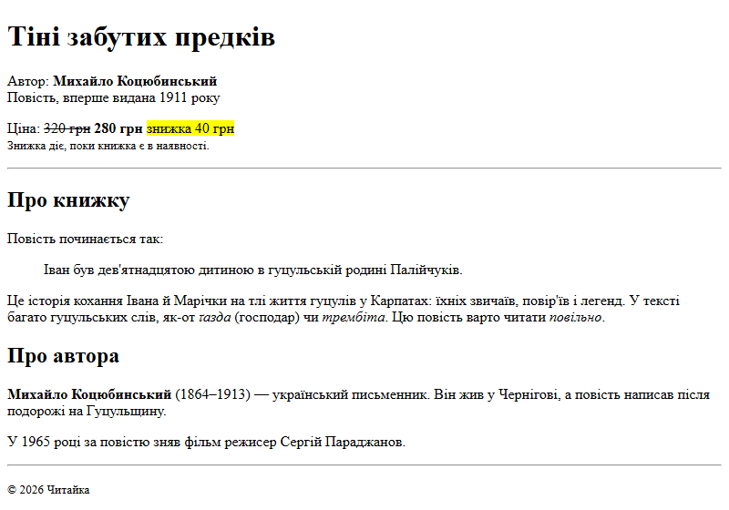
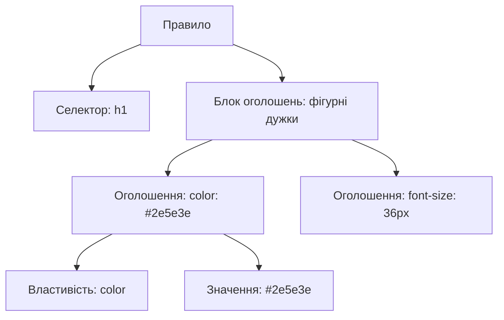
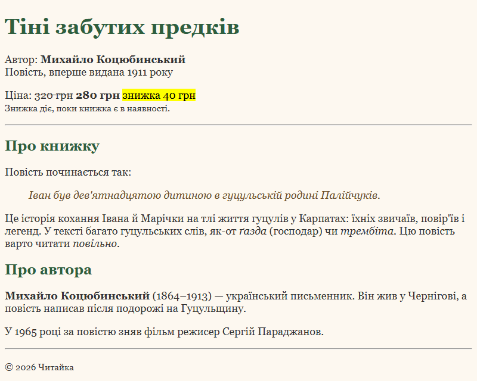
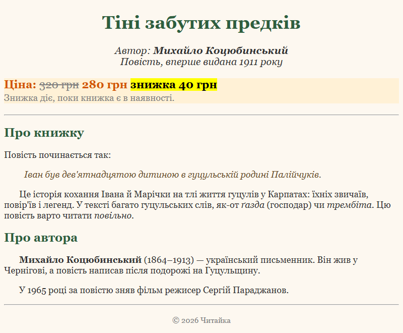

# 5. Основи CSS: підключення стилів, селектори тегів, класи

![block-badge] ![html-badge] ![css-badge]

## Зміст

1. [Що таке CSS і навіщо він потрібен](#що-таке-css-і-навіщо-він-потрібен)
2. [Як влаштоване CSS-правило](#як-влаштоване-css-правило)
3. [Три способи підключити CSS](#три-способи-підключити-css)
4. [Селектор тегу](#селектор-тегу)
5. [Селектор класу](#селектор-класу)
6. [Перші властивості CSS](#перші-властивості-css)
7. [Коментарі в CSS](#коментарі-в-css)
8. [Приклад: оформлюємо сторінку книжки](#приклад-оформлюємо-сторінку-книжки)
9. [Часті помилки](#часті-помилки)
10. [Як подивитися стилі будь-якого сайту](#як-подивитися-стилі-будь-якого-сайту)
11. [Підсумок](#підсумок)
12. [Запитання для самоперевірки](#запитання-для-самоперевірки)
13. [Довідкові матеріали](#довідкові-матеріали)

---

## Що таке CSS і навіщо він потрібен

У попередніх уроках ми зверстали сторінку книжки «Тіні забутих предків» для книгарні «Читайка»:
заголовки, абзаци, цитата, ціна зі знижкою. Ось її код після уроку 4:

```html
<!DOCTYPE html>
<html lang="uk">
<head>
    <meta charset="UTF-8">
    <meta name="viewport" content="width=device-width, initial-scale=1.0">
    <title>Тіні забутих предків — Читайка</title>
</head>
<body>
    <h1>Тіні забутих предків</h1>
    <p>Автор: <b>Михайло Коцюбинський</b><br>
        Повість, вперше видана 1911 року</p>
    <p>Ціна: <s>320&nbsp;грн</s> <strong>280&nbsp;грн</strong> <mark>знижка 40&nbsp;грн</mark><br>
        <small>Знижка діє, поки книжка є в наявності.</small></p>

    <hr>

    <h2>Про книжку</h2>
    <p>Повість починається так:</p>
    <blockquote>
        <p>Іван був дев'ятнадцятою дитиною в гуцульській родині Палійчуків.</p>
    </blockquote>
    <p>Це історія кохання Івана й Марічки на тлі життя гуцулів у Карпатах: їхніх звичаїв,
        повір'їв і легенд. У тексті багато гуцульських слів, як-от <i>ґазда</i> (господар)
        чи <i>трембіта</i>. Цю повість варто читати <em>повільно</em>.</p>

    <h2>Про автора</h2>
    <p><b>Михайло Коцюбинський</b> (1864–1913) — український письменник. Він жив у Чернігові,
        а повість написав після подорожі на Гуцульщину.</p>
    <p>У 1965 році за повістю зняв фільм режисер Сергій Параджанов.</p>

    <hr>

    <p><small>&copy; 2026 Читайка</small></p>
</body>
</html>
```

Результат у браузері:



Сторінка правильна: усе на своїх місцях, заголовки — заголовки, цитата — цитата. Але вигляд у неї
«за замовчуванням»: чорний текст, однаковий шрифт, біле тло. Рядок з автором нічим не відрізняється
від звичайного абзацу, а ціна губиться серед тексту. HTML описує, **що** є на сторінці, але не вміє
сказати, **як** це має виглядати. Для цього існує окрема мова.

> **CSS** (Cascading Style Sheets, каскадні таблиці стилів) — мова, якою описують **зовнішній вигляд**
> HTML-елементів: кольори, шрифти, розміри, вирівнювання, розташування. _HTML — це зміст, CSS — це
> оформлення цього змісту_.

**Навіщо відділяти оформлення від змісту:**

- той самий HTML можна оформити зовсім по-різному, не змінюючи в ньому жодного слова
- один файл стилів може оформлювати всі сторінки сайту — і змінювати їх усі одразу
- HTML-код залишається коротким і зрозумілим: у ньому лише зміст і структура

---

## Як влаштоване CSS-правило

CSS-файл складається з **правил**. Кожне правило відповідає на два запитання: **які** елементи
оформити і **як** саме.

> **CSS-правило** (CSS rule) — інструкція для браузера: «знайди такі елементи й застосуй до них такі
> стилі». _Правило = селектор + блок оголошень_.

Ось правило, яке робить заголовок `h1` зеленим і великим:

```css
h1 {
    color: #2e5e3e;
    font-size: 36px;
}
```

| Частина | У прикладі | Що означає |
| :---- | :---- | :---- |
| **Селектор** (selector) | `h1` | **які** елементи оформлюємо — тут усі заголовки `h1` |
| **Блок оголошень** (declaration block) | `{ ... }` | фігурні дужки, всередині яких перелічено стилі |
| **Оголошення** (declaration) | `color: #2e5e3e;` | одна пара «властивість: значення», завершується `;` |
| **Властивість** (property) | `color`, `font-size` | **що** саме змінюємо: колір тексту, розмір шрифту |
| **Значення** (value) | `#2e5e3e`, `36px` | **яким** це має бути: конкретний колір, конкретний розмір |



На діаграмі показано, з чого складається правило: селектор і блок оголошень, у якому кожне оголошення —
це пара «властивість — значення».

**Правила запису:**

- між властивістю і значенням — двокрапка `:`
- кожне оголошення закінчується крапкою з комою `;` (у тому числі останнє — так безпечніше)
- блок оголошень відкривається `{` і обов'язково закривається `}`
- назви властивостей пишуться маленькими латинськими літерами, слова розділяються дефісом: `font-size`,
  `background-color`
- пробіли й переноси рядків браузер ігнорує, але прийнято писати кожне оголошення з нового рядка
  з відступом у 4 пробіли — так код легше читати

> [!TIP]
> **Порада:** аналогія з анкетою. Селектор — це «кому» (усім заголовкам `h1`), властивість — назва поля
> анкети («колір»), значення — те, що в це поле вписано («зелений»).

---

## Три способи підключити CSS

Правила треба якось «прив'язати» до HTML-сторінки. Є три способи. Розглянемо кожен на тому самому
завданні: зробити заголовок книжки зеленим.

### Атрибут `style` (вбудовані стилі)

Стилі записуються прямо в тегу, в атрибуті `style`. Селектор і фігурні дужки не потрібні — стиль
діє лише на цей один елемент. Ви вже бачили цей спосіб в уроці 4, коли ми підсвічували блокові й
рядкові елементи кольоровим фоном.

```html
<h1 style="color: #2e5e3e;">Тіні забутих предків</h1>
```

### Тег `style` (внутрішня таблиця стилів)

Правила записуються в тегу `<style>` усередині `<head>`. Вони діють на всю цю сторінку.

```html
<head>
    <meta charset="UTF-8">
    <meta name="viewport" content="width=device-width, initial-scale=1.0">
    <title>Тіні забутих предків — Читайка</title>
    <style>
        h1 {
            color: #2e5e3e;
        }
    </style>
</head>
```

### Зовнішній файл і тег `link`

Правила записуються в окремий файл з розширенням `.css` (зазвичай `style.css`), а в `<head>` сторінки
його підключають тегом `<link>`.

```html
<head>
    <meta charset="UTF-8">
    <meta name="viewport" content="width=device-width, initial-scale=1.0">
    <title>Тіні забутих предків — Читайка</title>
    <link rel="stylesheet" href="style.css">
</head>
```

```css
h1 {
    color: #2e5e3e;
}
```

| Атрибут | Значення | Що означає |
| :---- | :---- | :---- |
| **`rel`** | `stylesheet` | як файл пов'язаний зі сторінкою: «це таблиця стилів» |
| **`href`** | `style.css` | шлях до файлу стилів |

Тег `<link>` — одиночний, закривального тегу не має.

### Порівняння способів

| Спосіб | Як записується | Плюси | Мінуси |
| :---- | :---- | :---- | :---- |
| **Атрибут `style`** | `<h1 style="color: green;">` | швидко змінити один елемент | діє лише на один елемент; стилі перемішані з HTML; для 10 абзаців треба повторити 10 разів |
| **Тег `style`** | `<style>` у `<head>` | одне правило оформлює всі такі елементи сторінки | діє лише на одну сторінку; на кожній сторінці сайту — своя копія стилів |
| **Зовнішній файл** | `<link rel="stylesheet" href="style.css">` | один файл для всіх сторінок сайту; HTML і CSS розділені; браузер завантажує файл один раз і запам'ятовує | потрібен ще один файл і правильний шлях до нього |

**Головна різниця** — область дії: атрибут `style` оформлює один елемент, тег `style` — одну сторінку,
а зовнішній файл — скільки завгодно сторінок, які його підключили.

**Чому зовнішній файл — найкращий вибір:**

- щоб змінити колір заголовків на всьому сайті, достатньо змінити один рядок в одному файлі
- HTML-файл містить лише зміст, а CSS-файл — лише оформлення: кожен файл простіше читати
- над HTML і CSS можуть працювати різні люди, не заважаючи одне одному

Тому далі в курсі ми підключатимемо стилі **зовнішнім файлом**. Атрибут `style` і тег `<style>`
трапляються на практиці (наприклад, у листах електронної пошти чи коротких прикладах), тож їх треба
вміти читати.

### Шлях до файлу в `href`

У `href` вказується шлях до CSS-файлу **відносно HTML-сторінки**. Якщо обидва файли лежать в одній
папці, достатньо імені файлу:

```
book/
├── book.html
└── style.css
```

```html
<link rel="stylesheet" href="style.css">
```

Якщо стилі лежать в окремій папці `css`, шлях починається з назви цієї папки:

```
book/
├── book.html
└── css/
    └── style.css
```

```html
<link rel="stylesheet" href="css/style.css">
```

Детальніше про шляхи до файлів (зокрема як «вийти» в батьківську папку) — в уроці про зображення.

> [!NOTE]
> **Зверніть увагу:** у CodePen тег `<link>` для стилів не потрібен — CSS-код пишеться у панелі **CSS**,
> і CodePen сам підключає його до HTML. А от у VS Code файл `style.css` треба створити поруч зі
> сторінкою і підключити тегом `<link>`.

---

## Селектор тегу

Найпростіший селектор — назва тегу.

> **Селектор тегу** (type selector) — селектор, що складається з назви тегу без кутових дужок: `h1`,
> `p`, `body`. _Правило застосовується до **всіх** елементів з цим тегом на сторінці_.

Оформимо сторінку книжки лише селекторами тегів. Створимо поруч зі сторінкою файл `style.css`:

```css
body {
    font-family: Georgia, serif;
    background-color: #fdf8f0;
    color: #333333;
}

h1 {
    color: #2e5e3e;
    font-size: 36px;
}

h2 {
    color: #2e5e3e;
}

p {
    font-size: 18px;
}

blockquote {
    font-style: italic;
    color: #6b4f2a;
}
```

У `<head>` сторінки додамо один рядок, решта HTML — без змін:

```html
<link rel="stylesheet" href="style.css">
```

Результат у браузері:



**Що змінилося:**

- `body` — уся сторінка отримала кремове тло, темно-сірий текст і шрифт Georgia
- `h1` і `h2` — обидва рівні заголовків стали зеленими, а `h1` ще й більшим
- `p` — **усі** абзаци отримали шрифт 18 пікселів
- `blockquote` — цитата стала курсивною й коричневою

> [!NOTE]
> **Зверніть увагу:** колір і шрифт ми задали лише для `body`, а змінився текст в усіх абзацах і
> заголовках. Це тому, що деякі властивості (колір, шрифт) елементи «успадковують» від елемента, всередині
> якого вони лежать. Детальніше про спадкування — у модулі 2.

Але в селектора тегу є обмеження: він не розрізняє однакові теги. Рядок з автором, ціна, опис книжки й
підвал «© 2026 Читайка» — це все абзаци `p`, тому правило `p { ... }` оформило їх однаково. А ми хочемо,
щоб ціна була більшою й помаранчевою (як і обіцяли в уроці 4), а підвал — сірим і по центру. Для цього
потрібні **класи**.

---

## Селектор класу

> **Клас** (class) — назва, яку ми самі даємо елементу через HTML-атрибут `class`, щоб оформити його
> окремо від інших елементів з таким самим тегом. _Клас — це «наліпка» на елементі, за якою CSS його
> знаходить_.

> **Селектор класу** (class selector) — крапка й назва класу: `.price`. _Правило застосовується до всіх
> елементів, у яких є цей клас, незалежно від тегу_.

Робота з класом — це завжди два кроки: «наклеїти наліпку» в HTML і описати її вигляд у CSS.

| Крок | Де | Як записується | Крапка |
| :---- | :---- | :---- | :---- |
| **1. Дати елементу клас** | HTML | `<p class="price">` | **без** крапки |
| **2. Описати стиль класу** | CSS | `.price { ... }` | **з** крапкою |

```html
<p class="price">Ціна: <s>320&nbsp;грн</s> <strong>280&nbsp;грн</strong> <mark>знижка 40&nbsp;грн</mark><br>
    <small>Знижка діє, поки книжка є в наявності.</small></p>
```

```css
.price {
    font-size: 22px;
    font-weight: bold;
    color: #d35400;
}
```

Тепер більшим, жирним і помаранчевим стане лише абзац із ціною — інші абзаци залишаться як були.

> [!NOTE]
> **Зверніть увагу:** абзац з ціною отримує стилі і від `p` (шрифт 18px), і від `.price` (шрифт 22px).
> Коли тег і клас задають одну й ту саму властивість, перемагає клас — він точніше вказує на елемент.
> Чому саме так, розберемо в модулі 2 (тема «Каскад і специфічність»).

### Один клас на різних тегах

Клас не прив'язаний до тегу: його можна дати будь-якому елементу. Створимо клас для вирівнювання по
центру й використаємо його і для заголовка `h1`, і для абзацу:

```css
.center {
    text-align: center;
}
```

```html
<h1 class="center">Тіні забутих предків</h1>
...
<p class="center"><small>&copy; 2026 Читайка</small></p>
```

Одне правило — і по центру опиняються і заголовок, і підвал. Якщо згодом захочемо вирівняти по центру
ще щось, достатньо додати елементу клас `center`, не пишучи нового CSS.

### Кілька класів на одному елементі

Елемент може мати кілька класів одночасно — їх записують в одному атрибуті `class` **через пробіл**.
Елемент отримає стилі від усіх своїх класів.

```html
<p class="author center">Автор: <b>Михайло Коцюбинський</b><br>
    Повість, вперше видана 1911 року</p>
...
<p class="note center"><small>&copy; 2026 Читайка</small></p>
```

```css
.author {
    font-size: 20px;
    font-style: italic;
}

.note {
    color: gray;
    font-weight: normal;
}
```

Рядок з автором отримує курсив і розмір від `.author` та вирівнювання від `.center`; підвал — сірий
колір від `.note` та вирівнювання від `.center`. Так класи працюють як «конструктор»: один клас
відповідає за одне, і їх можна комбінувати.

Клас `.note` ми дамо ще й примітці про знижку — тегу `<small>` всередині абзацу з ціною:
`<small class="note">`. Абзац з ціною жирний і помаранчевий, а примітка в ньому завдяки `.note` буде
сірою й не жирною (`font-weight: normal`).

### Як називати класи

**Правила, яких варто дотримуватися:**

- лише латинські літери, цифри, дефіс `-` і підкреслення `_`
- назва починається з літери: `price`, а не `1price`
- кілька слів — через дефіс: `old-price`, `book-title`
- назва описує **роль** елемента, а не його вигляд: `price` краще, ніж `red-big-text` (колір завтра
  може змінитися, а ціна залишиться ціною); виняток — маленькі «службові» класи на одну дію, як-от
  `center`, які навмисно дають різним елементам
- великі й малі літери розрізняються: `Price` і `price` — різні класи, тому пишіть усе маленькими

> [!WARNING]
> **Часта помилка:** пробіл у назві класу. `class="old price"` — це не один клас «old price», а **два**
> класи: `old` і `price`. Для назви з кількох слів використовуйте дефіс: `class="old-price"`.

---

## Перші властивості CSS

У цьому уроці ми використовуємо кілька найпотрібніших властивостей. Решту (і всі способи записувати
значення) розберемо в модулі 2.

| Властивість | Що змінює | Приклади значень |
| :---- | :---- | :---- |
| **`color`** | колір тексту | `darkred`, `gray`, `#2e5e3e` |
| **`background-color`** | колір тла елемента | `#fdf8f0`, `white` |
| **`font-size`** | розмір шрифту | `18px`, `36px` |
| **`font-weight`** | товщина (жирність) шрифту | `bold` — жирний, `normal` — звичайний |
| **`font-style`** | накреслення шрифту | `italic` — курсив, `normal` — звичайний |
| **`font-family`** | шрифт | `Georgia, serif`, `Arial, sans-serif` |
| **`text-align`** | вирівнювання тексту | `left`, `center`, `right`, `justify` (по ширині) |
| **`text-indent`** | відступ першого рядка абзацу («червоний рядок») | `30px` |

### Як записуються кольори

Поки що нам вистачить двох способів:

| Спосіб | Приклад | Пояснення |
| :---- | :---- | :---- |
| **Назва кольору** | `red`, `darkred`, `gray`, `white` | англійська назва; браузер знає близько 150 таких назв |
| **HEX-код** | `#2e5e3e`, `#ffffff` | `#` і шість символів (цифри `0–9` і літери `a–f`): по два на червону, зелену й синю складову кольору |

Назви зручні, коли потрібен простий колір, а HEX-код дає змогу задати будь-який із мільйонів відтінків —
саме його найчастіше копіюють з макета дизайнера. Як «читати» HEX-код і які ще є способи задати колір —
у модулі 2.

> [!TIP]
> **Порада:** VS Code показує біля кожного кольору в CSS-файлі маленький квадратик цього кольору. Якщо
> навести на нього курсор миші, відкриється палітра, в якій колір можна вибрати мишею.

### Розміри в пікселях

`px` — це **пікселі**, крихітні точки, з яких складається зображення на екрані. Звичайний текст у
браузері за замовчуванням має розмір `16px`, тому `18px` — трохи більше за звичайний, а `36px` — більше
вдвічі. Між числом і `px` пробілу немає: `18px`, а не `18 px`. Інші одиниці виміру — у модулі 2.

### Шрифт: `font-family`

У `font-family` через кому перелічують шрифти в порядку бажаності: `Georgia, serif` означає «шрифт
Georgia, а якщо його немає на комп'ютері — будь-який шрифт із засічками». Поки що використовуйте
стандартні шрифти, які є майже на кожному комп'ютері: `Arial`, `Verdana`, `Georgia`, `"Times New Roman"`
(назву з пробілами беруть у лапки). Як підключати інші шрифти — у модулі 2.

---

## Коментарі в CSS

Як і в HTML, у CSS можна залишати коментарі — примітки для людей, які браузер ігнорує.

> **Коментар у CSS** (CSS comment) — текст між `/*` і `*/`. _Браузер його пропускає, а людина, що читає
> код, розуміє, що й навіщо тут написано_.

```css
/* ===== Класи ===== */

/* стара (закреслена) ціна: сіра і не жирна */
.old-price {
    color: gray;
    font-weight: normal;
}
```

**Навіщо коментарі в CSS:**

- ділити файл на розділи (стилі тегів, стилі класів, стилі шапки…)
- пояснювати неочевидне: навіщо тут саме таке значення
- тимчасово «вимкнути» оголошення, не видаляючи його: `/* color: red; */`

> [!WARNING]
> **Часта помилка:** писати коментарі як `// коментар` або `<!-- коментар -->`. У CSS працює **лише**
> `/* ... */`. Інші записи браузер сприйме як помилковий код і може пропустити через них сусіднє правило.

> [!TIP]
> **Порада:** у VS Code виділіть рядки й натисніть **Ctrl+/** — редактор сам обгорне їх у коментар
> потрібного виду (у CSS-файлі — `/* */`, у HTML-файлі — `<!-- -->`).

---

## Приклад: оформлюємо сторінку книжки

Зберімо все разом: додамо в HTML класи, а в `style.css` — правила для них. Структура проєкту:

```
book/
├── book.html
└── style.css
```

#### `book.html` — сторінка книжки з класами

Порівняно з уроком 4 додано тег `<link>` і атрибути `class`. Текст сторінки не змінився.

```html
<!DOCTYPE html>
<html lang="uk">
<head>
    <meta charset="UTF-8">
    <meta name="viewport" content="width=device-width, initial-scale=1.0">
    <title>Тіні забутих предків — Читайка</title>
    <link rel="stylesheet" href="style.css">
</head>
<body>
    <h1 class="center">Тіні забутих предків</h1>
    <p class="author center">Автор: <b>Михайло Коцюбинський</b><br>
        Повість, вперше видана 1911 року</p>
    <p class="price">Ціна: <s class="old-price">320&nbsp;грн</s> <strong>280&nbsp;грн</strong> <mark>знижка 40&nbsp;грн</mark><br>
        <small class="note">Знижка діє, поки книжка є в наявності.</small></p>

    <hr>

    <h2>Про книжку</h2>
    <p>Повість починається так:</p>
    <blockquote>
        <p>Іван був дев'ятнадцятою дитиною в гуцульській родині Палійчуків.</p>
    </blockquote>
    <p class="text">Це історія кохання Івана й Марічки на тлі життя гуцулів у Карпатах: їхніх звичаїв,
        повір'їв і легенд. У тексті багато гуцульських слів, як-от <i>ґазда</i> (господар)
        чи <i>трембіта</i>. Цю повість варто читати <em>повільно</em>.</p>

    <h2>Про автора</h2>
    <p class="text"><b>Михайло Коцюбинський</b> (1864–1913) — український письменник. Він жив у Чернігові,
        а повість написав після подорожі на Гуцульщину.</p>
    <p class="text">У 1965 році за повістю зняв фільм режисер Сергій Параджанов.</p>

    <hr>

    <p class="note center"><small>&copy; 2026 Читайка</small></p>
</body>
</html>
```

#### `style.css` — стилі сторінки

```css
/* Стилі сторінки книжки «Тіні забутих предків» */

/* ===== Селектори тегів ===== */

body {
    font-family: Georgia, serif;
    background-color: #fdf8f0;
    color: #333333;
}

h1 {
    color: #2e5e3e;
    font-size: 36px;
}

h2 {
    color: #2e5e3e;
}

p {
    font-size: 18px;
}

blockquote {
    font-style: italic;
    color: #6b4f2a;
}

/* ===== Класи ===== */

/* вирівнювання по центру: для будь-якого елемента */
.center {
    text-align: center;
}

.author {
    font-size: 20px;
    font-style: italic;
}

.price {
    font-size: 22px;
    font-weight: bold;
    color: #d35400;
    background-color: #fff1d6;
}

/* стара (закреслена) ціна: сіра і не жирна */
.old-price {
    color: gray;
    font-weight: normal;
}

/* червоний рядок на початку абзацу */
.text {
    text-indent: 30px;
}

.note {
    color: gray;
    font-weight: normal;
}
```

Результат у браузері:



**Що зробив кожен клас:**

| Клас | На яких елементах | Що змінив |
| :---- | :---- | :---- |
| **`.center`** | `h1`, `p` з автором, `p` з підвалом | вирівняв текст по центру |
| **`.author`** | `p` з автором | збільшив шрифт і зробив курсив |
| **`.price`** | `p` з ціною | великий жирний помаранчевий текст на світлому тлі |
| **`.old-price`** | `s` зі старою ціною | сірий звичайний (не жирний) текст |
| **`.text`** | абзаци з описом книжки й про автора | відступ першого рядка 30px |
| **`.note`** | `small` з приміткою про знижку, `p` з підвалом | сірий звичайний (не жирний) текст |

> [!NOTE]
> **Зверніть увагу:** тло `.price` розтяглося на всю ширину сторінки, хоча тексту в абзаці менше. Це
> тому, що `p` — **блоковий** елемент (урок 4): він займає всю ширину рядка, і тло фарбує всю цю
> ширину. Текст притиснутий до краю тла — внутрішні відступи (`padding`) ми навчимося додавати в
> модулі 2.

Порівняйте «було» і «стало»: HTML-текст той самий, змінилося лише оформлення.

| Було (без CSS) | Стало (зі `style.css`) |
| :---- | :---- |
|  |  |

> [!IMPORTANT]
> **Ключова ідея:** селектори тегів задають загальний вигляд усіх однакових елементів (усі `h2`, усі
> `p`), а класи — особливий вигляд окремих елементів (саме ця ціна, саме цей підвал). HTML лише
> «наклеює» класи, а весь вигляд описано в одному файлі `style.css`.

---

## Часті помилки

CSS не показує повідомлень про помилки: браузер мовчки пропускає те, чого не зрозумів. Тому, якщо стиль
«не працює», шукайте одну з цих причин.

**1. Забута крапка з комою `;`**

```css
h1 {
    color: darkred
    font-size: 60px;
    text-align: center;
}
```

Браузер прочитає `darkred font-size: 60px` як одне незрозуміле значення властивості `color` і пропустить
його. У результаті заголовок не стане ні червоним, ні великим — зламаються **обидва** оголошення, хоча
помилка лише в одному рядку. `text-align` після них спрацює.

**2. Забута закривальна дужка `}`**

```css
h1 {
    color: darkred;

h2 {
    color: green;
}

p {
    color: blue;
}
```

Браузер вважає, що блок `h1` ще не закінчився, і «з'їдає» все, що йде далі. Заголовок `h1` стане
темно-червоним, а правила для `h2` і `p` перестануть працювати.

**3. Крапка в атрибуті `class`**

```html
<p class=".price">280 грн</p>
```

Крапка потрібна лише в CSS-селекторі. В HTML назва класу пишеться **без** крапки: `class="price"`.
Інакше клас називатиметься `.price` з крапкою, і правило `.price { ... }` до нього не застосується.

**4. Неправильний шлях до `style.css`**

```html
<link rel="stylesheet" href="styles.css">
```

Файл називається `style.css`, а в `href` написано `styles.css` — браузер не знайде файл і покаже
сторінку взагалі без стилів. Перевіряйте назву файлу (літера в літеру), розширення `.css` і папку:
якщо файл лежить у `css/`, шлях має бути `css/style.css`.

**5. Кирилиця або пробіл у назві класу**

```html
<p class="ціна">280 грн</p>
<p class="old price">320 грн</p>
```

Кирилиця в назвах класів технічно працює, але легко сплутати схожі літери (`а` українська й `a`
латинська виглядають однаково, але для браузера це різні символи) — і стиль «зникне» без видимої
причини. Пробіл ділить назву на два окремі класи. Пишіть назви латиницею через дефіс: `price`,
`old-price`.

> [!TIP]
> **Порада:** VS Code підсвічує помилки в CSS-файлі червоною хвилястою лінією (наприклад, забуту `}`).
> Якщо стиль не працює, спершу подивіться, чи немає такої лінії, а потім перевірте елемент в
> Інструментах розробника (див. наступний розділ).

---

## Як подивитися стилі будь-якого сайту

Кожен сайт, яким ви користуєтеся, оформлений за допомогою CSS — і з тими самими селекторами тегів і
класами, які ми щойно вивчили. Подивитися їх можна в **Інструментах розробника** (DevTools), з якими ви
познайомилися в уроці 2:

1. **Ви** клацаєте правою кнопкою миші на елементі сторінки → вибираєте **Inspect** (в українському інтерфейсі браузера — перекладена назва цього пункту, див. урок 2).
2. **Браузер** відкриває Інструменти розробника на вкладці **Elements** (Елементи) → підсвічує HTML-код
   цього елемента.
3. **Панель Styles** (Стилі) праворуч показує всі CSS-правила, які застосовано до елемента, з назвою
   файлу й номером рядка (наприклад, `style.css:41`).

**Що можна побачити й зробити в панелі Styles:**

- які класи має елемент і які правила з них застосувалися
- закреслені оголошення — ті, що «програли» іншому правилу (як `font-size: 18px` з `p` у ціни, яку
  перебив `.price`)
- зняти «пташку» біля оголошення — і побачити, як елемент виглядає без нього
- клацнути на значення й змінити його (напр., колір) — сторінка зміниться одразу

<!--
> [!CAUTION]
> 📸 **TODO-IMG** `images/l5_i4.png`
> **Що зобразити:** сторінка книжки з прикладу уроку, відкрита в браузері з Інструментами розробника (F12): на вкладці Elements виділено абзац `<p class="price">`, у панелі Styles видно правило `.price` з посиланням `style.css` і нижче правило `p` із закресленим `font-size: 18px`.
-->

> [!NOTE]
> **Зверніть увагу:** зміни в Інструментах розробника діють лише у вашому браузері й зникають після
> оновлення сторінки. Це «чернетка» для експериментів: вдалий варіант треба перенести у свій
> `style.css`.

Так можна «підглянути», як оформлені ваші улюблені сайти: які кольори використано для заголовків, який
шрифт у тексті, які класи мають кнопки. Це один з найкращих способів учитися CSS.

---

## Підсумок

- CSS описує зовнішній вигляд сторінки, а HTML — її зміст; правило CSS складається із селектора й
  блоку оголошень «властивість: значення;»
- стилі можна підключити атрибутом `style`, тегом `<style>` або зовнішнім файлом через
  `<link rel="stylesheet" href="style.css">` — зовнішній файл найзручніший, бо один файл оформлює весь сайт
- селектор тегу (`p`) оформлює всі елементи з цим тегом, а селектор класу (`.price`) — лише елементи з
  атрибутом `class="price"`
- один клас можна дати різним тегам, а одному елементу — кілька класів через пробіл
- браузер мовчки пропускає помилки в CSS, тому стежте за `;`, `}`, назвами класів і шляхом до файлу

---

## Запитання для самоперевірки

1. Яку роль на сторінці виконує CSS і чим вона відрізняється від ролі HTML?
2. Назвіть частини CSS-правила `h2 { color: green; }`: де селектор, властивість, значення, блок
   оголошень?
3. Якими трьома способами можна підключити CSS до сторінки? Чим вони відрізняються областю дії?
4. Чому для сайту з кількох сторінок краще використовувати зовнішній файл стилів?
5. Що треба написати в `href`, якщо файл `style.css` лежить у папці `css` поруч зі сторінкою?
6. Чим селектор тегу відрізняється від селектора класу? Коли селектора тегу недостатньо?
7. Чому в HTML пишуть `class="price"`, а в CSS — `.price`? Що буде, якщо в HTML написати
   `class=".price"`?
8. Як дати одному елементу два класи? Скільки класів має елемент з `class="old price"`?
9. Ви забули `;` після `color: darkred` у правилі для `h1`. Які оголошення перестануть працювати і чому
   браузер не повідомить про помилку?

---

## Довідкові матеріали

- [CSS](https://uk.wikipedia.org/wiki/CSS) — `uk.wikipedia.org`
- [What is CSS?](https://developer.mozilla.org/en-US/docs/Learn_web_development/Core/Styling_basics/What_is_CSS) — `developer.mozilla.org`
- [Getting started with CSS](https://developer.mozilla.org/en-US/docs/Learn_web_development/Core/Styling_basics/Getting_started) — `developer.mozilla.org`
- [Type selectors](https://developer.mozilla.org/en-US/docs/Web/CSS/Reference/Selectors/Type_selectors) — `developer.mozilla.org`
- [Class selectors](https://developer.mozilla.org/en-US/docs/Web/CSS/Reference/Selectors/Class_selectors) — `developer.mozilla.org`
- [Comments](https://developer.mozilla.org/en-US/docs/Web/CSS/Guides/Syntax/Comments) — `developer.mozilla.org`
- [&lt;named-color&gt; CSS type](https://developer.mozilla.org/en-US/docs/Web/CSS/Reference/Values/named-color) — `developer.mozilla.org`
- [How to add CSS](https://www.w3schools.com/css/css_howto.asp) — `w3schools.com`
- [View and change CSS](https://developer.chrome.com/docs/devtools/css) — `developer.chrome.com`

---

[block-badge]:https://img.shields.io/badge/%D0%9E%D1%81%D0%BD%D0%BE%D0%B2%D0%B8%20HTML%20%D1%96%20CSS-purple?style=flat
[html-badge]:https://img.shields.io/badge/HTML-E34F26?style=flat&logo=html5&logoColor=white
[css-badge]:https://img.shields.io/badge/CSS-1572B6?style=flat&logo=css&logoColor=white
