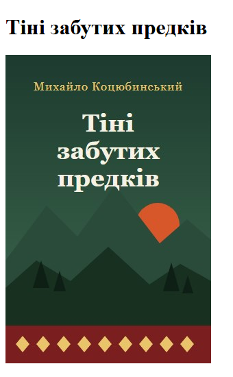
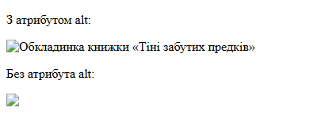
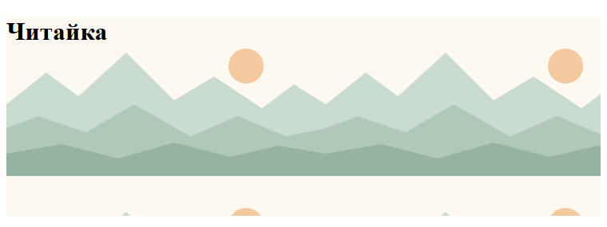
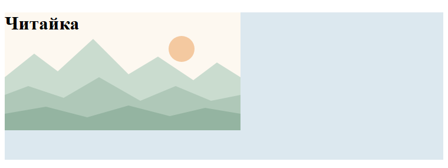
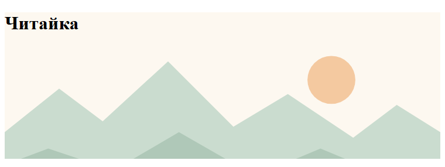
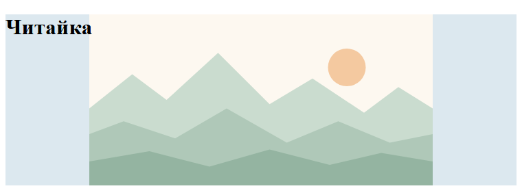
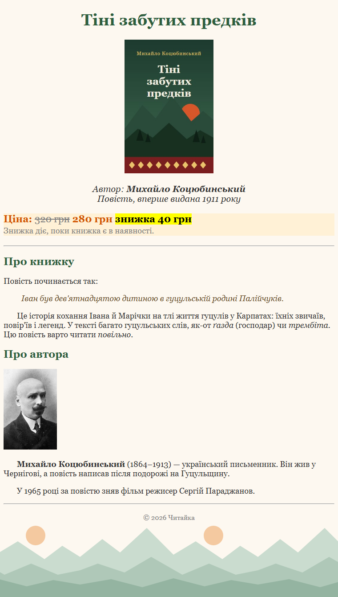

# 6. Зображення на сторінці

![block-badge] ![html-badge] ![css-badge]

## Зміст

1. [Тег img](#тег-img)
2. [Атрибут alt](#атрибут-alt)
3. [Розмір зображення](#розмір-зображення)
4. [Шляхи до файлів](#шляхи-до-файлів)
5. [Формати зображень](#формати-зображень)
6. [Фонове зображення](#фонове-зображення)
7. [Сторінка книжки з обкладинкою і фоном](#сторінка-книжки-з-обкладинкою-і-фоном)
8. [img чи background-image](#img-чи-background-image)
9. [Що ви вже використовували, не знаючи цього](#що-ви-вже-використовували-не-знаючи-цього)
10. [Підсумок](#підсумок)
11. [Запитання для самоперевірки](#запитання-для-самоперевірки)
12. [Довідкові матеріали](#довідкові-матеріали)

---

## Тег img

Сторінка книжки «Тіні забутих предків», яку ми будуємо від уроку до уроку, вже має назву, опис, ціну й
стилі. Але покупець в інтернет-магазині насамперед шукає очима **обкладинку**: без неї сторінка
схожа на текстовий документ, а не на вітрину книгарні.

> **`img`** (від image — зображення) — одиночний тег, який вставляє на сторінку зображення з окремого
> файлу. _Картинка не «вклеюється» в HTML-файл: у коді лише вказано, де лежить файл, а браузер
> завантажує його окремим запитом_.

Пам'ятаєте з уроку 1, як браузер отримує сторінку? Спершу він завантажує HTML-документ, а побачивши
в ньому `img`, надсилає ще один запит — за файлом зображення.

**Основні атрибути `img`:**

| Атрибут | Що задає | Приклад | Обов'язковий? |
| :---- | :---- | :---- | :---- |
| **`src`** | шлях до файлу зображення (від source — джерело) | `src="images/cover.jpg"` | так |
| **`alt`** | текстовий опис зображення (від alternative — альтернативний) | `alt="Обкладинка книжки"` | так |
| **`width`** | ширину в пікселях | `width="200"` | ні |
| **`height`** | висоту в пікселях | `height="300"` | ні |

Зображення зазвичай зберігають в окремій папці `images/` поруч з HTML-файлом — так у проєкті
легше орієнтуватися. Структура нашого прикладу:

```
chytaika/
├── book.html
├── style.css
└── images/
    ├── cover.jpg
    ├── kotsiubynskyi.jpg
    └── mountains.svg
```

Почнімо з мінімальної сторінки: заголовок і обкладинка.

#### `book.html` — сторінка з обкладинкою

```html
<!DOCTYPE html>
<html lang="uk">
<head>
    <meta charset="UTF-8">
    <meta name="viewport" content="width=device-width, initial-scale=1.0">
    <title>Тіні забутих предків</title>
</head>
<body>
    <h1>Тіні забутих предків</h1>
    
</body>
</html>
```

Результат у браузері:



Без атрибутів `width` і `height` браузер показує зображення в його **справжньому розмірі** — наша
обкладинка має 300 × 450 пікселів.

> [!NOTE]
> **Зверніть увагу:** `img` — одиночний тег, закривального `</img>` не буває. Іноді ви побачите запис
> `` зі скісною рискою в кінці — це теж правильно, але в HTML вона не обов'язкова.

Згадайте поділ на блокові й рядкові елементи з уроку 4: `img` поводиться як **рядковий** елемент —
стоїть у рядку разом з текстом і сусідніми зображеннями, а не займає окремий рядок. Тому зображення,
яке має стояти окремо, зручно розміщувати всередині власного абзацу `p`.

---

## Атрибут alt

Зображення може не завантажитися: файл перейменували, інтернет повільний, у шляху помилка. А деякі
відвідувачі зображень не бачать узагалі — і саме для цих випадків є атрибут `alt`.

> **Альтернативний текст** (alternative text, атрибут `alt`) — короткий опис того, що зображено на
> картинці. _`alt` — це те, що людина має дізнатися із зображення, якщо його не видно_.

**Хто й коли читає `alt`:**

- незрячі та слабозорі користувачі — **програма екранного читання** (screen reader) озвучує `alt` вголос
- будь-який відвідувач, якщо зображення не завантажилося, — браузер показує `alt` на місці картинки
- пошукові системи — за `alt` вони розуміють, що на зображенні, і показують його в пошуку картинок

Перевірмо, що станеться, якщо помилитися в імені файлу. Напишемо `cover.jpeg` замість `cover.jpg` —
такого файлу в папці немає:

```html
<body>
    <p>З атрибутом alt:</p>
    
    <p>Без атрибута alt:</p>
    
</body>
```

Результат у браузері:



У першому випадку відвідувач хоча б розуміє, що тут мала бути обкладинка. У другому — бачить лише
значок «зламаної» картинки й нічого не дізнається. Вигляд зламаного зображення в різних браузерах
трохи відрізняється (наприклад, Firefox показує лише текст без значка), але `alt` показують усі.

**Як писати `alt`:**

| Зображення | Поганий `alt` | Добрий `alt` |
| :---- | :---- | :---- |
| **Обкладинка книжки** | `alt="картинка"` | `alt="Обкладинка книжки «Тіні забутих предків»"` |
| **Портрет автора** | `alt="kotsiubynskyi.jpg"` | `alt="Портрет Михайла Коцюбинського"` |
| **Декоративний орнамент-роздільник** | `alt="орнамент орнамент орнамент"` | `alt=""` — порожній |

Порожній `alt=""` — це не те саме, що відсутній `alt`. Він повідомляє програмі екранного читання:
«Зображення суто декоративне, пропусти його». А якщо `alt` немає взагалі, програма може зачитати
замість нього ім'я файлу.

> [!TIP]
> **Порада:** якщо зображення не з'являється, натисніть **F12** і відкрийте вкладку **Console**
> (Консоль). Браузер напише там помилку на кшталт `Failed to load resource` і вкаже шлях, за яким
> шукав файл, — порівняйте його з тим, де файл лежить насправді.

<!--
> [!CAUTION]
> 📸 **TODO-IMG** `images/l6_i3.png`
> **Що зобразити:** сторінка зі зламаним зображенням (`src="images/cover.jpeg"`), відкрита в браузері, і вкладка Console Інструментів розробника (F12) з червоним повідомленням про помилку завантаження файлу `cover.jpeg`.
-->

---

## Розмір зображення

Обкладинка завширшки 300 пікселів на сторінці книжки — завелика. Розмір зображення можна задати двома
способами: атрибутами `width` / `height` в HTML або властивістю `width` у CSS.

```html


```

```css
.small {
    width: 100px;
}
```

Результат у браузері:


**Що ми бачимо:**

- перша обкладинка — атрибут `width="150"`: ширина 150 пікселів, висоту браузер обчислив сам,
  зберігши пропорції
- друга — CSS-властивість `width: 100px` через клас `.small`: так само, лише ширина 100 пікселів
- третя — задано **і ширину, і висоту**, що не відповідають пропорціям картинки: обкладинку сплющило

Зверніть увагу на різницю в записі: в атрибуті `width="150"` пишуть лише число, а в CSS обов'язково
вказують одиницю: `width: 100px` (px — пікселі). Про одиниці виміру в CSS детальніше поговоримо згодом.
Усі три зображення стоять в одному рядку — бо `img` є рядковим елементом.

> [!WARNING]
> **Часта помилка:** задавати одночасно `width` і `height` «на око». Якщо пропорції не збігаються з
> пропорціями файлу, зображення розтягнеться чи сплющиться. Щоб цього уникнути, задавайте лише
> ширину — висоту браузер підлаштує сам.

Ще два практичні правила:

- **не збільшуйте** маленьке зображення: картинка 100 × 150 пікселів, розтягнута до 400 пікселів,
  стане розмитою
- **зменшення не робить файл легшим**: якщо фото важить 5 МБ, а ви показуєте його завширшки
  100 пікселів, браузер однаково завантажить усі 5 МБ — тому великі фото краще заздалегідь зменшити
  в графічному редакторі

---

## Шляхи до файлів

У прикладах вище в `src` стоїть `images/cover.jpg`. Браузер має зрозуміти, де саме шукати цей файл, —
для цього слугує шлях.

> **Шлях** (path) — адреса файлу: як дістатися від одного файлу до іншого через папки.
> _Шлях — це маршрут: «зайди в папку images, візьми файл cover.jpg»_.

Шляхи бувають двох видів.

> **Відносний шлях** (relative path) — шлях, який відраховується від поточного файлу, наприклад
> `images/cover.jpg`.
>
> **Абсолютний шлях** (absolute path) — повна адреса з протоколом і доменом, яка однакова звідусіль,
> наприклад `https://chytaika.example/images/cover.jpg`.

Відносний шлях — як пояснення дороги від того місця, де ви стоїте: «пройди в сусідню кімнату». Абсолютний —
як повна поштова адреса: її однаково розуміють у будь-якому місті.

Для своїх файлів (зображень, стилів, сторінок свого сайту) використовують **відносні** шляхи: сайт
можна перенести в іншу папку, на інший комп'ютер чи на сервер — і шляхи не зламаються. Абсолютні
потрібні, щоб послатися на файл з **іншого** сайту.

Розгляньмо, як записати шлях з різних місць. Додамо до проєкту папку `authors/` з окремою сторінкою
про автора:

```
chytaika/
├── book.html
├── style.css
├── images/
│   ├── cover.jpg
│   ├── kotsiubynskyi.jpg
│   └── mountains.svg
└── authors/
    └── kotsiubynskyi.html
```

| Звідки (поточний файл) | Куди | Шлях | Як читати |
| :---- | :---- | :---- | :---- |
| **`book.html`** | `style.css` | `style.css` | файл лежить у тій самій папці |
| **`book.html`** | `images/cover.jpg` | `images/cover.jpg` | зайти в папку `images`, взяти `cover.jpg` |
| **`authors/kotsiubynskyi.html`** | `images/kotsiubynskyi.jpg` | `../images/kotsiubynskyi.jpg` | `..` — піднятися на рівень вище (з `authors` у `chytaika`), потім у `images` |
| **`authors/kotsiubynskyi.html`** | `book.html` | `../book.html` | піднятися на рівень вище, взяти `book.html` |
| **`style.css`** | `images/mountains.svg` | `images/mountains.svg` | шлях у CSS відраховується від **CSS-файлу** |
| **будь-який файл** | файл на іншому сайті | `https://chytaika.example/images/cover.jpg` | абсолютний шлях: повна адреса |

**Як складається відносний шлях:**

- `ім'я_файлу` — файл у тій самій папці
- `папка/ім'я_файлу` — зайти в папку
- `../` — піднятися на одну папку вище; `../../` — на дві
- папки розділяються **прямою** скісною рискою `/`

> [!NOTE]
> **Зверніть увагу:** шлях усередині `url(...)` у CSS-файлі відраховується від самого CSS-файлу, а не
> від HTML-сторінки. Якщо перенести `style.css` у папку `css/`, шлях до фону зміниться на
> `../images/mountains.svg`.

**Типові помилки в шляхах:**

| Помилка | Приклад | Чому не працює | Правильно |
| :---- | :---- | :---- | :---- |
| **Шлях на вашому диску** | `src="C:\Users\Student\Desktop\chytaika\images\cover.jpg"` | на сервері й на комп'ютері відвідувача такої папки немає | `src="images/cover.jpg"` |
| **Зворотні скісні риски** | `src="images\cover.jpg"` | у вебі папки розділяють лише `/` | `src="images/cover.jpg"` |
| **Інший регістр літер** | `src="images/Cover.JPG"`, а файл — `cover.jpg` | Windows не розрізняє великі й малі літери, а сервери зазвичай розрізняють: у вас працює, на сайті — ні | ім'я точно як у файлу |
| **Інше розширення** | `src="images/cover.jpeg"`, а файл — `cover.jpg` | для браузера це різні файли | `src="images/cover.jpg"` |
| **Пробіли й кирилиця в іменах** | `src="images/Обкладинка книжки.jpg"` | такі імена легко записати з помилкою, а на деяких серверах і в деяких програмах вони працюють ненадійно | `src="images/cover.jpg"` |

> [!TIP]
> **Порада:** називайте файли латиницею, малими літерами, без пробілів, розділяючи слова дефісом:
> `cover.jpg`, `author-photo.jpg`, `bg-mountains.svg`. Так ви ніколи не помилитеся з регістром чи
> пробілом.

Перевірити, чи правильний шлях, просто: відкрийте сторінку в браузері. Якщо замість зображення —
значок і `alt`-текст, шлях неправильний.

---

## Формати зображень

Обкладинка в нас — у форматі JPG, а фон, який ми додамо далі, — у форматі SVG. Формат визначає, як
саме зображення збережене у файлі, а отже — його якість, розмір файлу й можливості.

> **Растрове зображення** (raster image) — зображення, складене з сітки кольорових точок (пікселів).
> _Якщо сильно збільшити — видно «квадратики»_.
>
> **Векторне зображення** (vector image) — зображення, описане фігурами: лініями, колами,
> многокутниками. _Його можна збільшувати скільки завгодно — краї лишаються чіткими_.

| Формат | Вид | Прозорість | Анімація | Коли використовувати | Приклад у «Читайці» |
| :---- | :---- | :---- | :---- | :---- | :---- |
| **JPG (JPEG)** | растровий | ні | ні | фотографії та зображення з плавними переходами кольорів; файл маленький, але стиснення трохи погіршує якість | обкладинка, портрет автора |
| **PNG** | растровий | так | ні | скриншоти, графіка з чіткими краями й текстом, зображення з прозорим фоном; якість не втрачається, але фото в PNG важать набагато більше | логотип на прозорому фоні |
| **SVG** | векторний | так | так | логотипи, іконки, прості ілюстрації; чіткий на будь-якому розмірі | фон із горами `mountains.svg` |
| **WebP** | растровий | так | так | сучасна заміна JPG і PNG: за тієї самої якості файл зазвичай менший; підтримують усі сучасні браузери | та сама обкладинка, але легшим файлом |
| **GIF** | растровий | так (лише «повністю прозорий» піксель) | так | короткі прості анімації; лише 256 кольорів, тому для фото не годиться | анімований значок «Новинка» |

> [!NOTE]
> **Зверніть увагу:** `.jpg` і `.jpeg` — це той самий формат, просто два варіанти розширення. Але в
> `src` має стояти саме те розширення, яке має файл (див. таблицю помилок вище).

Коротке правило вибору: **фото — JPG або WebP, графіка з прозорістю — PNG, логотипи й іконки — SVG,
проста анімація — GIF**.

---

## Фонове зображення

Окрім `img`, є другий спосіб показати картинку — через CSS. Так роблять, коли зображення лише
**прикрашає** сторінку: текстура паперу, візерунок, пейзаж за заголовком.

> **`background-image`** — CSS-властивість, що задає фонове зображення елемента. Шлях до файлу
> записують у `url(...)`. _Фон лежить «під» вмістом елемента, як шпалери під меблями_.

З уроку 5 ви вже знаєте `background-color` — колір фону. `background-image` працює схоже, але замість
кольору підкладає картинку.

Щоб побачити, як поводиться фон, зробимо заголовок-банер «Читайки» і дамо йому фонову картинку
`mountains.svg` (400 × 200 пікселів):

```html
<h1 class="banner">Читайка</h1>
```

```css
.banner {
    height: 250px;
    background-color: #dce8ef;
    background-image: url("images/mountains.svg");
}
```

Властивість `height: 250px` задає банеру висоту 250 пікселів — інакше заголовок був би заввишки з
рядок тексту й фону не було б де показатися (розміри блоків детально розберемо в модулі 2, у темі
«Блокова модель»). `background-color` залишаємо: його видно там, де
картинки немає, і поки вона завантажується.

**Властивості фону:**

| Властивість | Що задає | Основні значення |
| :---- | :---- | :---- |
| **`background-image`** | яке зображення | `url("шлях/до/файлу")` |
| **`background-repeat`** | чи повторювати зображення | `repeat` (за замовчуванням), `no-repeat`, `repeat-x`, `repeat-y` |
| **`background-size`** | розмір зображення | `cover`, `contain`, розмір у пікселях |
| **`background-position`** | де розмістити зображення | `top`, `bottom`, `left`, `right`, `center` і їх поєднання (`right bottom`) |
| **`background-attachment`** | чи прокручується фон разом зі сторінкою | `scroll` (за замовчуванням), `fixed` |

### Повторення: background-repeat

За замовчуванням фонове зображення **повторюється плиткою** — і по горизонталі, і по вертикалі, —
доки не заповнить увесь елемент. Наш код вище якраз так і виглядає:



Банер ширший і вищий за картинку, тому браузер поклав її кілька разів поспіль. Для візерунків це
зручно (маленька плитка заповнює будь-яку площу), а для пейзажу виглядає дивно. Вимкнемо повторення:

```css
.banner {
    height: 250px;
    background-color: #dce8ef;
    background-image: url("images/mountains.svg");
    background-repeat: no-repeat;
}
```



Тепер картинка одна — у лівому верхньому куті, як за замовчуванням, а решту банера заповнює
`background-color`. Значення `repeat-x` повторює зображення лише по горизонталі (смугою), а
`repeat-y` — лише по вертикалі.

### Розмір фону: background-size

Щоб одна картинка заповнила весь банер, задамо їй розмір `cover` (покрити):

```css
.banner {
    height: 250px;
    background-color: #dce8ef;
    background-image: url("images/mountains.svg");
    background-size: cover;
}
```



Значення `contain` (вмістити) працює навпаки: зображення збільшується лише настільки, щоб поміститися
**повністю**. Додамо ще `no-repeat` і поставимо картинку в центр через `background-position`:

```css
.banner {
    height: 250px;
    background-color: #dce8ef;
    background-image: url("images/mountains.svg");
    background-size: contain;
    background-repeat: no-repeat;
    background-position: center;
}
```



| Значення `background-size` | Що робить | Чи видно всю картинку | Чи заповнений увесь елемент |
| :---- | :---- | :---- | :---- |
| **не задано** | справжній розмір картинки | залежить від розміру елемента | лише якщо картинка повторюється плиткою |
| **`cover`** | масштабує, щоб покрити весь елемент; зайве обрізається | ні — краї можуть обрізатися | так |
| **`contain`** | масштабує, щоб картинка вміщалася повністю | так | ні — можуть лишитися порожні смуги |

> [!TIP]
> **Порада:** для великих фонових фото (банер, обкладинка розділу) найчастіше використовують
> `background-size: cover` разом з `background-position: center` — так фото завжди заповнює блок, а
> обрізаються рівномірно краї, а не лише права й нижня частини.

### Положення: background-position

`background-position` визначає, звідки «прикладати» картинку. Значення — слова `top` (вгорі),
`bottom` (внизу), `left` (ліворуч), `right` (праворуч), `center` (по центру) і їх поєднання:
`right bottom` — у правому нижньому куті. За замовчуванням — лівий верхній кут (`left top`).
Положення помітне, коли картинка не заповнює елемент: з `no-repeat` або `contain`, як у прикладі вище.

### Прокручування: background-attachment

Цю властивість на статичному скриншоті не побачиш, тому опишемо словами.

- `background-attachment: scroll` (за замовчуванням) — фон «приклеєний» до елемента: коли ви
  прокручуєте сторінку, фон їде вгору разом із текстом
- `background-attachment: fixed` — фон «приклеєний» до вікна браузера: текст прокручується, а
  картинка стоїть на місці, ніби сторінка ковзає по склу над нею

`fixed` часто використовують для фону всієї сторінки: пейзаж залишається на своєму місці, хоч би
куди ви прокрутили. Спробуйте самі на прикладі нижче — зменште вікно браузера, щоб з'явилася
смуга прокручування, і погортайте сторінку.

> [!WARNING]
> **Часта помилка:** розмістити текст на яскравому, контрастному фоні — і його стає неможливо
> прочитати. Фон під текстом має бути спокійним: світлим під темним текстом або темним під світлим.

---

## Сторінка книжки з обкладинкою і фоном

Тепер повернімося до сторінки книжки з уроку 5 і додамо все вивчене: обкладинку, портрет автора й
фон сторінки. Текст сторінки не змінився; нові рядки — два абзаци з `img` у HTML і позначені коментарем
«нове» правила в CSS.

```
chytaika/
├── book.html
├── style.css
└── images/
    ├── cover.jpg
    ├── kotsiubynskyi.jpg
    └── mountains.svg
```

#### `book.html` — сторінка книжки з обкладинкою і портретом

```html
<!DOCTYPE html>
<html lang="uk">
<head>
    <meta charset="UTF-8">
    <meta name="viewport" content="width=device-width, initial-scale=1.0">
    <title>Тіні забутих предків — Читайка</title>
    <link rel="stylesheet" href="style.css">
</head>
<body>
    <h1 class="center">Тіні забутих предків</h1>
    <p class="center">
        
    </p>
    <p class="author center">Автор: <b>Михайло Коцюбинський</b><br>
        Повість, вперше видана 1911 року</p>
    <p class="price">Ціна: <s class="old-price">320&nbsp;грн</s> <strong>280&nbsp;грн</strong> <mark>знижка 40&nbsp;грн</mark><br>
        <small class="note">Знижка діє, поки книжка є в наявності.</small></p>

    <hr>

    <h2>Про книжку</h2>
    <p>Повість починається так:</p>
    <blockquote>
        <p>Іван був дев'ятнадцятою дитиною в гуцульській родині Палійчуків.</p>
    </blockquote>
    <p class="text">Це історія кохання Івана й Марічки на тлі життя гуцулів у Карпатах: їхніх звичаїв,
        повір'їв і легенд. У тексті багато гуцульських слів, як-от <i>ґазда</i> (господар)
        чи <i>трембіта</i>. Цю повість варто читати <em>повільно</em>.</p>

    <h2>Про автора</h2>
    <p>
        
    </p>
    <p class="text"><b>Михайло Коцюбинський</b> (1864–1913) — український письменник. Він жив у Чернігові,
        а повість написав після подорожі на Гуцульщину.</p>
    <p class="text">У 1965 році за повістю зняв фільм режисер Сергій Параджанов.</p>

    <hr>

    <p class="note center"><small>&copy; 2026 Читайка</small></p>
</body>
</html>
```

#### `style.css` — стилі сторінки

```css
/* Стилі сторінки книжки «Тіні забутих предків» */

/* ===== Селектори тегів ===== */

body {
    font-family: Georgia, serif;
    background-color: #fdf8f0;
    color: #333333;
    /* нове: фонове зображення сторінки — смуга гір унизу вікна */
    background-image: url("images/mountains.svg");
    background-repeat: repeat-x;
    background-position: bottom;
    background-attachment: fixed;
}

h1 {
    color: #2e5e3e;
    font-size: 36px;
}

h2 {
    color: #2e5e3e;
}

p {
    font-size: 18px;
}

blockquote {
    font-style: italic;
    color: #6b4f2a;
}

/* ===== Класи ===== */

/* вирівнювання по центру: для будь-якого елемента */
.center {
    text-align: center;
}

/* нове: ширина обкладинки, висоту браузер обчислить сам */
.cover {
    width: 200px;
}

.author {
    font-size: 20px;
    font-style: italic;
}

.price {
    font-size: 22px;
    font-weight: bold;
    color: #d35400;
    background-color: #fff1d6;
}

/* стара (закреслена) ціна: сіра і не жирна */
.old-price {
    color: gray;
    font-weight: normal;
}

/* червоний рядок на початку абзацу */
.text {
    text-indent: 30px;
}

.note {
    color: gray;
    font-weight: normal;
}
```

Результат у браузері:


<sup><sup>Джерело портрета: https://commons.wikimedia.org/wiki/File:%D0%9A%D0%BE%D1%86%D1%8E%D0%B1%D0%B8%D0%BD%D1%81%D1%8C%D0%BA%D0%B8%D0%B9_%D0%9C%D0%B8%D1%85%D0%B0%D0%B9%D0%BB%D0%BE.jpg (суспільне надбання)</sup></sup>

**Що тут нового:**

- **обкладинка** — `img` з класом `cover`; ширину задано в CSS, тож якщо ми захочемо змінити розмір
  обкладинок на всіх сторінках магазину, достатньо виправити одне правило
- **обкладинка стоїть по центру** — бо абзац, у якому вона лежить, має клас `center` з
  `text-align: center`: `img` — рядковий елемент, тому вирівнюється так само, як текст
- **портрет** — `img` з атрибутом `width="120"`; так теж можна, але розмір тоді «зашитий» у HTML
- **фон сторінки** — у правилі для `body`: картинка `mountains.svg` повторюється лише по горизонталі
  (`repeat-x`), прикладена до низу (`bottom`) і закріплена у вікні (`fixed`) — смуга гір завжди
  внизу екрана, хоч як прокручуйте сторінку
- `background-color` збігається з кольором неба на картинці, тому межі між кольором і зображенням
  не видно

> [!IMPORTANT]
> **Ключова ідея:** обкладинка й портрет — частина **вмісту** сторінки (про них розповідає текст,
> покупцеві важливо їх побачити), тому вони вставлені тегом `img` з `alt`. Гори — лише **оформлення**,
> тому вони в CSS як `background-image`.

---

## img чи background-image

Тепер, коли ви знаєте обидва способи, головне питання — який обрати.

| Критерій | `img` | `background-image` |
| :---- | :---- | :---- |
| **Де задається** | в HTML | у CSS |
| **Роль зображення** | вміст: без нього сторінка втрачає зміст | оформлення: прикраса, атмосфера |
| **Текстовий опис** | є атрибут `alt` | немає — програма екранного читання фон пропускає |
| **Пошукові системи** | бачать і показують у пошуку картинок | зазвичай ігнорують |
| **Текст поверх зображення** | незручно | легко: текст — вміст елемента, картинка — під ним |
| **Повторення, заповнення блоку** | ні | так: `background-repeat`, `background-size` |
| **Збереження через контекстне меню** | «Зберегти зображення як…» є | цього пункту зазвичай немає |
| **Приклад у «Читайці»** | обкладинка, портрет автора | гори внизу сторінки, банер |

**Головна різниця** — роль зображення: якщо, прибравши картинку, відвідувач втратить інформацію,
це **вміст**, і його вставляють тегом `img` з `alt`; якщо сторінка лише стане простішою на вигляд,
це **оформлення**, і йому місце в CSS як `background-image`.

> [!WARNING]
> **Часта помилка:** робити фото товару фоном (`background-image`), бо «так легше розмістити текст
> поверх». Тоді в картинки немає `alt`, незряча людина не дізнається про неї, а пошукова система не
> покаже товар у пошуку зображень.

Корисна перевірка — уявіть, що ви читаєте сторінку вголос телефоном. Обкладинку ви б описали
(«на обкладинці — гори й захід сонця»), а візерунок фону — ні. Те, що ви б описали, — це `img`.

---

## Що ви вже використовували, не знаючи цього

Ви щодня бачите обидва способи на знайомих сайтах:

| Що на сторінці | Як зроблено зазвичай | Чому |
| :---- | :---- | :---- |
| **Фото товару в інтернет-магазині** | `img` | це головна інформація про товар |
| **Ілюстрація в статті [Вікіпедії](https://uk.wikipedia.org/)** | `img` з підписом | пояснює зміст статті |
| **Прев'ю відео на [YouTube](https://www.youtube.com/)** | `img` | показує, про що відео |
| **Великий банер з написом на головній сторінці** | `background-image` з `background-size: cover` | текст поверх фото, фото заповнює весь блок |
| **Візерунок, текстура паперу на фоні сайту** | `background-image` з повторенням | маленька плитка заповнює весь екран |
| **Логотип сайту** | `img` у форматі SVG | чіткий на будь-якому екрані; несе назву компанії |

> [!TIP]
> **Порада:** щоб перевірити, як зроблено зображення на будь-якому сайті, клацніть на ньому правою
> кнопкою миші й виберіть **Inspect** (в українському інтерфейсі — перекладений пункт): відкриються Інструменти розробника. Якщо виділиться
> тег `img` — це вміст; якщо елемент без `img`, а праворуч у стилях є `background-image` — це фон.

---

## Підсумок

- тег `img` вставляє зображення з окремого файлу: `src` — шлях до файлу, `alt` — текстовий опис,
  який бачать, коли картинка не завантажилась, і чують користувачі програм екранного читання
- розмір задають атрибутами `width` / `height` або CSS-властивістю `width`; щоб не спотворити
  пропорції, достатньо задати лише ширину
- для своїх файлів використовують відносні шляхи з прямими скісними рисками (`images/cover.jpg`,
  `../images/...`), а імена файлів пишуть латиницею, малими літерами, без пробілів
- фото — JPG або WebP, графіка з прозорістю — PNG, логотипи й іконки — SVG, проста анімація — GIF
- `background-image` разом з `background-repeat`, `background-size`, `background-position` і
  `background-attachment` задає фон елемента; `img` — для вмісту, `background-image` — для оформлення

---

## Запитання для самоперевірки

1. Які атрибути тегу `img` обов'язкові й що кожен з них задає?
2. Кому і в яких ситуаціях потрібен атрибут `alt`? Чим порожній `alt=""` відрізняється від відсутнього `alt`?
3. Чому зображення сплющилось, якщо задати йому `width="150" height="100"`? Як цього уникнути?
4. Чим відносний шлях відрізняється від абсолютного? Який шлях записати в `src` на сторінці
   `authors/kotsiubynskyi.html`, щоб показати файл `images/cover.jpg`?
5. На вашому комп'ютері зображення показується, а після завантаження сайту на сервер — ні. Назвіть
   щонайменше дві можливі причини.
6. Який формат ви оберете для фотографії, логотипа і зображення з прозорим фоном? Чому?
7. Що станеться з фоновим зображенням, яке менше за елемент, якщо не задати `background-repeat`?
8. Чим `background-size: cover` відрізняється від `contain`?
9. Банер на головній сторінці магазину і фото книжки в каталозі — що з них краще зробити через `img`,
   а що через `background-image`? Поясніть.

---

## Довідкові матеріали

- [Шлях файлу](https://uk.wikipedia.org/wiki/%D0%A8%D0%BB%D1%8F%D1%85_%28%D1%96%D0%BD%D1%84%D0%BE%D1%80%D0%BC%D0%B0%D1%82%D0%B8%D0%BA%D0%B0%29) — `uk.wikipedia.org`
- [Растрова графіка](https://uk.wikipedia.org/wiki/%D0%A0%D0%B0%D1%81%D1%82%D1%80%D0%BE%D0%B2%D0%B0_%D0%B3%D1%80%D0%B0%D1%84%D1%96%D0%BA%D0%B0) — `uk.wikipedia.org`
- [Векторна графіка](https://uk.wikipedia.org/wiki/%D0%92%D0%B5%D0%BA%D1%82%D0%BE%D1%80%D0%BD%D0%B0_%D0%B3%D1%80%D0%B0%D1%84%D1%96%D0%BA%D0%B0) — `uk.wikipedia.org`
- [JPEG](https://uk.wikipedia.org/wiki/JPEG) — `uk.wikipedia.org`
- [PNG](https://uk.wikipedia.org/wiki/PNG) — `uk.wikipedia.org`
- [Scalable Vector Graphics](https://uk.wikipedia.org/wiki/SVG) — `uk.wikipedia.org`
- [WebP](https://uk.wikipedia.org/wiki/WebP) — `uk.wikipedia.org`
- [GIF](https://uk.wikipedia.org/wiki/GIF) — `uk.wikipedia.org`
- [&lt;img&gt; HTML image embed element](https://developer.mozilla.org/en-US/docs/Web/HTML/Reference/Elements/img) — `developer.mozilla.org`
- [HTML images](https://developer.mozilla.org/en-US/docs/Learn_web_development/Core/Structuring_content/HTML_images) — `developer.mozilla.org`
- [Dealing with files](https://developer.mozilla.org/en-US/docs/Learn_web_development/Getting_started/Environment_setup/Dealing_with_files) — `developer.mozilla.org`
- [Image file type and format guide](https://developer.mozilla.org/en-US/docs/Web/Media/Guides/Formats/Image_types) — `developer.mozilla.org`
- [Backgrounds and borders](https://developer.mozilla.org/en-US/docs/Learn_web_development/Core/Styling_basics/Backgrounds_and_borders) — `developer.mozilla.org`
- [background-image CSS property](https://developer.mozilla.org/en-US/docs/Web/CSS/Reference/Properties/background-image) — `developer.mozilla.org`
- [background-size CSS property](https://developer.mozilla.org/en-US/docs/Web/CSS/Reference/Properties/background-size) — `developer.mozilla.org`
- [background-repeat CSS property](https://developer.mozilla.org/en-US/docs/Web/CSS/Reference/Properties/background-repeat) — `developer.mozilla.org`
- [background-position CSS property](https://developer.mozilla.org/en-US/docs/Web/CSS/Reference/Properties/background-position) — `developer.mozilla.org`
- [background-attachment CSS property](https://developer.mozilla.org/en-US/docs/Web/CSS/Reference/Properties/background-attachment) — `developer.mozilla.org`

---

[block-badge]:https://img.shields.io/badge/%D0%9E%D1%81%D0%BD%D0%BE%D0%B2%D0%B8%20HTML%20%D1%96%20CSS-purple?style=flat
[html-badge]:https://img.shields.io/badge/HTML-E34F26?style=flat&logo=html5&logoColor=white
[css-badge]:https://img.shields.io/badge/CSS-1572B6?style=flat&logo=css&logoColor=white
