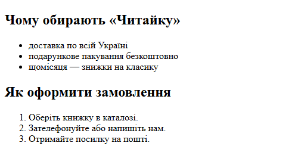
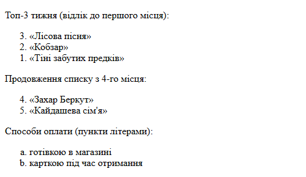
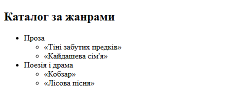
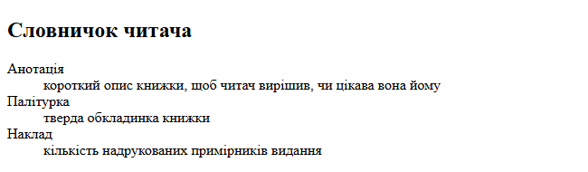
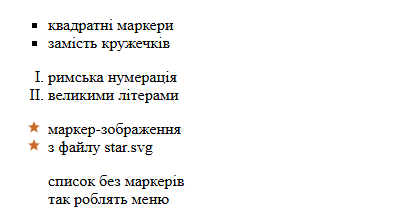
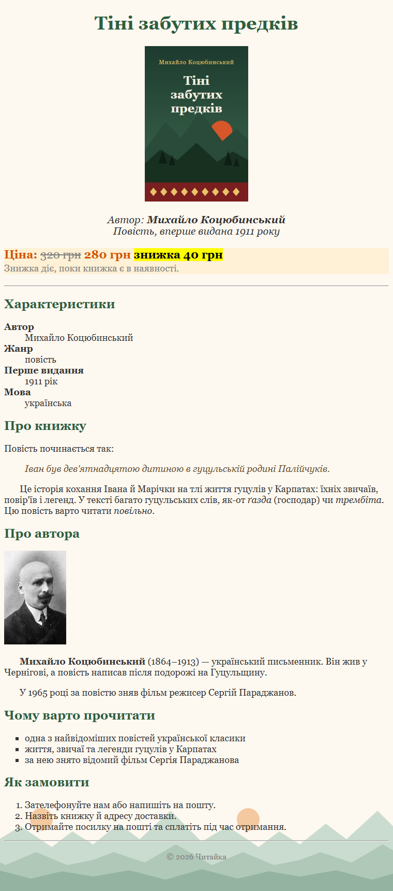

# 7. Списки

![block-badge] ![html-badge] ![css-badge]

## Зміст

1. [Списки в HTML](#списки-в-html)
2. [Оформлення списків у CSS](#оформлення-списків-у-css)
3. [Списки на сторінці книжки](#списки-на-сторінці-книжки)
4. [Часті помилки](#часті-помилки)
5. [Де використовуються списки](#де-використовуються-списки)
6. [Підсумок](#підсумок)
7. [Запитання для самоперевірки](#запитання-для-самоперевірки)
8. [Довідкові матеріали](#довідкові-матеріали)

---

## Списки в HTML

Досі наша сторінка книжки складалася із заголовків, абзаців і зображень. Але на будь-якому сайті
повно переліків: переваги магазину, кроки оформлення замовлення, книжки в каталозі, пункти меню.
Можна написати кожен пункт окремим абзацом, але тоді браузер (і програма екранного читання для
незрячих) не знатиме, що ці абзаци — одне ціле, а маркери й нумерацію довелося б ставити вручну.

> **Список** (list) — елемент HTML, що об'єднує кілька однотипних пунктів в одну групу. Кожен пункт
> позначається тегом `li` (list item — елемент списку). _Список — це «контейнер», а `li` — його пункти_.

В HTML є три види списків:

| Тег | Назва | Коли використовувати | Як виглядає за замовчуванням |
| :---- | :---- | :---- | :---- |
| **`ul`** | маркований список (unordered list) | порядок пунктів неважливий | пункти з кружечками-маркерами |
| **`ol`** | нумерований список (ordered list) | порядок важливий: кроки, рейтинг | пункти з номерами 1, 2, 3 |
| **`dl`** | список визначень (description list) | пари «термін — пояснення» | термін, під ним пояснення з відступом |

### Маркований і нумерований списки

Розгляньмо два переліки для «Читайки»: переваги магазину (порядок неважливий — `ul`) і кроки
замовлення (порядок важливий — `ol`). Тут і далі показуємо лише вміст `body` — решта документа така
сама, як у попередніх уроках.

```html
<h2>Чому обирають «Читайку»</h2>
<ul>
    <li>доставка по всій Україні</li>
    <li>подарункове пакування безкоштовно</li>
    <li>щомісяця — знижки на класику</li>
</ul>

<h2>Як оформити замовлення</h2>
<ol>
    <li>Оберіть книжку в каталозі.</li>
    <li>Зателефонуйте або напишіть нам.</li>
    <li>Отримайте посилку на пошті.</li>
</ol>
```

Результат у браузері:



**Що варто помітити:**

- маркери й номери браузер ставить сам — у коді їх немає
- `li` — блоковий елемент: кожен пункт починається з нового рядка
- список має відступ зліва — так браузер оформлює списки за замовчуванням
- якщо додати новий крок у середину `ol`, номери перерахуються автоматично

> [!WARNING]
> **Часта помилка:** писати `li` без `ul` / `ol` або класти всередину `ul` / `ol` щось, крім `li`
> (наприклад, абзац чи заголовок). Безпосередніми «дітьми» списку можуть бути **лише** пункти `li`.
> А от усередині самого `li` можна писати що завгодно: текст, посилання, зображення, інший список.

### Атрибути нумерованого списку

Тегу `ol` можна підказати, як саме нумерувати пункти:

| Атрибут | Що робить | Приклад |
| :---- | :---- | :---- |
| **`reversed`** | нумерує у зворотному порядку (3, 2, 1) | рейтинг «відлік до першого місця» |
| **`start`** | з якого числа почати | `start="4"` — продовження списку після перерви |
| **`type`** | вид нумерації: `1`, `a`, `A`, `i`, `I` | `type="a"` — пункти літерами a, b, c |

```html
<p>Топ-3 тижня (відлік до першого місця):</p>
<ol reversed>
    <li>«Лісова пісня»</li>
    <li>«Кобзар»</li>
    <li>«Тіні забутих предків»</li>
</ol>

<p>Продовження списку з 4-го місця:</p>
<ol start="4">
    <li>«Захар Беркут»</li>
    <li>«Кайдашева сім'я»</li>
</ol>

<p>Способи оплати (пункти літерами):</p>
<ol type="a">
    <li>готівкою в магазині</li>
    <li>карткою під час отримання</li>
</ol>
```

Результат у браузері:



Зверніть увагу: `reversed` — атрибут **без значення**: достатньо просто написати його в тегу.

> [!TIP]
> **Порада:** атрибут `type` використовуйте, лише коли вид нумерації важливий для змісту (наприклад,
> в інструкції пишуть «див. пункт б»). Якщо ж це просто питання вигляду, нумерацію краще змінювати
> в CSS — про це в наступному розділі.

### Вкладені списки

Список можна покласти всередину пункту іншого списку — так утворюється «дерево». Наприклад, каталог:
жанри, а в кожному жанрі — книжки.

```html
<h2>Каталог за жанрами</h2>
<ul>
    <li>Проза
        <ul>
            <li>«Тіні забутих предків»</li>
            <li>«Кайдашева сім'я»</li>
        </ul>
    </li>
    <li>Поезія і драма
        <ul>
            <li>«Кобзар»</li>
            <li>«Лісова пісня»</li>
        </ul>
    </li>
</ul>
```

Результат у браузері:



Вкладений список отримує ще більший відступ, а браузер сам змінює вид маркерів (суцільний кружечок →
порожній кружечок), щоб рівні було легко розрізнити.

> [!WARNING]
> **Часта помилка:** вкладати `ul` між пунктами — `</li><ul>...</ul><li>`. Вкладений список має
> бути **всередині** `li`: спершу текст пункту («Проза»), потім вкладений `ul`, і лише після нього —
> закривальний `</li>`.

### Список визначень

Третій вид списку потрібен для пар «термін — пояснення»: словничків, характеристик товару, контактів.

> **Список визначень** (description list) — список із пар «термін — опис». Складається з тегів
> `dl` (весь список), `dt` (description term — термін) і `dd` (description details — опис терміна).
> _`dt` відповідає на питання «що?», `dd` — «яке воно / що це означає?»_.

```html
<h2>Словничок читача</h2>
<dl>
    <dt>Анотація</dt>
    <dd>короткий опис книжки, щоб читач вирішив, чи цікава вона йому</dd>
    <dt>Палітурка</dt>
    <dd>тверда обкладинка книжки</dd>
    <dt>Наклад</dt>
    <dd>кількість надрукованих примірників видання</dd>
</dl>
```

Результат у браузері:



На сторінці книжки ми використаємо `dl` для характеристик: автор, жанр, рік видання. Одному терміну
`dt` може відповідати кілька описів `dd` — наприклад, графік роботи магазину на будні й на вихідні.

> [!IMPORTANT]
> **Ключова ідея:** вид списку обирають за змістом, а не за виглядом: важливий порядок — `ol`,
> неважливий — `ul`, пари «термін — опис» — `dl`. Вигляд (маркери, номери) потім можна змінити в CSS.

---

## Оформлення списків у CSS

Стандартні кружечки й номери підходять не завжди: для меню маркери взагалі зайві, а в каталозі
хочеться фірмових значків. Вигляд маркерів задають три властивості CSS.

| Властивість | Що робить | Приклад значення |
| :---- | :---- | :---- |
| **`list-style-type`** | вид маркера або нумерації | `square`, `upper-roman`, `none` |
| **`list-style-image`** | зображення замість маркера | `url("images/star.svg")` |
| **`list-style`** | скорочений запис для обох властивостей разом | `none` — прибрати маркери |

Найуживаніші значення `list-style-type`:

| Значення | Вигляд | Примітка |
| :---- | :---- | :---- |
| **`disc`** | ● суцільний кружечок | за замовчуванням для `ul` |
| **`circle`** | ○ порожній кружечок | |
| **`square`** | ■ квадратик | |
| **`decimal`** | 1, 2, 3 | за замовчуванням для `ol` |
| **`lower-alpha`** / **`upper-alpha`** | a, b, c / A, B, C | |
| **`lower-roman`** / **`upper-roman`** | i, ii, iii / I, II, III | |
| **`none`** | без маркера | для меню |

Властивості задають самому списку (`ul` або `ol`) — і вони діють на всі його пункти `li`. Нижче —
чотири списки з різними класами та файл стилів до них.

```html
<ul class="square">
    <li>квадратні маркери</li>
    <li>замість кружечків</li>
</ul>

<ol class="roman">
    <li>римська нумерація</li>
    <li>великими літерами</li>
</ol>

<ul class="stars">
    <li>маркер-зображення</li>
    <li>з файлу star.svg</li>
</ul>

<ul class="no-markers">
    <li>список без маркерів</li>
    <li>так роблять меню</li>
</ul>
```

```css
.square {
    list-style-type: square;
}

.roman {
    list-style-type: upper-roman;
}

.stars {
    list-style-image: url("images/star.svg");
}

.no-markers {
    list-style: none;
}
```

Результат у браузері:



**Нюанси `list-style-image`:**

- шлях у `url(...)` рахується **від файлу CSS**, а не від HTML-сторінки (у нас обидва лежать в одній
  папці, тому шлях однаковий)
- розмір маркера змінити не можна — зображення показується у власному розмірі, тому його готують
  маленьким (наша зірочка — 14×14 пікселів)
- якщо файл не знайдеться, браузер покаже звичайний маркер із `list-style-type`

> [!NOTE]
> **Зверніть увагу:** у списку без маркерів залишився відступ зліва. Це внутрішній відступ, який
> браузер додає спискам за замовчуванням. Керувати відступами ми навчимося в модулі 2, коли
> вивчатимемо блокову модель; поки цей відступ просто залишаємо. А список без маркерів ще знадобиться:
> у наступному уроці ми зробимо з нього меню сайту.

---

## Списки на сторінці книжки

Повернімося до сторінки книжки з уроку 6 і додамо до неї три списки — по одному кожного виду:

- **характеристики** книжки — пари «термін — значення», тому `dl`
- **«Чому варто прочитати»** — порядок пунктів неважливий, тому `ul` (з квадратними маркерами)
- **«Як замовити»** — кроки йдуть один за одним, тому `ol`

Решта сторінки (обкладинка, ціна, цитата, портрет автора, фон) і файли зображень — такі самі, як в
уроці 6. Нижче — лише нові фрагменти.

#### `book.html` — нові фрагменти

Після першої лінії `hr`, перед розділом «Про книжку»:

```html
<h2>Характеристики</h2>
<dl>
    <dt>Автор</dt>
    <dd>Михайло Коцюбинський</dd>
    <dt>Жанр</dt>
    <dd>повість</dd>
    <dt>Перше видання</dt>
    <dd>1911 рік</dd>
    <dt>Мова</dt>
    <dd>українська</dd>
</dl>
```

Після розділу «Про автора», перед другою лінією `hr`:

```html
<h2>Чому варто прочитати</h2>
<ul class="reasons">
    <li>одна з найвідоміших повістей української класики</li>
    <li>життя, звичаї та легенди гуцулів у Карпатах</li>
    <li>за нею знято відомий фільм Сергія Параджанова</li>
</ul>

<h2>Як замовити</h2>
<ol>
    <li>Зателефонуйте нам або напишіть на пошту.</li>
    <li>Назвіть книжку й адресу доставки.</li>
    <li>Отримайте посилку на пошті та сплатіть під час отримання.</li>
</ol>
```

#### `style.css` — нові правила

```css
/* нове: терміни в списку характеристик — жирні */
dt {
    font-weight: bold;
}

/* нове: розмір шрифту списків — як в абзаців */
li {
    font-size: 18px;
}

dl {
    font-size: 18px;
}

/* нове: квадратні маркери в списку «Чому варто прочитати» */
.reasons {
    list-style-type: square;
}
```

Результат у браузері:


<sup><sup>Джерело портрета: https://commons.wikimedia.org/wiki/File:%D0%9A%D0%BE%D1%86%D1%8E%D0%B1%D0%B8%D0%BD%D1%81%D1%8C%D0%BA%D0%B8%D0%B9_%D0%9C%D0%B8%D1%85%D0%B0%D0%B9%D0%BB%D0%BE.jpg (суспільне надбання)</sup></sup>

**Що варто помітити:**

- терміни `dt` за замовчуванням не жирні — ми виділили їх правилом `dt`, щоб характеристики легко
  читалися
- розмір шрифту задано пунктам `li` (вони є і в `ul`, і в `ol`) та списку `dl`: інакше списки були б
  дрібніші за абзаци, яким ще в уроці 5 ми задали `18px`
- клас `reasons` змінює маркери лише в одному списку, а нумерований список «Як замовити» лишився
  стандартним

> [!IMPORTANT]
> **Ключова ідея:** на одній сторінці можуть бути всі три види списків — кожен обирають за змістом
> переліку, а вигляд налаштовують у CSS окремо для кожного списку через класи.

---

## Часті помилки

Дві найчастіші помилки (`li` поза списком і вкладений список між пунктами) ми вже розібрали вище.
Ось ще кілька:

| Помилка | Неправильно | Що станеться | Правильно |
| :---- | :---- | :---- | :---- |
| **Маркери чи номери вручну** | `<p>1. Оберіть книжку.</p>` або `<li>- доставка</li>` | браузер не знає, що це список; після додавання пункту номери доведеться переписувати; у `li` з'явиться подвійний маркер | `ol` / `ul` з `li` — номери й маркери браузер поставить сам |
| **Список обрано за виглядом** | `ol` для переваг магазину, «бо з номерами гарніше» | номери підказують порядок чи рейтинг, якого насправді немає | вид списку — за змістом, вигляд маркерів — у CSS |
| **Шлях у `list-style-image` від HTML** | CSS у папці `css/`, а в `url()` написано `images/star.svg` | браузер шукатиме `css/images/star.svg`, зображення не знайдеться — буде звичайний маркер | шлях від файлу CSS: `url("../images/star.svg")` |
| **`dt` / `dd` поза `dl`** | `<dd>повість</dd>` прямо в `body` | код некоректний, зв'язок «термін — опис» втрачено | пари `dt` + `dd` лише всередині `dl` |

---

## Де використовуються списки

Списки є буквально на кожному сайті — ви користуєтеся ними щодня.

| Що ви бачите на сайті | Який список |
| :---- | :---- |
| **Меню сайту** вгорі чи збоку | `ul`, маркери прибрано через CSS |
| **Рецепт** або інструкція з кроками | `ol` |
| **Рейтинг** «Топ-10» | `ol` (іноді з `reversed`) |
| **Переваги товару**, перелік можливостей | `ul` |
| **Характеристики товару** в інтернет-магазині | `dl` (або таблиця) |
| **Зміст статті** у [Вікіпедії](https://uk.wikipedia.org/) | вкладені списки |

> [!TIP]
> **Порада:** відкрийте будь-який сайт, натисніть **F12** і в Інструментах розробника знайдіть меню
> сайту. Найчастіше ви побачите там саме `ul` з пунктами `li`.

---

## Підсумок

- списки бувають маркованими (`ul`), нумерованими (`ol`) і списками визначень (`dl` / `dt` / `dd`)
- безпосередньо в `ul` та `ol` можуть бути лише пункти `li`, а вкладений список кладуть усередину `li`
- нумерацію `ol` налаштовують атрибутами `reversed`, `start` і `type`
- вигляд маркерів змінюють у CSS властивостями `list-style-type` і `list-style-image`, а
  `list-style: none` прибирає їх
- вид списку обирають за змістом, а вигляд налаштовують у CSS

---

## Запитання для самоперевірки

1. Чим відрізняються списки `ul` і `ol`? Наведіть приклад, коли потрібен саме нумерований список.
2. Які теги складають список визначень і для чого кожен із них?
3. Які елементи можуть бути безпосередньо всередині `ul` чи `ol`, а що можна писати всередині `li`?
4. Як правильно вкласти один список в інший? Яку помилку часто роблять?
5. Що роблять атрибути `reversed`, `start` і `type` тегу `ol`?
6. Як змінити вигляд маркерів і як прибрати їх зовсім? Для чого потрібен список без маркерів?
7. Від якого файлу рахується шлях у `list-style-image` і чому не можна змінити розмір такого маркера?
8. Чому маркери й номери не варто писати в тексті вручну?

---

## Довідкові матеріали

- [&lt;ul&gt; HTML unordered list element](https://developer.mozilla.org/en-US/docs/Web/HTML/Reference/Elements/ul) — `developer.mozilla.org`
- [&lt;ol&gt; HTML ordered list element](https://developer.mozilla.org/en-US/docs/Web/HTML/Reference/Elements/ol) — `developer.mozilla.org`
- [&lt;dl&gt; HTML description list element](https://developer.mozilla.org/en-US/docs/Web/HTML/Reference/Elements/dl) — `developer.mozilla.org`
- [list-style-type CSS property](https://developer.mozilla.org/en-US/docs/Web/CSS/Reference/Properties/list-style-type) — `developer.mozilla.org`
- [list-style-image CSS property](https://developer.mozilla.org/en-US/docs/Web/CSS/Reference/Properties/list-style-image) — `developer.mozilla.org`
- [Lists](https://developer.mozilla.org/en-US/docs/Learn_web_development/Core/Structuring_content/Lists) — `developer.mozilla.org`
- [Styling lists](https://developer.mozilla.org/en-US/docs/Learn_web_development/Core/Text_styling/Styling_lists) — `developer.mozilla.org`

---

[block-badge]:https://img.shields.io/badge/%D0%9E%D1%81%D0%BD%D0%BE%D0%B2%D0%B8%20HTML%20%D1%96%20CSS-purple?style=flat
[html-badge]:https://img.shields.io/badge/HTML-E34F26?style=flat&logo=html5&logoColor=white
[css-badge]:https://img.shields.io/badge/CSS-1572B6?style=flat&logo=css&logoColor=white
