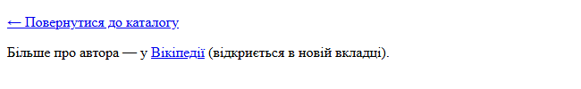
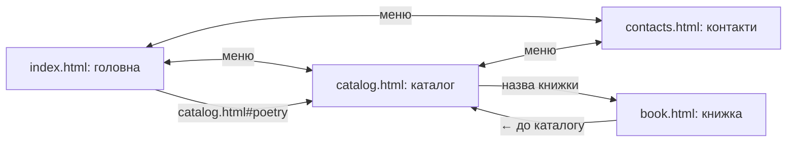
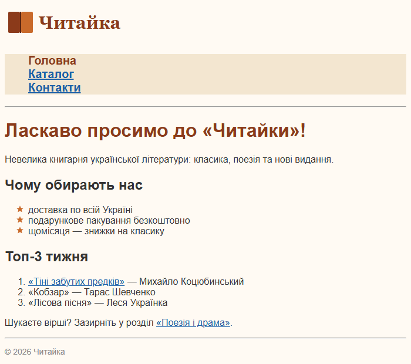
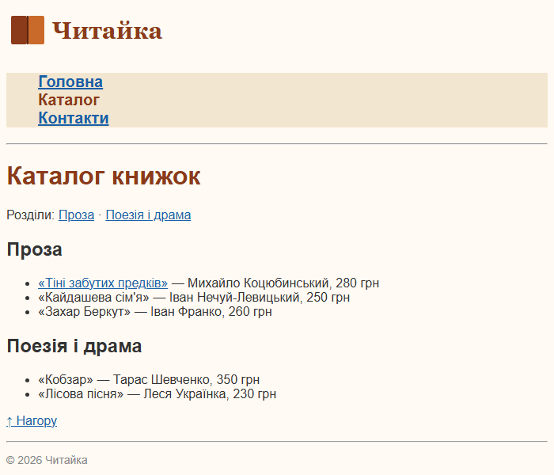
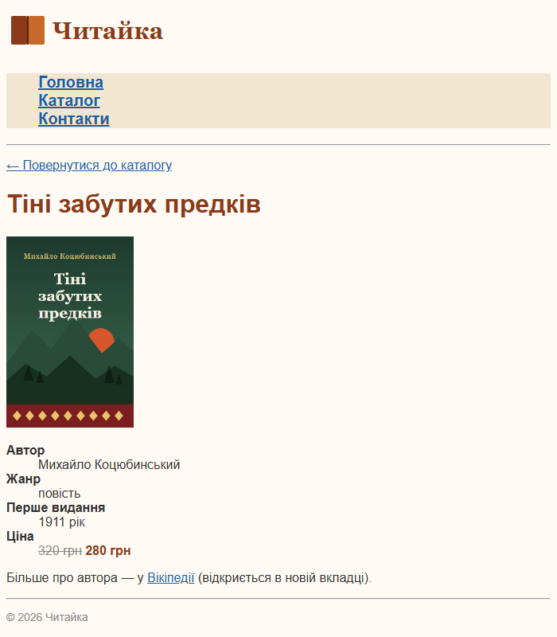
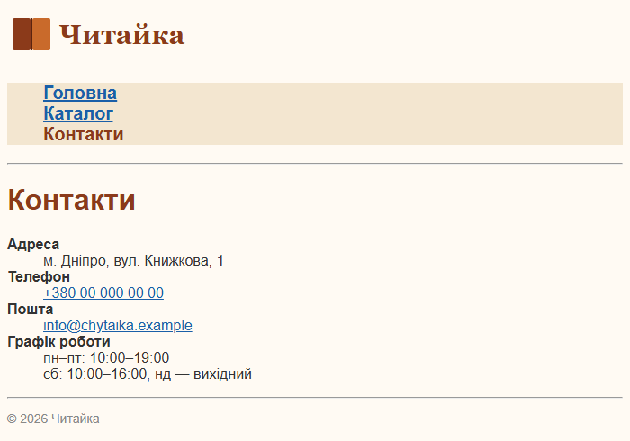

# 8. Посилання; багатосторінковий сайт

![block-badge] ![html-badge] ![css-badge]

## Зміст

1. [Посилання](#посилання)
2. [Пошта, телефон і якорі](#пошта-телефон-і-якорі)
3. [Зображення-посилання](#зображення-посилання)
4. [Стилі посилань](#стилі-посилань)
5. [Багатосторінковий сайт «Читайки»](#багатосторінковий-сайт-читайки)
6. [Часті помилки](#часті-помилки)
7. [Де це використовується на практиці](#де-це-використовується-на-практиці)
8. [Підсумок](#підсумок)
9. [Запитання для самоперевірки](#запитання-для-самоперевірки)
10. [Довідкові матеріали](#довідкові-матеріали)

---

## Посилання

Досі кожна наша сторінка існувала сама по собі. Без посилань не було б вебу: саме вони перетворюють окремі сторінки на «павутину» (пригадайте урок 1 —
гіпертекст). У HTML посилання створює тег `a`.

> **Посилання** (hyperlink, link) — елемент, натиснувши на який, користувач переходить на іншу
> сторінку, файл або в інше місце тієї самої сторінки. Створюється тегом `a` (anchor — «якір»), адресу
> переходу задає атрибут `href` (hypertext reference). _`href` відповідає на питання «куди?», текст між
> `<a>` і `</a>` — на питання «що натиснути?»_.

```html
<a href="catalog.html">Каталог</a>
```

Тег `a` — рядковий елемент, тому його ставлять усередину абзацу, пункту списку тощо — так само, як
`strong` чи `em`.

### Відносні й абсолютні посилання

У значенні `href` працюють ті самі правила шляхів, що й в атрибуті `src` у тегу `img` (урок 6).

> **Відносне посилання** (relative URL) — адреса, що рахується від поточної сторінки: `catalog.html`,
> `images/logo.svg`, `../index.html`. Так посилаються на **власні** сторінки сайту.
>
> **Абсолютне посилання** (absolute URL) — повна адреса з протоколом: `https://uk.wikipedia.org/...`.
> Так посилаються на **інші** сайти. _Відносне — «сусідній кабінет», абсолютне — повна поштова адреса_.

### Атрибути `target` і `title`

| Атрибут | Що робить | Приклад |
| :---- | :---- | :---- |
| **`href`** | адреса переходу (обов'язковий) | `href="catalog.html"` |
| **`target="_blank"`** | відкриває посилання в **новій вкладці** | посилання на інший сайт |
| **`title`** | підказка, що з'являється, коли навести курсор на посилання | `title="Стаття у Вікіпедії"` |

На сторінці книжки зробимо два посилання: повернення до каталогу (відносне) і статтю про автора у
Вікіпедії (абсолютне, у новій вкладці).

```html
<p><a href="catalog.html">← Повернутися до каталогу</a></p>
<p>Більше про автора — у <a href="https://uk.wikipedia.org/wiki/Михайло_Коцюбинський" target="_blank" title="Стаття «Коцюбинський Михайло Михайлович»">Вікіпедії</a> (відкриється в новій вкладці).</p>
```

Результат у браузері:



За замовчуванням браузер показує посилання **синіми й підкресленими** — так користувач одразу бачить, що
на текст можна натиснути. Як змінити цей вигляд — у розділі «Стилі посилань».

> [!TIP]
> **Порада:** якщо посилання відкривається в новій вкладці, попередьте про це користувача — дописом
> «(відкриється в новій вкладці)» або значком. Інакше людина може не помітити нової вкладки й не
> зрозуміти, чому кнопка «Назад» не працює. Свої сторінки відкривайте в тій самій вкладці, а
> `target="_blank"` залишайте для зовнішніх сайтів і файлів.

**Як писати текст посилання:**

- текст має пояснювати, **куди** веде посилання: «Каталог», «Стаття у Вікіпедії», а не «тут» чи
  «натисніть сюди»
- `title` — лише доповнення: на телефоні курсору немає, тож підказку там не видно, і важлива
  інформація має бути в самому тексті
- кирилиця в адресі зовнішнього сайту (як у посиланні на Вікіпедію вище) — нормально: браузер сам
  перетворить її на правильний вигляд. А от **файлам власного сайту** давайте латинські імена (див.
  «Часті помилки»)

---

## Пошта, телефон і якорі

Атрибут `href` може вести не лише на сторінку. Особливі адреси починаються зі «схеми» — слова з
двокрапкою.

### Посилання на пошту й телефон

```html
<a href="mailto:info@chytaika.example">info@chytaika.example</a>
<a href="tel:+380000000000">+380 00 000 00 00</a>
```

| Схема | Що відбувається після натискання | Формат адреси |
| :---- | :---- | :---- |
| **`mailto:`** | відкривається поштова програма з новим листом на цю адресу | `mailto:` + адреса пошти |
| **`tel:`** | на телефоні — відкривається набір номера; на комп'ютері браузер може запропонувати програму для дзвінків | `tel:` + номер **без пробілів**, з кодом країни `+380` |

Текст посилання можна писати зручно для читання (`+380 00 000 00 00`), а в `href` — номер без пробілів.

> [!NOTE]
> **Зверніть увагу:** пошта `info@chytaika.example` і номер `+380 00 000 00 00` — навмисно вигадані.
> На комп'ютері без налаштованої поштової програми після натискання `mailto:` може нічого не
> статися або з'явитися вікно вибору програми — це нормально.

### Якорі всередині сторінки

На довгій сторінці зручно мати «зміст»: натиснув — і сторінка прокрутилася до потрібного розділу.
Саме так влаштований зміст на початку цього уроку.

> **Якір** (anchor, fragment) — позначене місце на сторінці, до якого можна перейти посиланням.
> Місце позначають атрибутом `id` з унікальним ім'ям, а посилання пишуть як `href="#ім'я"`. _`id` —
> це «закладка» в книжці, `#id` — «відкрий на закладці»_.

```html
<h1 id="top">Каталог книжок</h1>
<p>Розділи: <a href="#prose">Проза</a> · <a href="#poetry">Поезія і драма</a></p>

<h2 id="prose">Проза</h2>
<!-- ... список книжок ... -->

<h2 id="poetry">Поезія і драма</h2>
<!-- ... список книжок ... -->

<p><a href="#top">↑ Нагору</a></p>
```

Як це працює:

1. **`id="prose"`** позначає заголовок «Проза» як місце на сторінці.
2. **Користувач** натискає `<a href="#prose">` → **браузер** шукає на сторінці елемент з `id="prose"`.
3. **Браузер** прокручує сторінку так, щоб цей елемент опинився вгорі вікна, і дописує `#prose` у
   кінець адреси.

Посилання «Нагору» веде до заголовка `h1` з `id="top"` — на самий початок сторінки.

Можна перейти й до якоря **на іншій сторінці** — для цього пишуть ім'я файлу, а після нього `#id`:

```html
<a href="catalog.html#poetry">«Поезія і драма»</a>
```

**Правила для `id`:**

- значення `id` має бути **унікальним** на сторінці: двох елементів з `id="top"` бути не може
- без пробілів; найкраще — латинськими літерами в нижньому регістрі: `prose`, `poetry`, `top`
- у `href` перед іменем обов'язкова решітка `#`, а в самому `id` — ні: `id="top"`, `href="#top"`

> [!NOTE]
> **Зверніть увагу:** якщо сторінка коротка й уся вміщується у вікні, прокручувати нікуди — і
> перехід за якорем буде непомітним (зміниться лише адреса). Щоб побачити ефект, зменште висоту вікна
> браузера.

### Усі види адрес у `href`

| Вид адреси | Приклад `href` | Куди веде |
| :---- | :---- | :---- |
| **Відносна** | `catalog.html` | сторінка в тій самій папці |
| **Відносна з папкою** | `books/kobzar.html` | сторінка в підпапці `books` |
| **Відносна вгору** | `../index.html` | сторінка в батьківській папці |
| **Абсолютна** | `https://uk.wikipedia.org/` | інший сайт |
| **Якір** | `#poetry` | місце на цій самій сторінці |
| **Сторінка + якір** | `catalog.html#poetry` | місце на іншій сторінці |
| **Пошта** | `mailto:info@chytaika.example` | новий лист у поштовій програмі |
| **Телефон** | `tel:+380000000000` | дзвінок за номером |

---

## Зображення-посилання

Усередину `a` можна покласти не лише текст, а й зображення — тоді натискатимуть на картинку. Найвідоміший
приклад — логотип у кутку сайту: майже на кожному сайті він веде на головну сторінку.

```html
<a href="index.html"></a>
```

Зверніть увагу на `alt`: коли зображення є посиланням, `alt` має пояснювати не лише **що** на картинці,
а й **куди** веде посилання. Програма екранного читання прочитає незрячому користувачу саме цей текст —
«Читайка — на головну».

> [!TIP]
> **Порада:** користувачі звикли, що логотип веде на головну, — тож робіть так і на своїх сайтах.
> Результат цього коду ви побачите вгорі кожної сторінки сайту «Читайки» нижче.

---

## Стилі посилань

Посилання, як і будь-який елемент, можна оформити в CSS: змінити колір, прибрати підкреслення. Але в
посилання є **стани**: звичайне, вже відвідане, під курсором миші. Для кожного стану можна задати
власний стиль.

> **Псевдоклас** (pseudo-class) — додаток до селектора, що вибирає елемент лише в певному **стані**.
> Пишеться після селектора через двокрапку: `a:hover`. _Клас ми ставимо в HTML самі, а псевдоклас
> браузер «вмикає» сам, залежно від дій користувача_.

Без псевдокласів посилання виглядало б однаково і до, і після наведення курсора, а користувач не
отримував би жодного «відгуку» від сторінки.

| Селектор | Коли спрацьовує |
| :---- | :---- |
| **`a`** | усі посилання, будь-коли |
| **`a:visited`** | посилання, за яким користувач уже переходив (браузер пам'ятає історію) |
| **`a:hover`** | посилання, на яке зараз наведено курсор миші |

Оформимо посилання «Читайки»: сині, відвідані — фіолетові, під курсором — червоні без підкреслення.

```css
a {
    color: #1a5fa8;
}

a:visited {
    color: #6b3fa0;
}

a:hover {
    color: #c0392b;
    text-decoration: none;
}
```

Властивість `text-decoration` керує лініями тексту: `none` прибирає підкреслення, `underline` —
додає його.

<!--
> [!CAUTION]
> 📸 **TODO-IMG** `images/l8_i2.png`
> **Що зобразити:** сторінку `catalog.html` з прикладу «Читайки» (розділ «Багатосторінковий сайт «Читайки»») у браузері з курсором миші, наведеним на посилання «Тіні забутих предків»: це посилання червоне й без підкреслення, а решта посилань — підкреслені (сині або, якщо їх уже відвідували, фіолетові).
-->

**Головні нюанси:**

- **порядок правил важливий**: `a:hover` пишуть **після** `a:visited`. Обидва правила однаково
  «сильні», тому діє те, що записане пізніше; якби `a:visited` стояло нижче, відвідані посилання не
  змінювали б колір під курсором
- **`:visited` має обмеження**: з міркувань приватності браузер дозволяє змінювати для відвіданих
  посилань лише кольори (`color`, `background-color` тощо). Інакше сторонній сайт міг би з'ясувати,
  які сторінки ви відвідували
- **`:hover` не працює на сенсорних екранах так, як з мишею**: на телефоні курсора немає, тому важлива
  інформація не має з'являтися лише під час наведення

> [!NOTE]
> **Зверніть увагу:** тут ми знайомимося з псевдокласами лише базово — на рівні «як змінити колір
> посилання». Інші псевдокласи (`:active`, `:focus`, `:first-child` тощо) та ефекти наведення для меню
> детально розберемо в модулі 2.

---

## Багатосторінковий сайт «Читайки»

Тепер зберемо все разом. Досі в нас була одна сторінка книжки, а справжній сайт — це кілька сторінок,
пов'язаних посиланнями (пригадайте визначення вебсайту з уроку 1). Створимо невеликий сайт «Читайки»
з чотирьох сторінок.

**Що потрібно для багатосторінкового сайту:**

- усі сторінки й файли лежать в одній папці проєкту (зображення — у підпапці `images`)
- на кожній сторінці — **однакове меню**, щоб з будь-якої сторінки можна було потрапити на будь-яку іншу
- **один спільний файл стилів**, підключений до всіх сторінок: змінили колір в одному місці — він
  змінився на всьому сайті
- головна сторінка називається `index.html`: саме цей файл сервер віддає, коли в адресі немає імені
  файлу (`https://chytaika.example/` → `index.html`)

### Структура проєкту

```
chytaika/
├── index.html      — головна
├── catalog.html    — каталог книжок
├── book.html       — сторінка книжки «Тіні забутих предків»
├── contacts.html   — контакти
├── style.css       — спільні стилі для всіх сторінок
└── images/
    ├── logo.svg    — логотип
    ├── cover.jpg   — обкладинка книжки
    └── star.svg    — маркер для списку переваг
```

Сторінки пов'язані між собою так:



На діаграмі показано, що меню з'єднує три основні сторінки, а на сторінку книжки ведуть посилання з
каталогу й головної (на `book.html` теж є меню, але для простоти ці стрілки не намальовані).

> [!NOTE]
> **Зверніть увагу:** `book.html` — це **спрощена** версія сторінки книжки з уроку 7: ми залишили
> назву, обкладинку, характеристики (список визначень) і посилання. Цитату, опис, розділ «Про автора»
> та інші списки з попередніх уроків можете перенести сюди самостійно. Файл `style.css` теж новий —
> спільний для всього сайту, з іншим шрифтом і кольорами (див. нижче).

### Спільне меню

Меню сайту — це звичайний **маркований список посилань**: порядок пунктів не є «рейтингом», тому `ul`.
Маркери прибираємо властивістю `list-style: none` з уроку 7.

```html
<ul class="menu">
    <li class="current">Головна</li>
    <li><a href="catalog.html">Каталог</a></li>
    <li><a href="contacts.html">Контакти</a></li>
</ul>
```

Пункт **поточної** сторінки — не посилання, а звичайний текст: переходити на сторінку, на якій ви вже
є, немає сенсу. Клас `current` виділяє цей пункт іншим кольором, щоб користувач бачив, де він зараз.
На кожній сторінці посиланням не є «свій» пункт меню, і саме він отримує клас `current`.

На справжніх сайтах меню ще обгортають тегом `nav` (navigation — навігація), який підказує браузеру
й програмам екранного читання, що це блок навігації. Такі смислові (семантичні) теги ми вивчатимемо
в модулі 2, тому поки обходимося без `nav`.

> [!NOTE]
> **Зверніть увагу:** наше меню — вертикальне. Горизонтальне меню (пункти в один рядок) роблять
> засобами CSS, які ми вивчатимемо згодом (відступи — у модулі 2, Flexbox — у модулі 3). Пункти можна поставити в рядок і
> властивістю `display: inline`, яка робить `li` рядковими, але тоді відстань між пунктами — лише
> один пробіл, і налаштувати її без відступів не вийде. Тому поки — вертикальне меню.

#### `index.html` — головна сторінка

```html
<!DOCTYPE html>
<html lang="uk">
<head>
    <meta charset="UTF-8">
    <meta name="viewport" content="width=device-width, initial-scale=1.0">
    <title>Читайка — книгарня</title>
    <link rel="stylesheet" href="style.css">
</head>
<body>
    <a href="index.html"></a>
    <ul class="menu">
        <li class="current">Головна</li>
        <li><a href="catalog.html">Каталог</a></li>
        <li><a href="contacts.html">Контакти</a></li>
    </ul>
    <hr>

    <h1>Ласкаво просимо до «Читайки»!</h1>
    <p>Невелика книгарня української літератури: класика, поезія та нові видання.</p>

    <h2>Чому обирають нас</h2>
    <ul class="benefits">
        <li>доставка по всій Україні</li>
        <li>подарункове пакування безкоштовно</li>
        <li>щомісяця — знижки на класику</li>
    </ul>

    <h2>Топ-3 тижня</h2>
    <ol>
        <li><a href="book.html">«Тіні забутих предків»</a> — Михайло Коцюбинський</li>
        <li>«Кобзар» — Тарас Шевченко</li>
        <li>«Лісова пісня» — Леся Українка</li>
    </ol>
    <p>Шукаєте вірші? Зазирніть у розділ <a href="catalog.html#poetry">«Поезія і драма»</a>.</p>

    <hr>
    <p class="footer">&copy; 2026 Читайка</p>
</body>
</html>
```

Результат у браузері:



Інші сторінки мають ту саму будову: такий самий `head` (змінюється лише `title`), логотип, меню й
підвал. Відрізняються лише вміст між двома лініями `hr` і пункт меню з класом `current`. Тому далі
показуємо тільки вміст.

#### `catalog.html` — каталог

`title` — «Каталог — Читайка»; у меню пункт «Каталог» — без посилання, з класом `current`.

```html
<h1 id="top">Каталог книжок</h1>
<p>Розділи: <a href="#prose">Проза</a> · <a href="#poetry">Поезія і драма</a></p>

<h2 id="prose">Проза</h2>
<ul>
    <li><a href="book.html">«Тіні забутих предків»</a> — Михайло Коцюбинський, 280&nbsp;грн</li>
    <li>«Кайдашева сім'я» — Іван Нечуй-Левицький, 250&nbsp;грн</li>
    <li>«Захар Беркут» — Іван Франко, 260&nbsp;грн</li>
</ul>

<h2 id="poetry">Поезія і драма</h2>
<ul>
    <li>«Кобзар» — Тарас Шевченко, 350&nbsp;грн</li>
    <li>«Лісова пісня» — Леся Українка, 230&nbsp;грн</li>
</ul>

<p><a href="#top">↑ Нагору</a></p>
```

Результат у браузері:



Посиланням зроблено лише «Тіні забутих предків» — бо тільки для цієї книжки існує сторінка. Інші
назви — звичайний текст: посилання «в нікуди» лише заплутали б покупця.

#### `book.html` — сторінка книжки

`title` — «Тіні забутих предків — Читайка»; у меню всі три пункти — посилання, класу `current` немає (сторінки книжки в меню немає).

```html
<p><a href="catalog.html">← Повернутися до каталогу</a></p>
<h1>Тіні забутих предків</h1>

<dl>
    <dt>Автор</dt>
    <dd>Михайло Коцюбинський</dd>
    <dt>Жанр</dt>
    <dd>повість</dd>
    <dt>Перше видання</dt>
    <dd>1911 рік</dd>
    <dt>Ціна</dt>
    <dd><s class="old-price">320 грн</s> <strong class="price">280 грн</strong></dd>
</dl>
<p>Більше про автора — у <a href="https://uk.wikipedia.org/wiki/Михайло_Коцюбинський" target="_blank" title="Стаття «Коцюбинський Михайло Михайлович»">Вікіпедії</a> (відкриється в новій вкладці).</p>
```

Результат у браузері:



#### `contacts.html` — контакти

`title` — «Контакти — Читайка»; у меню пункт «Контакти» — без посилання, з класом `current`.
Адреса магазину, як і сам магазин, вигадана.

```html
<h1>Контакти</h1>
<dl>
    <dt>Адреса</dt>
    <dd>м. Дніпро, вул. Книжкова, 1</dd>
    <dt>Телефон</dt>
    <dd><a href="tel:+380000000000">+380 00 000 00 00</a></dd>
    <dt>Пошта</dt>
    <dd><a href="mailto:info@chytaika.example">info@chytaika.example</a></dd>
    <dt>Графік роботи</dt>
    <dd>пн–пт: 10:00–19:00</dd>
    <dd>сб: 10:00–16:00, нд — вихідний</dd>
</dl>
```

Результат у браузері:



#### `style.css` — спільні стилі

Один файл стилів для всіх чотирьох сторінок. Він підключений однаковим рядком
`<link rel="stylesheet" href="style.css">` у `head` кожної сторінки.

```css
/* Спільні стилі для всіх сторінок «Читайки» */
body {
    font-family: Arial, sans-serif;
    background-color: #fffaf3;
    color: #333333;
}

h1 {
    color: #8b3a1a;
}

/* Меню: прибираємо маркери, робимо пункти більшими */
.menu {
    list-style: none;
    background-color: #f3e6d0;
    font-size: 20px;
    font-weight: bold;
}

/* Пункт меню поточної сторінки */
.current {
    color: #8b3a1a;
}

/* Посилання: звичайні, відвідані, під курсором */
a {
    color: #1a5fa8;
}

a:visited {
    color: #6b3fa0;
}

a:hover {
    color: #c0392b;
    text-decoration: none;
}

/* Терміни в списках визначень */
dt {
    font-weight: bold;
}

/* Список переваг із зірочками */
.benefits {
    list-style-image: url("images/star.svg");
}

.price {
    font-weight: bold;
    color: #8b3a1a;
}

.old-price {
    color: #888888;
}

.footer {
    font-size: 14px;
    color: #888888;
}
```

**Що варто помітити в стилях:**

- `font-size` і `font-weight` задано для всього списку `.menu`, а посилання всередині його пунктів їх
  успадкували — усі пункти меню великі й жирні
- пункт поточної сторінки не є посиланням, тому стилі `a`, `a:visited`, `a:hover` на нього не діють —
  його колір задає лише клас `.current`
- правило `.benefits` впливає лише на список переваг на головній, а решта списків сайту залишаються
  зі звичайними маркерами

> [!NOTE]
> **Зверніть увагу:** меню, логотип і підвал доводиться **копіювати** в кожну сторінку. Якщо додати
> нову сторінку в меню, змінювати доведеться всі файли. Це чесне обмеження «чистого» HTML; на
> справжніх сайтах спільні частини підставляють автоматично — програмою на сервері або за допомогою
> JavaScript.

> [!IMPORTANT]
> **Ключова ідея:** багатосторінковий сайт — це кілька HTML-файлів в одній папці, які посилаються
> один на одного відносними посиланнями, мають однакове меню-список і спільний файл стилів.

---

## Часті помилки

| Помилка | Неправильно | Що станеться | Правильно |
| :---- | :---- | :---- | :---- |
| **Забутий `https://`** | `href="uk.wikipedia.org"` | браузер вважатиме це відносним шляхом і шукатиме **файл** з іменем `uk.wikipedia.org` у папці сайту — сторінку не буде знайдено (на сервері — помилка 404) | `href="https://uk.wikipedia.org"` |
| **Пробіли й кирилиця в іменах файлів** | `Мій каталог.html` | в адресі ім'я перетвориться на нечитабельне `%D0%9C%D1%96%D0%B9%20...`; на сервері легко помилитися в посиланні | `catalog.html`: латиниця, малі літери, без пробілів (замість пробілу — `-` або `_`) |
| **`href="#"` як заглушка** | `<a href="#">Каталог</a>` | посилання виглядає робочим, але лише прокручує сторінку нагору й дописує `#` до адреси | справжня адреса; якщо сторінки ще немає — звичайний текст без посилання |
| **Неправильний відносний шлях** | у файлі `books/kobzar.html`: `href="catalog.html"` | браузер шукатиме `books/catalog.html` — такого файлу немає | `href="../catalog.html"` — спершу вийти з папки `books` |
| **Не закрито `</a>`** | `<a href="book.html">Тіні забутих предків` | увесь текст далі по сторінці стане частиною посилання | завжди закривати `</a>` одразу після тексту посилання |
| **Регістр літер в імені** | файл `Catalog.html`, посилання `catalog.html` | на комп'ютері з Windows спрацює, а на сервері (зазвичай Linux) — ні: там це різні файли | імена файлів — лише малими літерами |

> [!TIP]
> **Порада:** після створення сайту перевірте **всі** посилання на кожній сторінці: чи ведуть
> вони куди слід — включно з «Нагору» та логотипом. Неробоче посилання — одна з найпомітніших
> для користувача помилок.

---

## Де це використовується на практиці

Посилання є буквально на кожному сайті — ви користуєтеся ними щодня.

| Що ви бачите на сайті | Як це зроблено |
| :---- | :---- |
| **Меню сайту** вгорі чи збоку | список `ul` з посиланнями, маркери прибрано через CSS |
| **Логотип**, що веде на головну | зображення-посилання |
| **Зміст статті** у [Вікіпедії](https://uk.wikipedia.org/) | список посилань на якорі `#розділ` |
| **Кнопка «Нагору»** на довгих сторінках | посилання на якір на початку сторінки |
| **Номер телефону** на сайті служби доставки — натискаєте на телефоні, і відкривається набір номера | посилання `tel:` |
| **«Напишіть нам»** на сторінці контактів | посилання `mailto:` |
| **Посилання на соцмережі** в підвалі сайту | абсолютні посилання, часто з `target="_blank"` |

> [!TIP]
> **Порада:** відкрийте будь-який сайт, натисніть **F12** і знайдіть у коді меню: у кожному пункті
> `li` ви побачите тег `a` з атрибутом `href`.

---

## Підсумок

- посилання створює тег `a` з атрибутом `href`: відносна адреса — для своїх сторінок, абсолютна з
  `https://` — для інших сайтів
- `href` може вести також на пошту (`mailto:`), телефон (`tel:`) і якір `#id` на сторінці
- зображення-посилання — це `img` усередині `a`; його `alt` пояснює, куди веде посилання
- стан посилання оформлюють псевдокласами `:visited` і `:hover` (`:hover` — після `:visited`)
- багатосторінковий сайт — кілька HTML-файлів з однаковим меню-списком і одним спільним `style.css`

---

## Запитання для самоперевірки

1. Чим відносне посилання відрізняється від абсолютного? Що станеться, якщо в посиланні на інший сайт
   забути `https://`?
2. Що робить атрибут `target="_blank"` і про що варто попередити користувача?
3. Як зробити посилання на пошту й на телефон? Чому в `tel:` номер пишуть без пробілів?
4. Як зробити посилання «Нагору», що веде на початок сторінки? Що потрібно вказати в `id` і що — в `href`?
5. Як перейти до певного розділу на **іншій** сторінці сайту?
6. Що має містити `alt` у зображення-посилання?
7. Чому `a:hover` записують після `a:visited` і які обмеження має псевдоклас `:visited`?
8. Як побудувати сайт із кількох сторінок, щоб усі вони мали однакове оформлення й меню? Яке
   обмеження має такий підхід?

---

## Довідкові матеріали

- [Гіперпосилання](https://uk.wikipedia.org/wiki/%D0%93%D1%96%D0%BF%D0%B5%D1%80%D0%BF%D0%BE%D1%81%D0%B8%D0%BB%D0%B0%D0%BD%D0%BD%D1%8F) — `uk.wikipedia.org`
- [Уніфікований локатор ресурсів](https://uk.wikipedia.org/wiki/URL) — `uk.wikipedia.org`
- [&lt;a&gt; HTML anchor element](https://developer.mozilla.org/en-US/docs/Web/HTML/Reference/Elements/a) — `developer.mozilla.org`
- [:hover CSS pseudo-class](https://developer.mozilla.org/en-US/docs/Web/CSS/Reference/Selectors/:hover) — `developer.mozilla.org`
- [:visited CSS pseudo-class](https://developer.mozilla.org/en-US/docs/Web/CSS/Reference/Selectors/:visited) — `developer.mozilla.org`
- [Privacy and the :visited selector](https://developer.mozilla.org/en-US/docs/Web/CSS/Guides/Selectors/Privacy_and_:visited) — `developer.mozilla.org`
- [Creating links](https://developer.mozilla.org/en-US/docs/Learn_web_development/Core/Structuring_content/Creating_links) — `developer.mozilla.org`
- [Styling links](https://developer.mozilla.org/en-US/docs/Learn_web_development/Core/Text_styling/Styling_links) — `developer.mozilla.org`

---

[block-badge]:https://img.shields.io/badge/%D0%9E%D1%81%D0%BD%D0%BE%D0%B2%D0%B8%20HTML%20%D1%96%20CSS-purple?style=flat
[html-badge]:https://img.shields.io/badge/HTML-E34F26?style=flat&logo=html5&logoColor=white
[css-badge]:https://img.shields.io/badge/CSS-1572B6?style=flat&logo=css&logoColor=white
